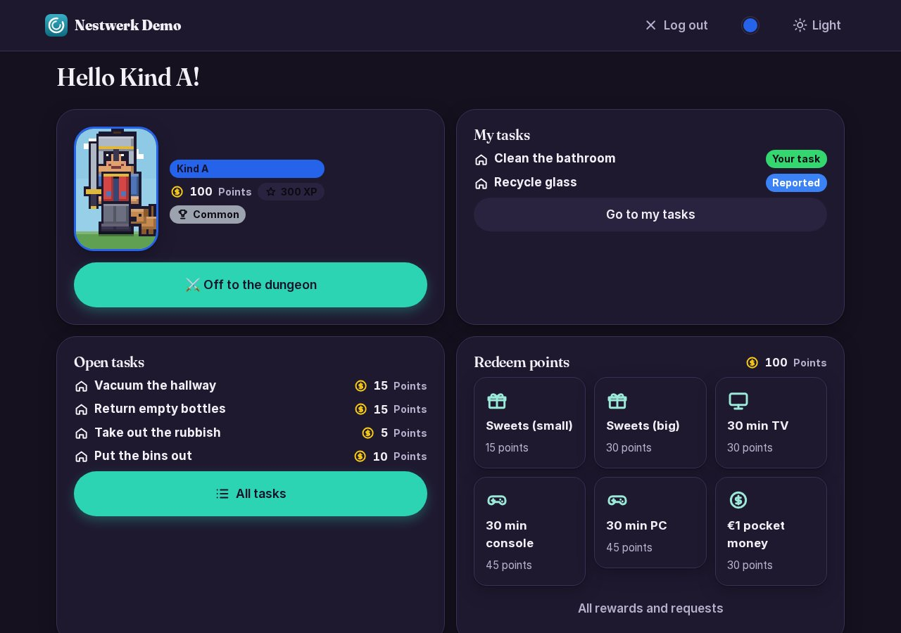
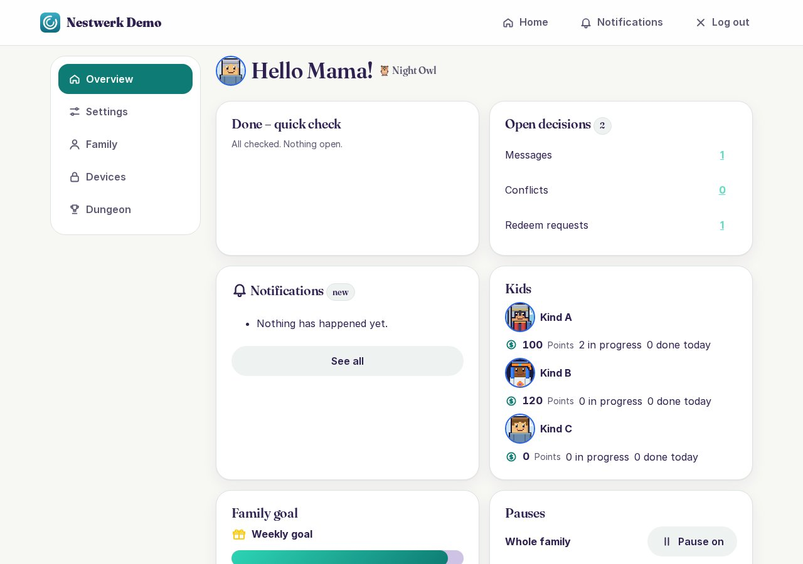
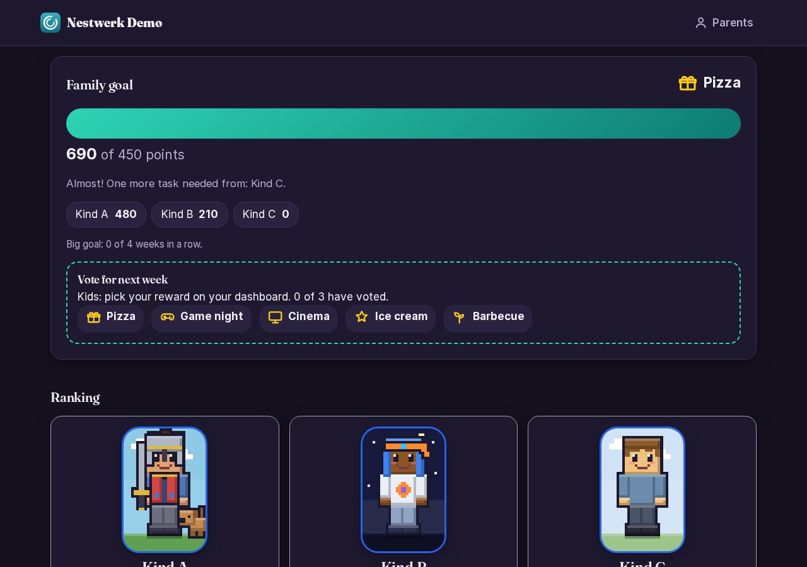
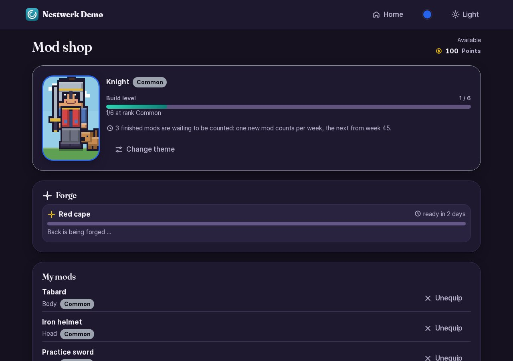
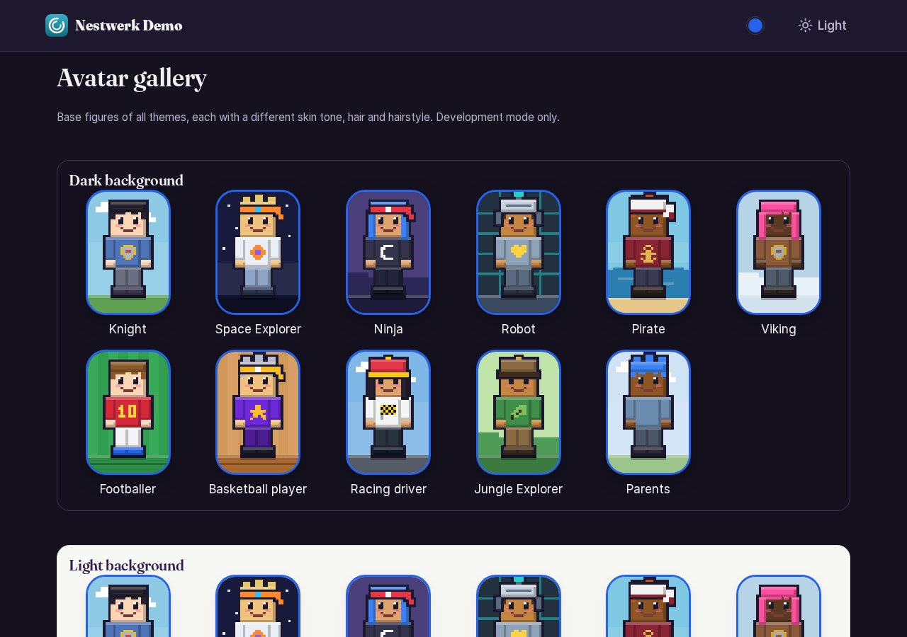
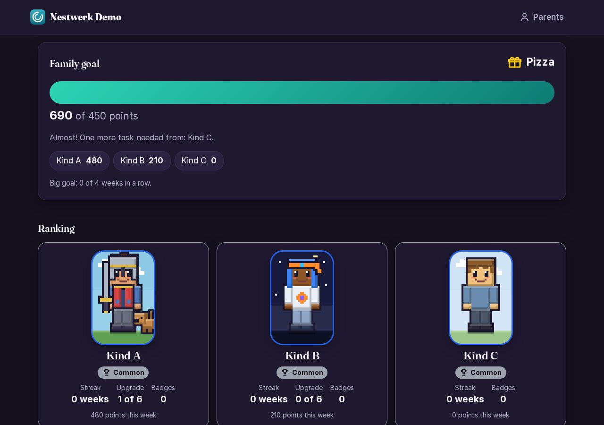

<p align="center"></p>

# Nestwerk

🇬🇧 **English** · 🇩🇪 [Deutsch](README.de.md)

**Website:** https://hassio0815-tech.github.io/nestwerk/

**Nestwerk – the family hub for chores, rewards & learning**

**Nestwerk** is a family dashboard for your own server. Kids voluntarily take on household chores, collect points and rise through the ranks. Parents keep an overview, confirm tasks and manage rewards. Everything runs locally on your home network.

The app UI is available in English and German.



---

## Features

- **Tasks:** library with templates, recurrence, time windows, reservation, parent confirmation, photo or text proof, bonus points, weekly planner with drag and drop
- **Rewards:** catalog with prices, redemption requests, monthly allowance limit
- **Points and ranks:** balance and total points (XP), six ranks with activity requirements, weekly streak with streak bonus, pause switch
- **Badges and milestones:** streaks, quarters and rank-ups
- **Avatars:** 10 themes with 36 mods each, mod shop with build time, hall of fame for finished heroes
- **Special day:** a personal day with one parent, limited to 2 per child per year
- **Family goal:** weekly shared goal, voting, family ranking, "Hero of the Week"
- **Forecast:** when will a child reach the next rank? Parents calibrate the pace.
- **Notifications:** email, push on iPhone, pop-up in the app
- **Hallway tablet:** kiosk view with family goal and ranking
- **Operations:** setup assistant, daily database backups, updates with rollback

---

## Privacy

- **Everything local:** data, photos and database stay on your server. There is no cloud.
- **No tracking:** no analytics services, no external scripts, self-hosted fonts.
- **Photos are short-lived:** proof photos are deleted immediately after confirmation.
- **Home network access:** kids use Nestwerk only at home. Parents reach it on the go through their own VPN.

---

## Requirements

- **Server:** Debian 13 VM (e.g. on Proxmox) with a fixed IP. Tested with 2 vCPU, 4 GB RAM, 46 GB storage.
- **Docker:** the installer sets up Docker and Compose.
- **Reverse proxy with HTTPS:** e.g. Nginx Proxy Manager.
- **Domain:** for a Let's Encrypt certificate via DNS challenge.
- **Optional:** local DNS server (AdGuard Home, Pi-hole), email mailbox on your own domain, iPhone with iOS 16.4 or later, Android tablet with Fully Kiosk Browser.

---

## Quick start

1. Create a VM (Debian 13, fixed IP) and make it reachable via SSH as root.
2. Get the code onto the VM (Git repository or bundle).
3. Start the installer:

   ```bash
   deploy/install.sh --npm-ip <NPM-IP> --domain nestwerk.<YOUR-DOMAIN> --heimnetz <HOME-NET-CIDR>
   ```

4. Set up the reverse proxy to `<VM-IP>:8000` with HTTPS and `client_max_body_size 50m;`.
5. Point a local DNS entry `nestwerk.<YOUR-DOMAIN>` to the proxy IP.
6. Open `https://nestwerk.<YOUR-DOMAIN>/einrichtung/` in your browser and go through the setup assistant with the setup token.

**The detailed guide with all steps, examples and troubleshooting is in [docs/en/INSTALLATION.md](docs/en/INSTALLATION.md).**

---

## Screenshots

All screenshots show **demo data** (Mama, Papa, Kid A/B/C).

| Topic | View |
|---|---|
| Kids' dashboard |  |
| Parents' dashboard |  |
| Family goal |  |
| Mod shop |  |
| Avatar gallery |  |
| Hallway tablet with ranking |  |

Older screenshots from development phases 1 to 3 (still under the old name) are archived in `docs/screenshots/`.

---

## Documentation

| Document | Content |
|---|---|
| [docs/en/INSTALLATION.md](docs/en/INSTALLATION.md) | Step-by-step installation, reverse proxy, DNS, devices, updates, backup, troubleshooting |
| [docs/en/USER-GUIDE.md](docs/en/USER-GUIDE.md) | For parents and kids: tasks, points, ranks, badges, avatar and more |
| [docs/en/RUNBOOK.md](docs/en/RUNBOOK.md) | Operations: update, rollback, backup restore, secrets, troubleshooting |
| [docs/SPEC.md](docs/SPEC.md) (German) | Product specification and decisions |
| [docs/ARCHITECTURE.md](docs/ARCHITECTURE.md) (German) | Architecture, layers, events, rule engine |
| [docs/DATA_MODEL.md](docs/DATA_MODEL.md) (German) | Data model and settings |
| [docs/en/EXTENDING-MODULES.md](docs/en/EXTENDING-MODULES.md) | Creating a new module, using `lernen` (learning) as the example |
| [CONTRIBUTING.md](CONTRIBUTING.md) | Contributing, tests, checks, layer rules |
| [CHANGELOG.md](CHANGELOG.md) | Changes by project phase |
| [LICENSE](LICENSE) | Full text of GNU AGPL-3.0 |

## License: AGPL-3.0

Nestwerk is licensed under the **GNU Affero General Public License, version 3 or later** (AGPL-3.0-or-later). The full text is in [LICENSE](LICENSE).

- You may use, modify and redistribute it.
- Anyone who runs a modified version as a network service must offer the modified source code to the users of that service. This protects self-hosted installations from being absorbed into closed online services.
- Dependencies are mostly permissive (BSD, MIT, Apache-2.0); pywebpush (MPL-2.0) is AGPL-compatible. The fonts Inter and Fraunces are under the SIL OFL; their license notices in `static/fonts/` are preserved.
- Before redistribution, check the dependency licenses with a tool such as `pip-licenses`.

Nestwerk was formerly called *FamKo*. Existing installations continue to run unchanged (see [docs/en/RUNBOOK.md](docs/en/RUNBOOK.md)).

---

## Development

```bash
python3 -m venv .venv && . .venv/bin/activate
pip install -e ".[dev]"
python manage.py migrate        # legt data/db/nestwerk.sqlite3 an
python manage.py runserver      # http://127.0.0.1:8000/gesundheit/
pytest                          # Tests
ruff check . && ruff format --check .
lint-imports                    # Schichtenregeln
```

Configuration via environment variables with the prefix `NESTWERK_` (template: `.env.example`).
Settings: `nestwerk/settings/{basis,entwicklung,produktion,test}.py`.

Docker locally:

```bash
cp .env.example .env
docker compose build && docker compose up -d
curl http://127.0.0.1:8000/gesundheit/
docker compose down
```
