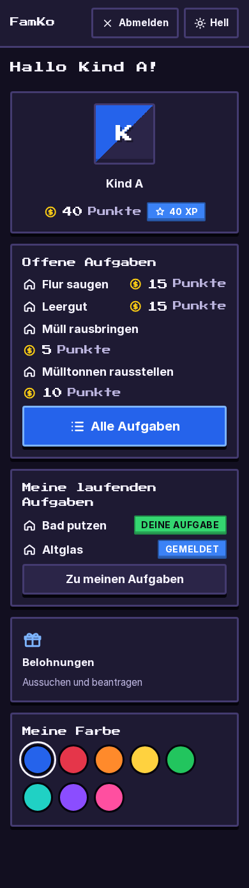
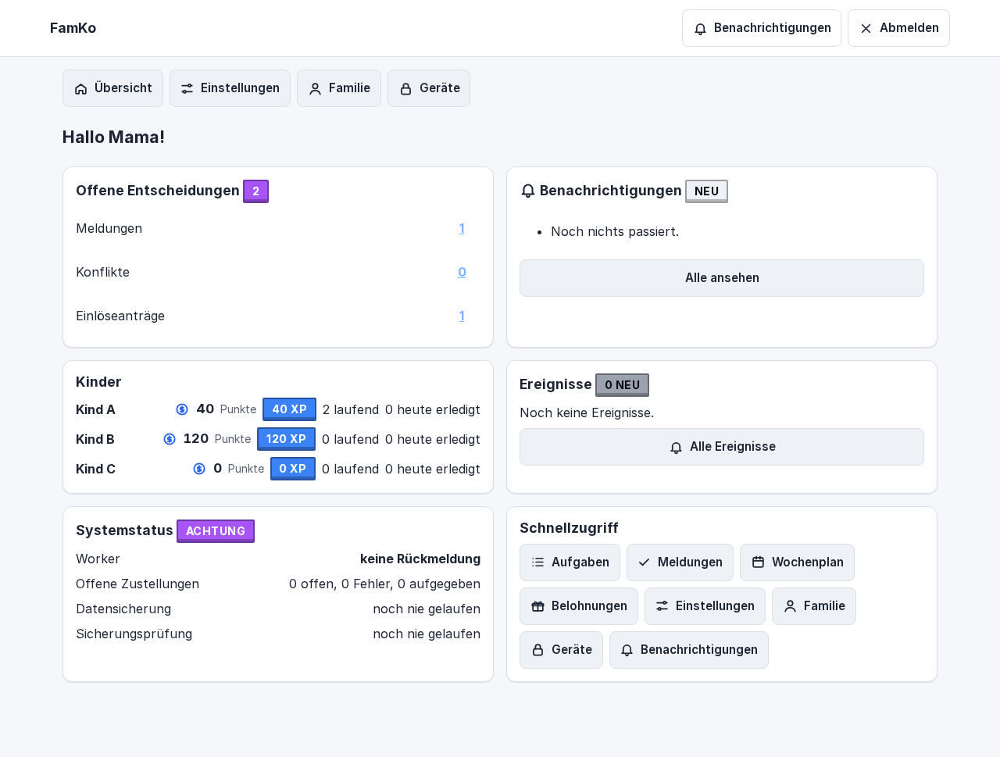
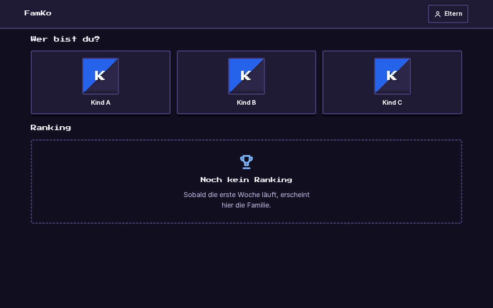
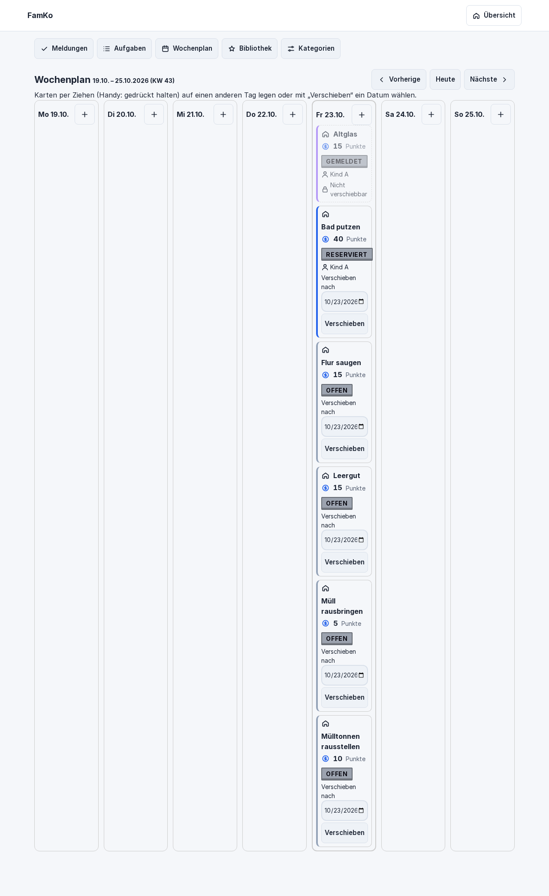
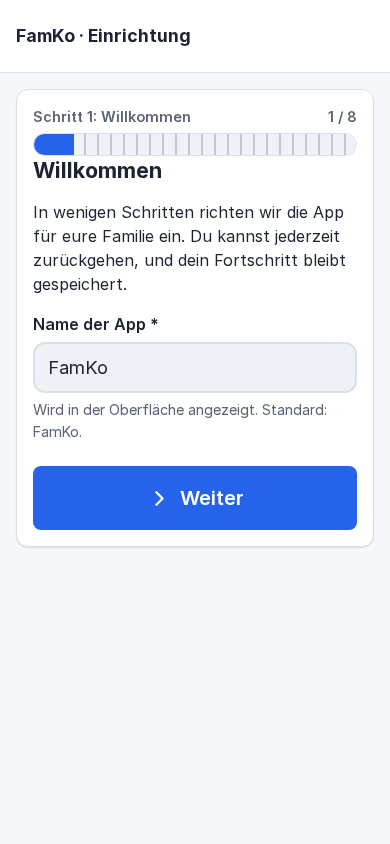
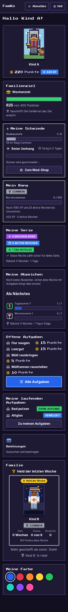
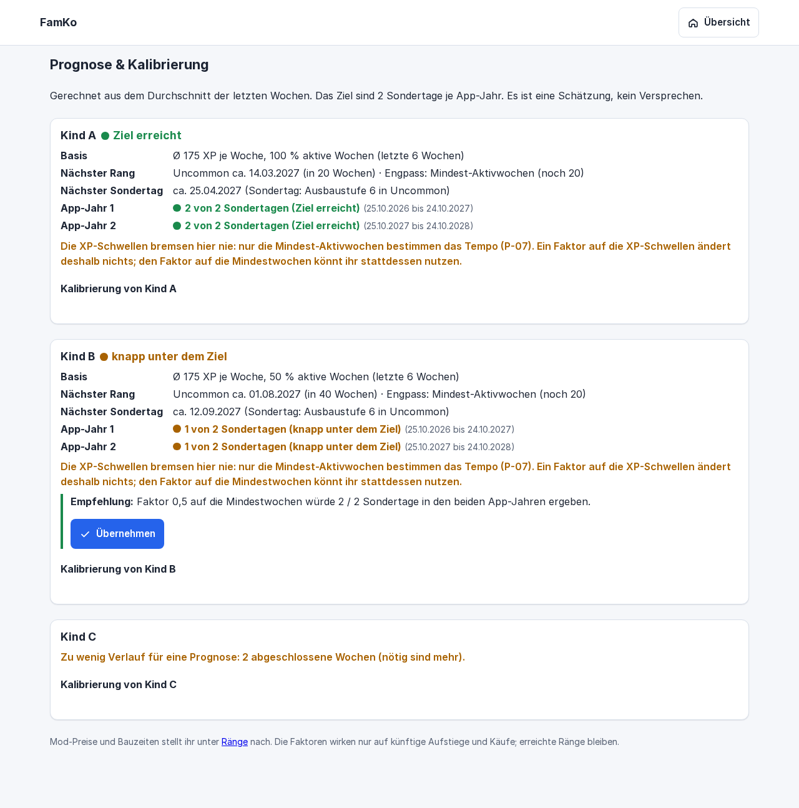
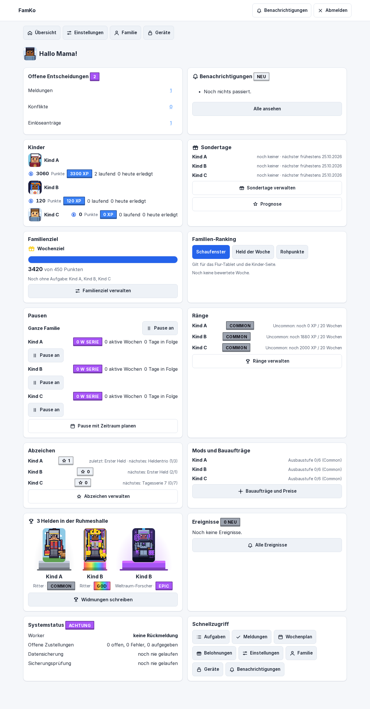

<p align="center"></p>

# Nestwerk

**Landingpage:** https://hassio0815-tech.github.io/nestwerk/ (nach Veröffentlichung)

**Nestwerk – the family hub for chores, rewards & learning**

**Nestwerk** ist ein Familien-Dashboard für den eigenen Server. Kinder übernehmen freiwillig Aufgaben im Haushalt, sammeln Punkte und steigen in Rängen auf. Eltern behalten den Überblick, bestätigen Aufgaben und pflegen Belohnungen. Alles läuft lokal im Heimnetz.



---

## Funktionen

- **Aufgaben:** Bibliothek mit Vorlagen, Wiederholung, Zeitfenster, Reservierung, Bestätigung durch die Eltern, Foto- oder Textnachweis, Bonuspunkte, Wochenplaner mit Drag and drop
- **Belohnungen:** Katalog mit Preisen, Einlöseanträge, Taschengeld-Limit pro Monat
- **Punkte und Ränge:** Guthaben und Gesamtpunkte (XP), sechs Ränge mit Aktivitätsbedingung, Wochenserie mit Serienbonus, Pause-Schalter
- **Abzeichen und Meilensteine:** Serien, Quartale und Rangaufstiege
- **Avatare:** 10 Themen mit je 36 Mods, Mod-Shop mit Bauzeit, Ruhmeshalle für fertige Helden
- **Sondertag:** persönlicher Tag mit einem Elternteil, begrenzt auf 2 pro Kind und Jahr
- **Familienziel:** wöchentliches Gemeinschaftsziel, Abstimmung, Familien-Ranking, „Held der Woche“
- **Prognose:** Wann erreicht ein Kind den nächsten Rang? Die Eltern kalibrieren das Tempo.
- **Benachrichtigungen:** E-Mail, Push auf dem iPhone, Pop-up in der App
- **Flur-Tablet:** Kiosk-Ansicht mit Familienziel und Ranking
- **Betrieb:** Einrichtungs-Assistent, tägliche Datenbank-Backups, Updates mit Rollback

---

## Datenschutz

- **Alles lokal:** Daten, Fotos und Datenbank bleiben auf deinem Server. Es gibt keine Cloud.
- **Kein Tracking:** Keine Analyse-Dienste, keine externen Skripte, selbst gehostete Schriften.
- **Fotos sind kurzlebig:** Nachweis-Fotos werden nach der Bestätigung sofort gelöscht.
- **Zugriff im Heimnetz:** Kinder nutzen Nestwerk nur zu Hause. Eltern erreichen es unterwegs über ihr eigenes VPN.

---

## Voraussetzungen

- **Server:** Debian-13-VM (z. B. auf Proxmox), mit fester IP. Getestet mit 2 vCPU, 4 GB RAM, 46 GB Speicher.
- **Docker:** Der Installer richtet Docker und Compose ein.
- **Reverse Proxy mit HTTPS:** z. B. Nginx Proxy Manager.
- **Domain:** für ein Let's-Encrypt-Zertifikat per DNS-Challenge.
- **Optional:** lokaler DNS-Server (AdGuard Home, Pi-hole), E-Mail-Postfach auf eigener Domain, iPhone ab iOS 16.4, Android-Tablet mit Fully Kiosk Browser.

---

## Schnellstart

1. VM anlegen (Debian 13, feste IP) und per SSH als root erreichbar machen.
2. Code auf die VM holen (Git-Repository oder Bundle).
3. Installer starten:

   ```bash
   deploy/install.sh --npm-ip <NPM-IP> --domain nestwerk.<DEINE-DOMAIN> --heimnetz <HEIMNETZ-CIDR>
   ```

4. Reverse Proxy auf `<VM-IP>:8000` einrichten, mit HTTPS und `client_max_body_size 50m;`.
5. Lokalen DNS-Eintrag `nestwerk.<DEINE-DOMAIN>` auf die Proxy-IP setzen.
6. Im Browser `https://nestwerk.<DEINE-DOMAIN>/einrichtung/` öffnen und den Assistenten mit dem Setup-Token durchlaufen.

**Die ausführliche Anleitung mit allen Schritten, Beispielen und Fehlersuche steht in [docs/INSTALLATION.md](docs/INSTALLATION.md).**

---

## Screenshots

Alle Screenshots zeigen **Demo-Daten** (Mama, Papa, Kind A/B/C).

| Thema | Ansicht |
|---|---|
| Kinder-Dashboard |  |
| Eltern-Dashboard |  |
| Flur-Tablet |  |
| Wochenplaner |  |
| Einrichtung |  |
| Ranking und Held der Woche |  |
| Prognose für Eltern |  |
| Ruhmeshalle |  |

Alle Bilder liegen in `docs/screenshots/` (Phasen 1 bis 3, mit Prüfberichten).

---

## Dokumentation

| Dokument | Inhalt |
|---|---|
| [docs/INSTALLATION.md](docs/INSTALLATION.md) | Installation Schritt für Schritt, Reverse Proxy, DNS, Geräte, Updates, Backup, Fehlersuche |
| [docs/BENUTZERHANDBUCH.md](docs/BENUTZERHANDBUCH.md) | Für Eltern und Kinder: Aufgaben, Punkte, Ränge, Abzeichen, Avatar und mehr |
| [docs/RUNBOOK.md](docs/RUNBOOK.md) | Betrieb: Update, Rollback, Backup-Restore, Secrets, Fehlersuche |
| [docs/SPEC.md](docs/SPEC.md) | Produktspezifikation und Entscheidungen |
| [docs/ARCHITECTURE.md](docs/ARCHITECTURE.md) | Architektur, Schichten, Ereignisse, Regel-Engine |
| [docs/DATA_MODEL.md](docs/DATA_MODEL.md) | Datenmodell und Einstellungen |
| [docs/MODULE-ERWEITERN.md](docs/MODULE-ERWEITERN.md) | Ein neues Modul anlegen, am Beispiel „lernen“ |
| [CONTRIBUTING.md](CONTRIBUTING.md) | Mitwirken, Tests, Prüfungen, Schichtenregeln |
| [CHANGELOG.md](CHANGELOG.md) | Änderungen nach Projektphasen |
| [LICENSE](LICENSE) | Volltext der GNU AGPL-3.0 |

## Lizenz: AGPL-3.0

Nestwerk steht unter der **GNU Affero General Public License, Version 3 oder neuer** (AGPL-3.0-or-later). Der Volltext liegt in [LICENSE](LICENSE).

- Nutzen, ändern und weitergeben ist erlaubt.
- Wer eine geänderte Fassung als Dienst im Netz betreibt, muss den geänderten Quellcode den Nutzern dieses Dienstes anbieten. Das schützt selbst gehostete Installationen davor, als geschlossener Online-Dienst vereinnahmt zu werden.
- Abhängigkeiten sind überwiegend permissiv (BSD, MIT, Apache-2.0); pywebpush (MPL-2.0) ist AGPL-kompatibel. Die Schriften Inter und Fraunces stehen unter der SIL OFL; ihre Lizenzhinweise in `static/fonts/` bleiben erhalten.
- Vor einer Weitergabe die Abhängigkeitslizenzen mit einem Werkzeug wie `pip-licenses` prüfen.

Nestwerk hieß früher *FamKo*. Bestehende Installationen laufen unverändert weiter (siehe [docs/RUNBOOK.md](docs/RUNBOOK.md)).

---

## Entwicklung

```bash
python3 -m venv .venv && . .venv/bin/activate
pip install -e ".[dev]"
python manage.py migrate        # legt data/db/nestwerk.sqlite3 an
python manage.py runserver      # http://127.0.0.1:8000/gesundheit/
pytest                          # Tests
ruff check . && ruff format --check .
lint-imports                    # Schichtenregeln
```

Konfiguration per Umgebungsvariablen mit Präfix `NESTWERK_` (Vorlage: `.env.example`).
Settings: `nestwerk/settings/{basis,entwicklung,produktion,test}.py`.

Docker lokal:

```bash
cp .env.example .env
docker compose build && docker compose up -d
curl http://127.0.0.1:8000/gesundheit/
docker compose down
```
