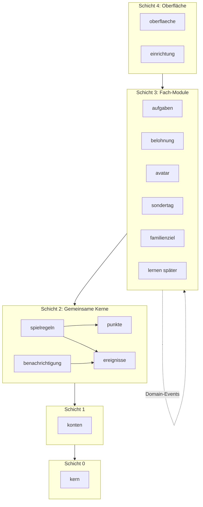
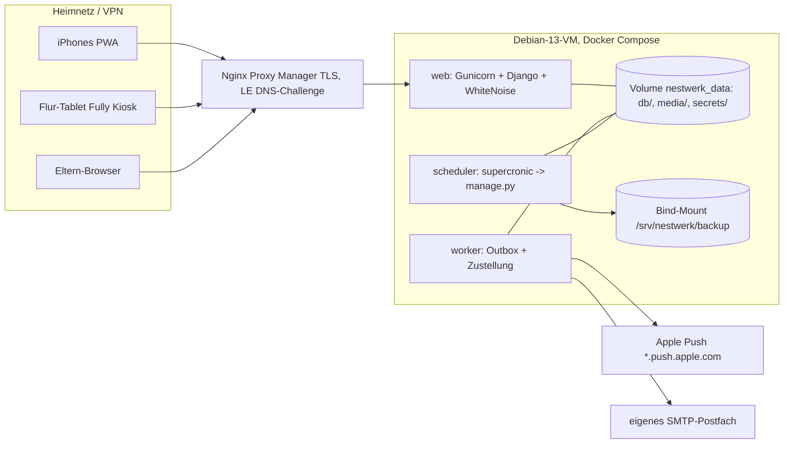
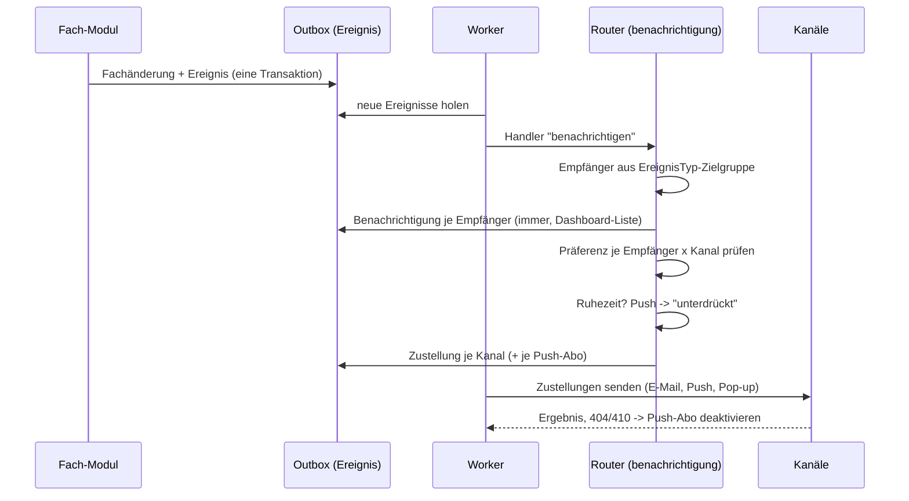
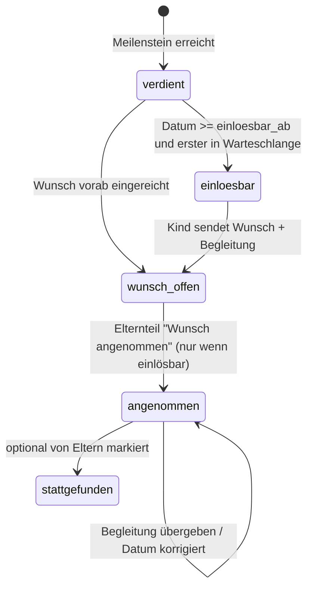
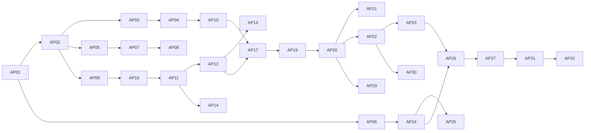

# Nestwerk: Architektur

- **Stand:** 24.10.2026 (Review AP31: 2.2, 5.2, 6, 7, 8 an den Code nach Phase 2 angeglichen)
- **Grundlage:** `docs/SPEC.md`, Entscheidungen 1–28 (Vorrang), `docs/research/web-push.md`
- **Datenmodell:** siehe `docs/DATA_MODEL.md`
- **Kennzeichnung:** **[K]** = kritischer Hinweis (Widerspruch oder technisch heikel, braucht Nutzer-Entscheidung). **[A]** = Architektur-Entscheidung dieses Dokuments.

---

## 1. Leitplanken

- **Stack:** Python 3.13, **Django 5.2 LTS** (Support bis 04/2028), Gunicorn, HTMX, SortableJS, SQLite (WAL), Docker Compose, Debian 13.
- **Grundregel:** Werte und Regeln liegen in der DB. Im Code stehen nur **Definitionen** (Schlüssel, Typ, Validierung) und **Seed-Startwerte** (Datenmigration). Laufzeit liest nie einen Code-Default. [A]
- **Zeit:** intern UTC (`USE_TZ=True`). Fachliche Tage und Wochen immer in `Europe/Berlin` (Einstellung). Woche = ISO-Woche, Montag–Sonntag. Eine zentrale Zeit-Utility (`kern.zeit`) ist die einzige Stelle für "heute", "ISO-Woche", "App-Jahr". [A]
- **Einzel-Familie:** Eine Installation = eine Familie. Kein Mandanten-Konzept (vermeidet Komplexität). [A]
- **Konsistenz vor Eleganz:** Punkte und Regeln werden in **einer DB-Transaktion** über direkte Service-Aufrufe gebucht. Domain-Events transportieren nur **Nebenwirkungen** (Benachrichtigungen, Abzeichen, Pop-ups, Module). [A]
- **Idempotenz überall:** jede Erzeugung hat einen fachlichen Eindeutigkeitsschlüssel (DB-Constraint), jeder Statuswechsel ist ein bedingtes `UPDATE ... WHERE status = alt`.

---

## 2. Modul-Schnitt (Django-Apps)

### 2.1 Schichten

| Schicht | App | Verantwortung |
|---|---|---|
| 0 Basis | `kern` | Einstellungen-Registry + Werte, Zeit-Utilities (Berlin, ISO-Woche, App-Jahr), Audit-Log, Job-Sperren, Modul-Registry (Kacheln, Metriken, Fortschritts-Provider) |
| 1 Identität | `konten` | Benutzer (Eltern, Kinder), Profile, Eltern-Zugang, Kinder-PIN, Geräte (Kiosk), Anmelde-Rate-Limit, Sitzungsrichtlinien |
| 2 Gemeinsame Kerne | `punkte` | Unveränderliches Ledger, Salden (Guthaben, XP), Buchungs-Service |
| | `ereignisse` | Domain-Event-Bus mit Outbox, Ereignistypen-Katalog, Worker |
| | `benachrichtigung` | Kanäle (E-Mail, Web-Push, In-App-Pop-up; später HA), Präferenzen, Ruhezeiten, Dashboard-Liste, Push-Abos |
| | `spielregeln` | Generische Regel-Engine: Aktivität, aktive Wochen, Serie, Serienbonus, Pausen, Ränge, Abzeichen, Meilensteine, Wochenauswertung, Held der Woche, Prognose, Kalibrierung |
| 3 Fach-Module | `aufgaben` | Kategorien, Bibliothek, Aufgaben, Wiederholung, Instanzen, Interesse/Reservierung, Meldung, Nachweise, Bestätigung, Sonderpunkte |
| | `belohnung` | Katalog, Einlöseanträge, Taschengeld-Limit |
| | `avatar` | Themen, Slots, Mods, Mod-Sets, Kauf, Bauzeit, Ausbaustufe, Themenwechsel, SVG-Generator |
| | `sondertag` | Ansprüche aus Meilensteinen, Grenzen (App-Jahr, Abstand), Wunsch, Begleitung, Annahme, Historie |
| | `familienziel` | Familienwoche, Ziel, Beiträge, Abstimmung, Großziel, Familienbelohnungen |
| 4 Oberfläche | `einrichtung` | Einrichtungs-Assistent (schreibt nur über Services der anderen Apps) |
| | `oberflaeche` | Layouts, Kinder-/Eltern-/Tablet-Dashboards, PWA (Manifest, `sw.js`), Live-Aktualisierung, Designsystem |
| Später | `lernen`, `forschen`, `hausautomation` | Schicht 3, docken über Registry + Events an |

- **[A] Sondertag und Familienziel als eigene Apps** (nicht in `avatar` bzw. `spielregeln`): eigene Regeln, eigene Zustände, später von `lernen` gespeist.
- **[A] Modul = Django-App im selben Image.** Eigene Container nur für eigene Prozesse (z. B. lokale KI, HA-Brücke). **[K]** SPEC 17 "weitere Module als zusätzliche Container" wörtlich genommen hieße getrennte Deployments mit geteilter SQLite-Datei; das ist riskant. Empfehlung: Fach-Module im Web-Image, nur Fremdprozesse als Container.

### 2.2 Abhängigkeitsregeln



- **Erlaubt:** Import nur **nach unten** (höhere Schicht -> niedrigere).
- **Verboten:** Imports zwischen Fach-Modulen (Schicht 3 untereinander). Kommunikation nur über:
  - **Domain-Events** (`ereignisse.veroeffentlichen(...)`, Handler im Ziel-Modul),
  - **Registry** in `kern` (Metrik-Provider, Fortschritts-Provider, Dashboard-Kacheln, Ereignistypen).
- **Innerhalb Schicht 2:** `spielregeln -> punkte, ereignisse`; `benachrichtigung -> ereignisse` (nie `punkte`); `punkte -> ereignisse` (Ereignis `punkte.gebucht`, AP04); `ereignisse` hängt nur von `kern`, `konten` ab.
- **Öffentliche Schnittstelle je App:** nur `services.py` (schreibend), `selectors.py` (lesend), `events.py` (Ereignistypen), `registry.py`. Fremde `models.py` werden nie importiert. Ausnahme: `ForeignKey` per String-Referenz (`"konten.Benutzer"`) auf Schicht 0–2.
- **Durchsetzung:** `import-linter` (Layers-Contract + "forbidden" zwischen Fach-Modulen) läuft in den Tests. [A] Seit AP19 zusätzlich "forbidden"-Verträge: Oberfläche und Fach-Module importieren keine fremden `models.py` (Enums wie `konten.Rolle` ausgenommen), `benachrichtigung` nie `punkte`. Seit AP31: Fach-Module und Oberfläche importieren aus `spielregeln` nur `services`/`selectors`/`registry`/`events` (Interna wie `raenge`, `abzeichen`, `held` verboten). Bewusste Ausnahme: `<modul>/events.py` registriert Texte über `benachrichtigung.texte.text_registrieren` (Registry-Charakter).
- **Dashboards:** `oberflaeche` rendert **Kacheln** aus der Registry; jedes Modul registriert seine Kacheln in `AppConfig.ready()`. Neues Modul = neue Kacheln ohne Änderung an `oberflaeche`.

### 2.3 Wichtige Querbeziehungen ohne Direkt-Import

| Bedarf | Lösung |
|---|---|
| Sondertag braucht "Ausbaustufe 6 in Seltenheit N" (avatar) | `avatar` meldet Metrik `ausbaustufe_voll` an `spielregeln.meilensteine` -> Regel feuert -> Event `meilenstein.erreicht` -> `sondertag` legt Anspruch an |
| Sondertag-Fortschritt "noch 2 Mods, 3 Wochen" | Fortschritts-Provider-Registry: `avatar` registriert `ausbaustufe_fortschritt(kind)`; `sondertag` fragt die Registry |
| Familienziel braucht Wochen-XP | `familienziel` liest über `punkte.selectors` (Schicht 2, erlaubt) und reagiert auf Event `punkte.gebucht` |
| Mod-Kauf braucht Rang | `avatar` -> `spielregeln.selectors.rang(kind)` (erlaubt) |
| Aufgabe bestätigt -> Punkte, Serienbonus, Aktivität | `aufgaben.services.bestaetigen` ruft in **einer Transaktion** `spielregeln.services.aktivitaet_erfassen`, `spielregeln.services.serienbonus_prozent`, `punkte.services.buchen` |
| Später: Lernen zählt als aktive Woche | `lernen` ruft ebenfalls `spielregeln.services.aktivitaet_erfassen` |

---

## 3. Docker-Compose-Topologie



### 3.1 Container (ein Image `nestwerk:<git-sha>`, drei Rollen)

| Container | Befehl | Aufgabe |
|---|---|---|
| `web` | `gunicorn nestwerk.wsgi -k gthread -w 2 --threads 4` | HTTP, Templates, HTMX, Static (WhiteNoise), Nachweis-Bilder über geschützte View |
| `worker` | `manage.py ereignisse_worker` (Endlosschleife, 2 s Takt) | Outbox abarbeiten, Push/E-Mail zustellen, Retries |
| `scheduler` | `supercronic /app/deploy/crontab` | Zeitgesteuerte Management-Commands (Abschnitt 6) |

- **[A] Eigener `worker`-Container** zusätzlich zu `scheduler`: "sofort"-Benachrichtigungen brauchen Sekunden-Latenz, Cron-Takt (1 min) wäre zu träge; Versand nie im Request (SMTP-Timeouts blockieren sonst Gunicorn).
- **Kein Redis/Celery:** Queue = Outbox-Tabelle in SQLite. Reicht für 5 Nutzer. [A]
- **RAM-Budget (2 GB VM):** web ~250 MB, worker ~100 MB, scheduler ~100 MB Spitze. Passt.
- **Port:** `web` lauscht auf `8000` nur an der VM-LAN-IP; VM-Firewall (nftables) erlaubt nur die NPM-IP. Keine offenen Ports nach außen.
- **Proxy:** `SECURE_PROXY_SSL_HEADER`, `CSRF_TRUSTED_ORIGINS=https://nestwerk.<domain>`, `USE_X_FORWARDED_HOST`. In NPM: kein Caching und keine Access-List auf `/sw.js`, `/manifest.webmanifest`. Websockets nicht nötig.
- **Ausgehend:** `*.push.apple.com:443`, `fcm.googleapis.com:443`, SMTP-Port des Postfachs.

### 3.2 SQLite-Betrieb mit drei Prozessen [K technisch heikel]

- Drei Prozesse schreiben: `web`, `worker`, `scheduler`. Ohne Maßnahmen drohen `database is locked`.
- Maßnahmen (Django 5.2 `OPTIONS`):
  - `"transaction_mode": "IMMEDIATE"` (Schreibsperre am Transaktionsanfang, kein Deadlock-Upgrade)
  - `"init_command"`: `PRAGMA journal_mode=WAL; PRAGMA synchronous=NORMAL; PRAGMA busy_timeout=5000; PRAGMA foreign_keys=ON; PRAGMA secure_delete=ON;`
  - Kurze Transaktionen; kein Netzwerk-I/O (SMTP, Push) innerhalb von Transaktionen.
- `secure_delete=ON`: gelöschte Nachweis-Texte werden in der DB-Datei überschrieben (Datenschutz, Abschnitt 9).
- Volume auf lokaler Platte der VM, **nie** auf NFS/SMB (WAL-Sperren).

### 3.3 Volumes und Secrets

- `nestwerk_data:/data`
  - `/data/db/nestwerk.sqlite3` (+ `-wal`, `-shm`)
  - `/data/media/nachweise/` (temporär, privat)
  - `/data/media/avatar-cache/` (regenerierbar)
  - `/data/secrets/` (`django_secret_key`, `vapid_private.pem`, `fernet.key`), beim ersten Start erzeugt, Rechte 600
- `/srv/nestwerk/backup` (Bind-Mount, im Proxmox-VM-Backup enthalten)
- **VAPID-Schlüssel und Fernet-Schlüssel** gehören zwingend ins Backup (Verlust = alle Push-Abos neu, SMTP-Passwort neu).

### 3.4 Backup

- **Ebene 1:** Proxmox-VM-Backup (Nutzer, täglich).
- **Ebene 2:** Job `db_sichern` täglich 03:30:
  - SQLite-Online-Backup-API (`sqlite3.Connection.backup`), keine Dateikopie im laufenden Betrieb
  - `PRAGMA integrity_check` auf der Kopie, dann gzip
  - Secrets als separates Archiv
  - Aufbewahrung (Einstellung): 14 täglich, 8 wöchentlich, 12 monatlich
  - **Nachweis-Fotos werden nicht gesichert** (Datenschutz)
- **Ebene 3 (empfohlen):** Kopie von `/srv/nestwerk/backup` außerhalb des Proxmox-Hosts (z. B. NAS). Nicht Teil des Projekts.
- **Wiederherstellungstest:** Job `backup_pruefen` wöchentlich: letztes Backup in Temp-DB entpacken, `integrity_check`, Zeilenzahl Ledger vergleichen, Ergebnis im Eltern-Dashboard (Systemstatus). Manuelle Vollwiederherstellung einmal vor Go-live üben (Runbook in README).

### 3.5 Update und Rollback

- Image-Tag = Git-Commit (`nestwerk:<sha>`), zusätzlich `nestwerk:vorher` als Zeiger auf die letzte gute Version.
- `deploy/update.sh`:
  1. `git pull`, `docker compose build`
  2. `docker compose run --rm web manage.py db_sichern --grund=update`
  3. `docker compose run --rm web manage.py migrate`
  4. `docker compose up -d`, Healthcheck `/gesundheit/` (DB lesbar, Migrationen vollständig, Worker-Herzschlag < 60 s)
- `deploy/rollback.sh <sha>`: Stack stoppen, Pre-Update-Backup zurückspielen, `NESTWERK_TAG=<sha> up -d`.
- **Migrationsregel:** Additiv (expand/contract). Felder erst hinzufügen, später entfernen. Daten-Migrationen reversibel oder mit Backup-Pflicht.
- Logs: Docker `json-file` mit Rotation (10 MB x 3).

---

## 4. Auth-Konzept

### 4.1 Benutzer

- Eigenes `AUTH_USER_MODEL = konten.Benutzer` ab Migration 0001 (später nicht mehr änderbar). [A]
- Rolle `eltern` oder `kind`. Jede Person ist ein eigener Benutzer.

### 4.2 Eltern

- **Ein gemeinsames Passwort** (Argon2-Hash in `ElternZugang`, Singleton). Eltern-Benutzer haben kein eigenes Passwort.
- Login-Formular: **Name wählen** (Auswahl der Eltern-Benutzer, z. B. "Mama", "Papa") + Passwort. Eigenes Auth-Backend prüft das gemeinsame Passwort und meldet als gewählten Benutzer an.
- Folge: Präferenzen, Ruhezeiten, Push-Abos und Audit-Einträge hängen sauber am Elternteil. Fälschbarkeit der Namensangabe akzeptiert (SPEC 2).
- **Sitzung:** Checkbox "vertrautes Gerät" -> 90 Tage gleitend; sonst Browser-Sitzung, 12 h. Werte in Einstellungen.
- **Auf dem Kiosk-Tablet:** Eltern-Login möglich, aber Leerlauf-Abmeldung wie Kinder (Startwert 5 min). [A]
- **Rate-Limit:** 10 Fehlversuche je IP in 15 min -> 15 min Sperre (Startwert, [O]-Punkt 11).

### 4.3 Kinder

- Startseite (Tablet und iPhone): Avatar-Auswahl -> PIN-Pad (4 Ziffern, große Tasten).
- PIN als Argon2-Hash in `KindProfil`. Eltern können PINs zurücksetzen.
- **Rate-Limit je Kind** (nicht je IP, da Tablet geteilt): 5 Fehlversuche -> 5 min Sperre, danach Verdopplung bis max. 60 min; Erfolg setzt zurück. Eltern sehen Sperren im Dashboard und können entsperren.
- Rechnung: 10.000 PINs, 5 Versuche je Sperrstufe -> Durchprobieren praktisch ausgeschlossen.
- **Persönliches iPhone:** Sitzung 365 Tage gleitend (bleibt angemeldet, E17).
- **[K] Heimnetz-Pflicht für Kinder** ist rein netzseitig (keine Portfreigabe). Optional zusätzlich Einstellung "Kinder-Login nur aus Netzen" (CIDR-Liste, Prüfung über `X-Forwarded-For` des vertrauten NPM). Empfehlung: aktivieren, Startwert = Heimnetz-Subnetz aus dem Assistenten.

### 4.4 Geräte und Tablet-Auto-Logout

- Eltern registrieren ein Gerät als **Kiosk** ("Dieses Gerät ist das Flur-Tablet"). Server setzt ein signiertes, httpOnly, langlebiges Cookie `nestwerk_geraet` -> `Geraet`-Datensatz.
- **Sitzungsrichtlinie je Gerätetyp** (Middleware `SitzungsRichtlinie`):
  - Kiosk: Kind- und Eltern-Sitzung enden nach Leerlauf (Startwert 300 s).
  - Persönlich: lange Sitzung wie oben.
- **Leerlauf serverseitig:** `letzte_aktivitaet` in der Session, nur durch **aktive** Requests aktualisiert. Polling-Endpunkte sind als **passiv** markiert und verlängern die Sitzung nicht. [A, wichtig]
- **Leerlauf clientseitig:** JS-Timer (Touch/Klick setzt zurück) -> nach Ablauf `POST /abmelden` und zurück zur Familien-Startseite. Zusätzlich Warnhinweis 30 s vorher ("Noch da?").
- Fully Kiosk: eigene Timeout-Funktion als Rückfallebene (Startseite neu laden nach X min).
- Ohne Anmeldung zeigt das Tablet die **Familien-Startseite**: Avatar-Auswahl, Familienziel-Leiste, Ranking. Nur Lesen.

### 4.5 Allgemein

- Django-Sessions in der DB (`django.contrib.sessions`), `clearsessions` täglich.
- CSRF für alle POSTs (HTMX sendet Token über `hx-headers` im `<body>`).
- Berechtigungen: Decorator/Mixin `nur_eltern`, `nur_kind`, `eigenes_kind` (Kind sieht nur eigene Daten, Familienansicht ausgenommen).
- Sicherheitsheader: CSP ohne Inline-Scripts (HTMX + eigene JS-Dateien), `Referrer-Policy`, `X-Content-Type-Options`, HSTS (in NPM).

---

## 5. Ereignisse und Benachrichtigungen

### 5.1 Domain-Event-Bus (Transactional Outbox)

- `ereignisse.veroeffentlichen(typ, kind=None, akteur=None, daten={}, schluessel=None)` schreibt eine `Ereignis`-Zeile **in derselben Transaktion** wie die Fachänderung. Rollback = kein Ereignis.
- `schluessel` (optional, eindeutig) verhindert doppelte Ereignisse aus Jobs (z. B. `reservierung.erinnerung:<interesse_id>`).
- **Handler-Typen:**
  - **synchron** (gleiche Transaktion): nur für fachlich zwingende Folgen innerhalb Schicht 2 (sparsam; z. B. Abzeichen-Prüfung nach Aktivität).
  - **asynchron** (Worker): alles andere. Je Handler eine `EreignisVerarbeitung` mit `unique(ereignis, handler)` -> genau einmal wirksam, Retries mit Backoff, Fehler sichtbar im Systemstatus.
- Ereignistypen werden in `events.py` der Module definiert und beim `migrate` in die Tabelle `EreignisTyp` synchronisiert (Bezeichnung, Zielgruppe, Standardkanäle editierbar).

### 5.2 Ereigniskatalog (Stand Code nach Phase 2)

Aus der Ereignis-Registry erzeugt (Review AP31, B-22). Zielgruppe `intern` = kein Empfänger (nur Handler). Bezeichnung, Zielgruppe und Standardkanäle sind je Typ in der DB editierbar (`EreignisTyp`).

| Typ | Modul | Zielgruppe | Standardkanäle |
|---|---|---|---|
| `aufgabe.abgelehnt` | aufgaben | kind | push |
| `aufgabe.antwort` | aufgaben | eltern | push, email |
| `aufgabe.bestaetigt` | aufgaben | kind | push |
| `aufgabe.erledigt` | aufgaben | intern | – |
| `aufgabe.gemeldet` | aufgaben | eltern | push, email |
| `aufgabe.interesse` | aufgaben | eltern | push, email |
| `aufgabe.konflikt` | aufgaben | eltern | push, email |
| `aufgabe.korrigiert` | aufgaben | kind | push |
| `aufgabe.nicht_uebernommen` | aufgaben | eltern | – |
| `aufgabe.reservierung_geloest` | aufgaben | kind | push |
| `aufgabe.rueckfrage` | aufgaben | kind | push |
| `aufgabe.sonderpunkte` | aufgaben | kind | push |
| `aufgabe.verfall_vorwarnung` | aufgaben | eltern | push, email |
| `aufgabe.vergeben` | aufgaben | kind | push |
| `aufgabe.vertrauen_gutgeschrieben` | aufgaben | eltern | push, email |
| `aufgabe.zugeteilt` | aufgaben | kind | push |
| `aufgabe.zurueckgegeben` | aufgaben | eltern | push, email |
| `reservierung.abgelaufen` | aufgaben | eltern | push, email |
| `reservierung.erinnerung` | aufgaben | kind | push |
| `mod.fertig` | avatar | kind | push, popup |
| `mod.gekauft` | avatar | eltern | push |
| `thema.gewechselt` | avatar | eltern | push |
| `ruhmeshalle.eltern` | avatar | eltern | push |
| `ruhmeshalle.held` | avatar | kind | popup |
| `belohnung.abgelehnt` | belohnung | kind | push |
| `belohnung.antrag` | belohnung | eltern | push, email |
| `belohnung.bestaetigt` | belohnung | kind | push |
| `system.backup_fehler` | ereignisse | eltern | push, email |
| `familienziel.abstimmung_gleichstand` | familienziel | eltern | push |
| `familienziel.abstimmung_offen` | familienziel | kind | popup |
| `familienziel.erreicht` | familienziel | eltern | push |
| `familienziel.erreicht_kind` | familienziel | kind | popup |
| `familienziel.grossziel` | familienziel | eltern | push |
| `familienziel.grossziel_kind` | familienziel | kind | popup |
| `punkte.gebucht` | punkte | intern | – |
| `sondertag.angenommen` | sondertag | kind | popup, push |
| `sondertag.einloesbar` | sondertag | kind | popup, push |
| `sondertag.einloesbar_eltern` | sondertag | eltern | push |
| `sondertag.freigeschaltet` | sondertag | kind | popup, push |
| `sondertag.uebergeben` | sondertag | eltern | push |
| `sondertag.verdient` | sondertag | eltern | push |
| `sondertag.wunsch` | sondertag | eltern | push, email |
| `abzeichen.verliehen` | spielregeln | beide | push, popup |
| `aktivitaet.erfasst` | spielregeln | intern | – |
| `meilenstein.erreicht` | spielregeln | intern | – |
| `pause.beendet` | spielregeln | kind | push |
| `pause.gestartet` | spielregeln | kind | push, popup |
| `rang.aufgestiegen` | spielregeln | beide | push, popup, email |
| `serie.gerissen` | spielregeln | kind | push |
| `serie.gestiegen` | spielregeln | kind | push, popup |
| `serienbonus.gebucht` | spielregeln | kind | popup |
| `spielregeln.held` | spielregeln | eltern | push |
| `spielregeln.held_kind` | spielregeln | kind | popup |
| `woche.ausgewertet` | spielregeln | intern | – |

### 5.3 Benachrichtigungsfluss



- **Immer:** Jede Benachrichtigung landet in der **Dashboard-Liste** mit Ungelesen-Zähler (unabhängig von Kanal und Ruhezeit).
- **Kanäle** = Klassen mit gemeinsamer Schnittstelle (`senden(zustellung)`), registriert in der Registry. Phase 1: `email`, `push`, `popup` (In-App). Später `homeassistant` als weiterer Kanal ohne Umbau.
- **Präferenzen:** je Elternteil x Ereignistyp x Kanal (an/aus). Startwerte aus `EreignisTyp.standard_kanaele` (laut E24: alle Ereignisse, Push + E-Mail, beide Eltern).
- **Kinder-Präferenzen:** setzen die Eltern (Kinder haben nur Push und Pop-up).
- **Ruhezeiten je Elternteil:** Zeitfenster (über Mitternacht erlaubt) + Wochentage. Push wird als `unterdrueckt_ruhezeit` vermerkt, nicht nachgeholt.
  - **[K]** SPEC sagt nur "Push bleibt stumm". Empfehlung: **E-Mail läuft auch in Ruhezeiten** (ist ohnehin lautlos); als Einstellung umschaltbar.
- **Web-Push** (Details `research/web-push.md`):
  - `pywebpush` + `py-vapid`, eigenes Modell `PushAbo`, kein `django-webpush`.
  - Payload im **Declarative-Web-Push-Format** (`web_push: 8030`, `notification.title/body/navigate`, `app_badge`) + SW-`push`-Handler als Fallback.
  - **Keine Action-Buttons** (iOS kann es nicht). Tipp öffnet per `navigate` den Deep Link (z. B. Bestätigungsseite der Meldung). **[K]** SPEC 13 "Push-Aktionen wie Bestätigen" ist auf iOS nicht umsetzbar; E28 bestätigt Deep Link.
  - `app_badge` = Anzahl offener Eltern-Entscheidungen bzw. offener eigener Aufgaben des Kindes.
  - TTL je Ereignistyp (Erinnerungen 6 h, sonst 24 h); `Urgency: high` nur für Kind-Erinnerungen.
  - Button "Test-Push senden" in den Einstellungen; Abo-Abgleich bei jedem App-Start.
- **E-Mail:** eigenes Django-E-Mail-Backend liest `SmtpKonto` (DB, Passwort Fernet-verschlüsselt). Text + einfaches HTML, Deep Link.
  - **[K]** "Jedes Ereignis sofort per E-Mail an beide Eltern" erzeugt viele Mails (jede Aufgabenwahl). Spec-Standard bleibt, Hinweis im Assistenten: "E-Mail nur für Entscheidungen" als Ein-Klick-Profil anbieten.
- **Pop-ups** (Rangaufstieg, Abzeichen, Sondertag, Konfetti): Kanal `popup` schreibt `Popup`-Zeilen; das Kinder-Dashboard zeigt ungesehene Pop-ups beim nächsten Laden/Poll und markiert sie als gesehen.

### 5.4 Live-Aktualisierung (Tablet, Dashboards)

- **[A] Entscheidung: HTMX-Polling, kein SSE.**
- Begründung:
  - SSE hält je Client eine Verbindung offen; mit Gunicorn-Sync/gthread blockiert das Threads, würde ASGI/Uvicorn erzwingen (zweiter Server-Stack).
  - NPM puffert Proxy-Antworten standardmäßig; SSE braucht Sonderkonfiguration (`proxy_buffering off`, Timeouts).
  - Fully-Kiosk-WebView: Verbindungsabbrüche bei Display-Aus/Standby; Polling erholt sich automatisch.
  - Last ist trivial: 1 Tablet + ~5 Geräte, Antwort meist `204`.
  - Sekundengenaue Aktualität ist nicht nötig.
- **Mechanik:**
  - `GET /live/stand?v=<version>` (passiv, verlängert keine Sitzung). `version` = höchste `Ereignis.id` (indizierte Abfrage, < 1 ms).
  - Unverändert -> `204`. Geändert -> `200` mit Header `HX-Trigger: nestwerk-aktualisiert` und neuer Version.
  - Kacheln haben `hx-trigger="nestwerk-aktualisiert from:body"` und laden sich selbst nach.
  - Intervalle in Einstellungen: Tablet 10 s, Handy/Desktop 30 s; pausiert bei `document.hidden`.
  - Tablet: kompletter Seiten-Reload alle 6 h (WebView-Speicherlecks).
- **Optional (Phase 3):** Fully-Kiosk-REST (PLUS-Lizenz) als Kanal `kiosk` für `screenOn` + Overlay bei Familienziel/Rangaufstieg.

---

## 6. Scheduler-Jobs

- Alle Jobs: `manage.py <job>`; je Job eine **Job-Sperre** (`JobSperre`, Lease 10 min) gegen Parallel-Läufe; Ergebnis in `JobLauf`.
- **Catch-up-Prinzip:** Jobs arbeiten den **Soll-Zustand bis jetzt** ab, nicht "nur das letzte Intervall". Ausgefallene Läufe holt der nächste Lauf nach.
- **Zeitzone:** supercronic mit `TZ=Europe/Berlin`. Keine Jobs zwischen 02:00 und 03:00 (Sommerzeit-Umstellung).

| Job | Takt (deploy/crontab) | Was | Idempotenz |
|---|---|---|---|
| `ereignisse_worker` | Dauerprozess (worker) | Outbox, Zustellungen, Retries; Ruhezeit vor jedem Versand erneut geprüft (B-19) | `unique(ereignis, handler)`, Zustellstatus |
| `aufgaben_erzeugen` | alle 15 min + 00:05 | Instanzen bis Horizont (Startwert 14 Tage) | `unique(aufgabe, faellig_am)`; ungebunden: Teil-Unique "max. 1 offene Instanz je Aufgabe" |
| `reservierungen_pruefen` | alle 5 min | Erinnerung 6 h vorher; Ablauf -> frei, Eltern informieren | `erinnert_am IS NULL` + Ereignis-Schlüssel; bedingtes Update |
| `verfall_pruefen` | alle 5 min | Vorwarnung Eltern 3 h vor Fensterende; Ablauf -> `nicht_uebernommen` | `vorwarnung_am IS NULL`; bedingtes Update |
| `wochen_sicherstellen` | stündlich :10 (Di 00:10 = Abschluss nach 24 h Puffer) | Wochenauswertung je Kind (aktiv, neutral, Serie), Ränge, Abzeichen/Meilensteine (Catch-up), Held der Woche | `unique(kind, iso_jahr, iso_woche)`, `finalisiert_am`, Fakten unique, Held = `zuwachs_relativ` gesetzt |
| `familienwoche_sicherstellen` | :03/:18/:33/:48 | Familienwoche anlegen, Abstimmung öffnen/schließen (Gleichstand -> Eltern), Woche abschließen (erreicht/verfehlt/neutral), Großziel | `unique(iso_jahr, iso_woche)`, bedingte Updates, Großziel `unique(ausloesende_woche)` |
| `mods_fertigstellen` | alle 5 min | Bau fertig -> Status, Zeitbremse-Woche, Slot belegen, Abzeichen/Meilensteine prüfen | bedingtes Update `im_bau -> fertig` |
| `sondertag_sicherstellen` | stündlich :25 | Ansprüche zu Meilenstein-Fakten nachholen, Einlösedaten neu, "jetzt einlösbar" melden | `unique(meilenstein)`, `einloesbar_gemeldet_am IS NULL` + Ereignis-Schlüssel |
| `nachweise_aufraeumen` | stündlich :17 | Waisen-Dateien und Nachweise abgeschlossener Meldungen löschen | Löschen ist idempotent |
| `db_sichern` | täglich 03:30 (+13:30 Nachholtermin) | Backup + Rotation | Dateiname mit Datum; existiert -> überspringen |
| `backup_pruefen` | So 04:30 | Wiederherstellungstest | rein lesend |
| `konten_aufraeumen` | täglich 04:15 | `clearsessions`, alte Anmeldeversuche | idempotent |
| `benachrichtigungen_aufraeumen` | täglich 04:20 | Aufbewahrung (B-15): gelesene Benachrichtigungen (`benachrichtigung.aufbewahrung_tage`, 90), ungelesene (`…_ungelesen_tage`, 180), Zustellungen (`…_zustellung_aufbewahrung_tage`, 90), verarbeitete Ereignisse (`ereignisse.aufbewahrung_tage`, 180; nur alle Handler ok und nicht mehr referenziert), Job-Läufe (`allgemein.joblauf_aufbewahrung_tage`, 90). Ledger und Audit nie. | Löschen ist idempotent |
| `prognose_berechnen` | (AP32, Phase 3) | Prognose je Kind | Upsert |

- **Kein Monats-Job** für das Taschengeld-Limit: Limit wird live je Kalendermonat berechnet.
- **Kein Tages-Job** für die Tagesserie: live aus `Aktivitaet` berechnet (Abschnitt 7.2).
- **Lazy-Evaluation:** Fachservices rufen bei Bedarf `wochen_sicherstellen(kind, bis_woche)` auf (gleiche idempotente Funktion wie der Job). Damit ist z. B. der Serienbonus am Montag 00:01 korrekt, auch wenn der Job noch nicht lief.

---

## 7. Regel-Engine (`spielregeln`)

### 7.1 Grundprinzip

- Alle Zustände (Serie, aktive Wochen, Rang, Ausbaustufe) sind **aus der Historie berechenbar** (Aktivitäten, Pausen, Ledger, Mod-Besitz). Gespeicherte Werte (`KindStand`, `Wochenauswertung`) sind **Caches mit Eindeutigkeitsschlüssel** und jederzeit per `manage.py spielregeln_neuberechnen` reproduzierbar.
- Ausnahme: **erreichte Ränge, verliehene Abzeichen, erreichte Meilensteine** sind dauerhafte Fakten (nie zurückgenommen).
- **Aktivität:** `Aktivitaet(kind, datum, modul, referenz)` entsteht bei Bestätigung einer Aufgabe (bzw. sofort bei "Vertrauen"). Storno einer Aufgabe markiert die Aktivität als storniert.

### 7.2 Aktive Woche, Serie, Pause

- **Bezugsdatum einer Aufgabe:** **[K]** SPEC lässt offen, ob Meldezeit oder Bestätigungszeit zählt. Problem: Kind meldet So 19 Uhr, Eltern bestätigen Mo -> Woche verloren, Serie bricht.
  - **Empfehlung:** Es zählt das **Meldedatum** (`gemeldet_am`, Berlin). Wochenabschluss wird erst nach einem **Puffer** finalisiert (Startwert 24 h, also Di 00:10). Bestätigungen nach Finalisierung zählen für die Woche der Bestätigung.
  - **Umsetzung (Review AP31):** Dieselbe Regel gilt für Aktivität **und** Punkte (Basis, Serienbonus, Sonderpunkte): `spielregeln.selectors.wirksames_datum`. Sonst landeten Punkte einer späten Bestätigung in der abgeschlossenen Woche (für Familienziel und Held der Woche verloren). Korrekturen (Gegenbuchung) zählen am Tag der Korrektur. Familienwoche und Kinder-Wochen schließen zum selben Zeitpunkt (`woche_abgeschlossen_ab`, lokale Wanduhr).
- **Aktive Woche:** ≥ 1 nicht stornierte Aktivität in der ISO-Woche.
- **Neutrale Woche:** nicht aktiv **und** überschneidet sich mit einer Pause (Kind oder Familie) an mindestens N Tagen (Startwert N = 1).
  - **[K]** "Pausierte Wochen und Tage sind neutral" ist bei Teil-Pausen unklar. Empfehlung: N = 1 (großzügig, Kindern gegenüber fair), einstellbar.
- **Wochenserie** (Woche für Woche, aufsteigend): aktiv -> +1; neutral -> unverändert; sonst -> 0. Laufende Woche bricht die Serie nie.
- **Tagesserie:** gleiche Regel auf Tagesebene (Pause-Tage neutral); laufender Tag bricht nie.
- **Aktive Wochen gesamt:** Anzahl aktiver Wochen seit Go-live; nie zurückgesetzt.
- **Pause:** Zeitraum `von`–`bis` (Datum, inklusiv, `bis` offen erlaubt), für ein Kind oder Familie (`kind = NULL`). Aufheben = `bis` setzen (Audit). Später setzt HA Pausen über eine API (Quelle `hausautomation`).

### 7.3 Serienbonus

- **[O5] Empfehlung: laufende Serie.** Bonus-Serie = Serie am Ende der Vorwoche (pausenbereinigt) **+ 1**, weil die Aufgabe die aktuelle Woche aktiv macht.
  - Beispiel: Serie 1 nach Vorwoche, erste Aufgabe dieser Woche -> Serie 2 -> +5 %.
  - Vorteil: Belohnung sofort spürbar, deterministisch zum Buchungszeitpunkt, kein Warten auf den Wochenjob.
- Prozent = `min(deckel, (serie - start + 1) * schritt)` für `serie >= start`, sonst 0. Startwerte: start 2, schritt 5, deckel 25.
- Bonus = `ceil(basispunkte * prozent / 100)`; eigene Buchung `serienbonus` mit Schlüssel `aufgabe:<instanz>:serienbonus`, gleiche Transaktion wie die Grundbuchung.
- **Nicht** auf Sonderpunkte und Korrekturen (Empfehlung; einstellbar "Bonus auf Sonderpunkte" = aus).

### 7.4 Ränge

- `Rang`-Tabelle (Stufe, Name, XP-Schwelle, Mindest-Aktivwochen, Standard-Mod-Preis, Bauzeit, Farbe).
- Berechneter Rang = höchste Stufe mit `xp >= schwelle * faktor` **und** `aktive_wochen >= min_wochen`.
- **Rangaufstieg ist ein Fakt** (`RangAufstieg`, unique je Kind+Rang): Rang sinkt nie, auch wenn Eltern Schwellen erhöhen. Sprünge über mehrere Stufen erzeugen je Stufe einen Eintrag + Abzeichen.
- Prüfung: nach jeder XP-Buchung (synchron) und im Wochenabschluss (aktive Wochen).
- **[K] XP "sinkt nie" vs. Korrektur bei Vertrauen:** SPEC 5.4 erlaubt nachträgliche Korrektur. Empfehlung: Korrektur = Gegenbuchung auf Guthaben **und** XP (es war nie verdient); Rang bleibt als Fakt erhalten. "XP sinkt nie" gilt für Ausgaben (Einlösen, Mods).
- **[K] Kalibrierungsfaktor pro Kind** (E14) widerspricht "einheitliche Rangstufen, gleiche Regeln für alle" (SPEC 6.2) und ist im Familien-Ranking für Kinder sichtbar ungleich. Empfehlung: **globaler Faktor** als Standard; Kind-Faktor möglich, aber nur Eltern sichtbar, mit Hinweis im Dashboard.

### 7.5 Abzeichen (generisch)

- `AbzeichenDefinition`: Schlüssel, Name, Symbol, **Metrik**, Schwelle, Wiederholbarkeit (`einmalig`, `je_quartal`, `je_rang`), Modul, aktiv.
- **Metrik-Provider** (Registry): `tagesserie`, `wochenserie`, `quartal_voll_aktiv`, `rang_erreicht`. Module können Metriken + Abzeichen ergänzen (z. B. `lernen.vokabeln_gesamt`).
- Verleihung: `unique(kind, abzeichen, bereich)`; `bereich` = `""` (einmalig), `2027-Q1`, `rang-3`.
- Auslöser: Event nach Aktivität (Serien), Wochenabschluss (Quartal), Rangaufstieg.
- **Quartal:** Kalenderquartal; eine ISO-Woche gehört zu dem Quartal, in dem ihr Donnerstag liegt. Voll aktiv = alle Wochen aktiv oder neutral, mindestens eine aktiv.
- **[K]** Serien-Abzeichen (z. B. Tagesserie 7) einmalig oder bei jeder neuen Serie erneut? Empfehlung: einmalig, Rekord-Anzeige im Profil.

### 7.6 Meilensteine und Sondertag

- `MeilensteinRegel`: Metrik + Bedingung (JSON) + Belohnungsart (`sondertag`, `modset`, später weitere) + Wiederholbarkeit.
- Startregeln:
  - `ausbaustufe_voll` mit `seltenheit in [2,3,4,5]`, Bereich `seltenheit-N` -> je Seltenheit **einmal im Leben** (auch nach Themenwechsel nicht erneut).
  - `godmode_zyklus`: alle 26 aktiven Wochen seit God-Mode-Aufstieg, Bereich `zyklus-K` -> Sondertag + Mod-Set K.
- **Ausbaustufe** ([K] Auslegung): Anzahl Slots, in denen das Kind im aktuellen Thema einen **fertigen, zählenden** Mod der Seltenheit N **besitzt**. Besitz zählt, nicht "angelegt". Grund: SPEC "im aktuellen Rang" bricht, wenn ein Kind Rang N+1 erreicht, bevor Stufe 6 in N fertig ist.
- **Ein zählender Mod pro Woche:** Bei Fertigstellung erhält der Mod `zaehlt_ab_woche` = frühestens die Woche nach dem zuletzt zählenden Mod. Ausbaustufe zählt nur Mods mit `zaehlt_ab_woche <= aktuelle Woche`.
- **Sondertag-Grenzen** (in `sondertag`, Werte in Einstellungen):
  - max. **2 je App-Jahr**; App-Jahr k = `[go_live + k Jahre, go_live + k+1 Jahre)`; 29.02. -> 28.02.
  - **150 Tage** Mindestabstand; Bezugsdatum = Annahmedatum (korrigierbar).
  - `einloesbar_ab` = frühestes Datum, an dem beide Grenzen erfüllt sind, berechnet aus allen **angenommenen** Sondertagen des Kindes (inkl. manuell erfasster Historie). Wird bei jeder Annahme/Korrektur für alle offenen Ansprüche neu berechnet.
  - Mehrere offene Ansprüche bilden eine **Warteschlange** (FIFO). Je Kind ist nur der erste offene Anspruch einlösbar.
  - Durchsetzung: Button "Wunsch angenommen" erst ab `einloesbar_ab`; Service prüft serverseitig erneut in derselben Transaktion.
  - Wird ein wartender (erster) Anspruch einlösbar, melden Job `sondertag_sicherstellen` an Kind (Pop-up/Push) und Eltern (Push) genau einmal (`sondertag.einloesbar`, `sondertag.einloesbar_eltern`). Sofort einlösbare Ansprüche melden nur die Freischaltung.
- **Ablauf** siehe Zustandsdiagramm:



- **[K]** SPEC: Pop-up mit Wunschfeld "bei Freischaltung", aber Einlösung evtl. erst Monate später. Empfehlung: Pop-up bei Freischaltung zeigt "verdient, einlösbar ab X" und erlaubt den Wunsch sofort; Annahme erst ab X.
- **[O3] God Mode:** Empfehlung: **kein** zusätzlicher Meilenstein "Ausbaustufe 6 in God Mode", nur der 26-Wochen-Zyklus (hält ~2/Jahr). Mod-Set je Zyklus = 6 Mods (1 je Slot), Preis = God-Mode-Rangpreis.

### 7.7 Familienziel

- `Familienwoche` je ISO-Woche (unique), Zielwert als **Snapshot** bei Wochenbeginn.
- Wochen-XP = Summe der XP-Buchungen aller Kinder mit Bezugsdatum in der Woche (Aufgabe, Serienbonus, Sonderpunkte, minus Korrekturen).
  - **[K]** SPEC sagt "verdiente XP"; Empfehlung: inkl. Serienbonus und Sonderpunkte (alles, was XP erhöht).
- Bedingung: jedes **nicht pausierte** Kind hat ≥ 1 Aktivität. Kind gilt als pausiert, wenn es in der Woche an ≥ N Tagen pausiert ist (gleiche Regel wie 7.2).
- Erfolg live bei `punkte.gebucht`: bedingtes Update `laufend -> erreicht` -> Event (Konfetti + Eltern-Push) genau einmal.
- Abstimmung: Kinder stimmen im Fenster (Startwert So 00:00–23:59) für die Folgewoche; `unique(woche, kind)`; Gleichstand oder keine Stimme -> Eltern entscheiden (Benachrichtigung).
- Großziel: nach 4 erreichten Wochen in Folge; **neutrale Wochen** (ganze Familie pausiert, d. h. alle aktiven Kinder an ≥ N Tagen) brechen die Folge nicht. Zähler startet nach Freischaltung neu. Abgeleitet aus der Historie; auslösende Woche = jüngste erreichte Woche der Folge, höchstens ein Großziel je Prüfung (Review AP31: gesenkte Serienlänge erzeugt keine rückwirkenden Mehrfach-Großziele).

### 7.8 Held der Woche

- Beim Wochenabschluss: Zuwachs = `(xp_woche - schnitt) / max(schnitt, mindestbasis)`; `schnitt` = Mittel der letzten 4 nicht neutralen Wochen (Startwerte: 4 Wochen, Mindestbasis 50).
- **Relativ** statt absolut: fair zwischen 8- und 13-Jährigem (Ziel E25).
- Nur Kinder mit `xp_woche > 0`; Gleichstand -> mehrere Helden. Erste Wochen ohne Historie: `schnitt = mindestbasis`.
- Anzeige in der Folgewoche.

### 7.9 Prognose und Kalibrierung

- Basis: mittlere XP je Woche und Anteil aktiver Wochen der letzten 6 nicht neutralen Wochen.
- **Nächster Rang:** `max(Wochen bis XP-Schwelle, Wochen bis Mindest-Aktivwochen)` -> Datum.
- **Nächster Sondertag:** max(Rang erreicht + Bauzeit/1-Mod-pro-Woche für 6 Slots, `einloesbar_ab`-Grenzen).
- **Abweichung:** prognostizierte Sondertage im laufenden App-Jahr vs. Ziel 2.
- Kalibrierungsvorschlag: Faktor = beobachtete XP/Woche ÷ Annahme (Startwert 175). Eltern übernehmen per Klick (Audit).
- **Umsetzung (AP32):** `spielregeln/prognose.py` (reine Rang-Rechnung `rang_ziele`, Basis aus `Wochenauswertung`, Engpass `xp`/`wochen`/`beides`) und `sondertag/prognose.py` (`rechnen(Eingabe, faktor_schwelle, faktor_wochen)` rein und reproduzierbar: je offene Sondertag-Regel frühester Termin, dann durch `grenzen.einloesbar_ab`; `empfehlen` rechnet Kandidatenfaktoren 0,40–2,00 durch, kleinster Fehlbetrag zum Ziel, bei Gleichstand kleinste Änderung). Seite `/eltern/prognose/` (Ampel je App-Jahr: grün ≥ Ziel, gelb = Ziel − 1, rot darunter). Zu wenig Historie (`spielregeln.prognose_min_wochen`): Hinweis statt Zahl. Einstellungen `spielregeln.prognose_wochen` (6), `prognose_min_wochen` (3), `prognose_ziel_sondertage` (2), `prognose_kind_zeigen` (Kind-Kachel "Nächster Rang voraussichtlich in ca. X Wochen", nur die Zahl).
- **P-07:** Binden die XP-Schwellen nie, erklärt die Seite, dass nur die Mindestwochen wirken. `Kalibrierung.faktor_wochen` (Standard 1,0, global x Kind) skaliert `min_aktive_wochen` (aufgerundet) in `berechneter_rang`/`rang_fortschritt`; Service `wochen_faktor_setzen` (Audit `kalibrierung.wochen_geaendert`). Mod-Preis-/Bauzeitfaktoren gibt es auch je Kind (`mod_faktoren_setzen(kind=…)`).

---

## 8. Avatar- und Mod-Grafik

- **Raster:** Pixel-Blockfigur auf festem Raster (z. B. 32 x 48 Einheiten), `shape-rendering="crispEdges"`, skaliert verlustfrei.
- **Teile-Bibliothek** (Code-Assets, versioniert): `avatar/teile/*.svg` mit benannten Ebenen und **Farbplatzhaltern** (`var(--p1)` bzw. Token `{p1}`).
- **Bauplan je Mod** (DB, JSON): Liste von Teilen + Palette + Versatz/Spiegelung. Optional **SVG-Override** (Handnachbesserung, DB-Text).
- **Thema** (DB): Palette, Basis-Figur-Varianten, Bau-Inszenierung (Schmiede, Werkstatt, ...).
- **Ebenen-Reihenfolge** (aus `Slot.ebene`): Hintergrund -> Rücken -> Figur -> Körper -> Kopf -> Hand -> Begleiter -> Aura (God Mode).
- **Generator:** reine Funktion `rendern(avatar_zustand) -> svg` (deterministisch). Eingabe: Thema, Figur, Akzentfarbe, angelegte Mods (nur fertige).
- **Speicherung/Cache:** Hash über die Eingabe -> `RenderCache` (Hash, SVG). Datei zusätzlich in `/data/media/avatar-cache/<hash>.svg`.
- **Auslieferung:** `GET /avatar/<hash>.svg` mit `Cache-Control: public, max-age=31536000, immutable` (URL ändert sich bei jeder Änderung). Kleine Ansichten inline.
- **Varianten-Erzeugung:** `manage.py avatar_varianten_erzeugen --thema ritter` erzeugt die 36 Baupläne aus Teile-Bibliothek + Themenregeln als Seed-Daten (Fixture). Danach in DB editierbar.
- **Sicherheit SVG (Overrides, Abzeichen):** gemeinsamer Whitelist-Parser `apps/kern/svg.py` (seit AP31; `xml.etree` mit Vorab-Sperre von DOCTYPE/ENTITY/PI, Größen-/Tiefen-/Elementgrenzen): nur `svg, g, rect, path, polygon, circle`, Attribute `fill, x, y, width, height, d, points, transform, opacity, cx, cy, r`; neu serialisiert. `viewBox` konfigurierbar (Avatar `0 0 32 48`, Abzeichen `0 0 64 64`), Verläufe optional (`defs`, `linearGradient`, `radialGradient`, `stop`; `fill="url(#id)"` nur auf im Dokument definierte ids). Keine Scripts, keine externen Referenzen, kein `style`.
- **Eltern-Avatar:** gleicher Generator, Thema `eltern`, keine Mods.
- **Ruhmeshalle (P3-A, `avatar.ruhmeshalle`):** Modell `RuhmeshallenEintrag` (Kind, Thema, Snapshot von Thema-Daten, angelegten Mods und Figur, Rang zum Zeitpunkt, Statistik, Widmung). Unveränderlich außer Widmung (`save` erlaubt nur `update_fields` der Widmung, `delete` verboten), je Kind eindeutig über `themenstart` (Idempotenz). Der Renderer zeichnet aus dem Snapshot (`render_zustand()`), nicht aus dem aktuellen Thema; Bild über denselben Cache. `in_ruhmeshalle_stellen` (Service, eine Transaktion unter der Schreibsperre): fertige Mods des Themas werden `eingefroren` (nicht `verloren`), Slots leer, neues Thema, Rang/XP/Sondertage unberührt; Audit `avatar.ruhmeshalle_eintrag`, Ereignisse `ruhmeshalle.held` (Kind) und `ruhmeshalle.eltern`, danach Abzeichen-Prüfung. Schwelle: Einstellung `avatar.ruhmeshalle_ausbaustufe` (6); gesperrt, solange Bauaufträge (`im_bau`) im aktuellen Thema laufen (AP36). Metriken `ruhmeshalle_eintraege`, `ruhmeshalle_themen`, `ruhmeshalle_hoechster_rang` (Abzeichen *Erster Held*, *Heldentrio*, *Sammler*, *Legende* per Datenmigration `spielregeln.0010`). Kacheln: Kind, Eltern, Tablet ("N Helden in der Ruhmeshalle"). Schichten: avatar liest `punkte` (Aufgabenzahl über `punkte.selectors.aufgaben_anzahl`), nie `aufgaben`.
- **Rechtlich:** eigene Formen und Farben; keine Namen/Texturen aus Minecraft. Prüfpunkt im Review (AP28).

---

## 9. Nachweis-Fotos

- **Client:** `<input type="file" accept="image/*" capture="environment">`. JS verkleinert vor dem Upload per Canvas auf max. 1600 px lange Kante, JPEG q=0,8 (~300 KB). Ohne JS: Server übernimmt.
- **Server-Validierung:**
  - Max. Upload-Größe (Startwert 15 MB, `DATA_UPLOAD_MAX_MEMORY_SIZE` passend), max. 3 Bilder je Meldung.
  - Pillow öffnet + `verify()`; erlaubt JPEG, PNG, WebP, HEIC (`pillow-heif`). Dateiendung und Client-MIME werden ignoriert.
  - Pixel-Limit gegen Dekompressionsbomben (`Image.MAX_IMAGE_PIXELS` = 40 MP).
  - **Neu kodieren** als JPEG, max. 1600 px, **EXIF entfernt** (GPS!), zufälliger Dateiname (UUID).
- **Speicherung:** `/data/media/nachweise/<uuid>.jpg`, **nicht** öffentlich. Auslieferung nur über View `nur_eltern` mit `Cache-Control: no-store`.
- **Löschung:**
  - Bestätigung: in derselben Transaktion `Nachweis`-Zeilen und Meldungstext löschen; Datei-Löschung per `transaction.on_commit`. Audit-Vermerk: wer, wann, "Nachweis gelöscht", ohne Inhalt.
  - Ablehnung/Rückfrage: Nachweis bleibt bis zur Klärung; danach gelöscht (gleiche Funktion).
  - Sicherheitsnetz-Job: Dateien ohne DB-Zeile und Nachweise abgeschlossener Meldungen löschen.
- **[K] Backups:** Ein Nachweis-Text, der zum Zeitpunkt des Backups existiert, steckt bis zum Ende der Backup-Aufbewahrung im Dump. Empfehlung: akzeptieren und dokumentieren (Fotos sind nie im Backup) oder Nachweis-Text in separater, nicht gesicherter Datei. Vorschlag: akzeptieren.
- **Bonus-Hinweis:** `PRAGMA secure_delete=ON` überschreibt gelöschte Inhalte in der DB-Datei.

---

## 10. Teststrategie

- **Werkzeuge:** `pytest`, `pytest-django`, `factory_boy`, `time-machine` (Zeitreisen), `hypothesis` (Eigenschaftstests), `import-linter`, `ruff`, `coverage`.
- **Struktur:** Tests je App unter `apps/<app>/tests/`; Querschnitt (Szenarien über Wochen) unter `tests/szenarien/`.
- **Pflicht-Kern (Branch-Coverage ≥ 90 % in `punkte`, `spielregeln`, `sondertag`, `aufgaben.services`, `belohnung.services`):**
  - **Ledger:** nur INSERT (Update/Delete wirft), Gegenbuchung, Salden Guthaben/XP, Idempotenz-Schlüssel, XP sinkt nicht durch Ausgaben. Hypothesis: beliebige Buchungsfolgen -> Saldo = Summe.
  - **Serie/Pause:** aktive/neutrale Wochen, Bruch, Teil-Pausen, Familien-Pause, laufende Woche bricht nicht, Tagesserie.
  - **Serienbonus:** Tabelle 18.2, Aufrundung, Deckel, Bezugswoche, Montag 00:01 vor Wochenjob.
  - **Ränge:** Schwelle + Mindestwochen, Mehrfachsprung, Rang bleibt nach Schwellenänderung, Faktor.
  - **Sondertag-Grenzen:** 2 je App-Jahr, 150 Tage, Warteschlange, App-Jahr-Grenzen, Schaltjahr, Korrektur des Annahmedatums, God-Mode-Zyklus.
  - **Ausbaustufe:** Bauzeit, 1 zählender Mod pro Woche, Themenwechsel -> 0, Meilenstein nicht doppelt.
  - **Reservierung/Verfall:** 48 h vs. Frist, Erinnerung genau einmal, Konflikt mehrerer Kinder, Verfall mit Vorwarnung, ungebundene Aufgaben ohne Stapel.
  - **Instanz-Erzeugung:** Job zweimal hintereinander = keine Duplikate; Ausfall 3 Tage -> Catch-up.
  - **Wochenabschluss:** zweimal laufen = gleiches Ergebnis; Puffer; späte Bestätigung.
  - **Familienziel:** Ziel, Bedingung mit pausiertem Kind, Erfolg genau einmal, Abstimmung/Gleichstand, Großziel-Folge.
  - **Einlösen:** offene Anträge gegen Guthaben, Abbuchung erst bei Bestätigung, Taschengeld-Monatslimit (inkl. offener Anträge).
  - **Zeit-Randfälle:** Sommer-/Winterzeit-Wechsel, ISO-Woche 53, Jahreswechsel, Mitternacht Berlin vs. UTC.
  - **Auth:** PIN-Rate-Limit + Eskalation, Kiosk-Leerlauf, Polling verlängert Sitzung nicht, Rechte (Kind sieht keine Eltern-Seiten).
  - **Nachweise:** Löschung bei Bestätigung (DB + Datei), EXIF entfernt, Nicht-Bild abgewiesen.
  - **Benachrichtigungen:** Präferenz-Matrix, Ruhezeit (über Mitternacht), 410 deaktiviert Abo, Ereignis genau einmal je Handler.
- **Szenario-Tests:** "52 Wochen Kind A" mit Zeitreise: Rangverlauf, Sondertage ≤ 2/App-Jahr, Abstände ≥ 150 Tage.
- **Nicht automatisiert (manuell, Checkliste):** iPhone-Push (iOS 26), Fully-Kiosk-Verhalten, Drag-and-Drop auf Touch.

---

## 11. Verzeichnisstruktur

```
Nestwerk/
├── pyproject.toml            # Abhängigkeiten, ruff, pytest, import-linter
├── Dockerfile
├── compose.yaml
├── .env.example              # NESTWERK_TAG, Domain, Heimnetz-CIDR (keine Secrets)
├── manage.py
├── deploy/
│   ├── crontab               # supercronic
│   ├── entrypoint.sh         # Secrets erzeugen, Rolle web/worker/scheduler
│   ├── update.sh
│   ├── rollback.sh
│   └── npm-hinweise.md       # Proxy-Einstellungen
├── nestwerk/                    # Django-Projekt
│   ├── settings/{basis,entwicklung,produktion,test}.py
│   ├── urls.py
│   └── wsgi.py
├── apps/
│   ├── kern/                 # einstellungen/, zeit.py, audit.py, registry.py, jobs.py
│   ├── konten/
│   ├── punkte/
│   ├── ereignisse/
│   ├── benachrichtigung/     # kanaele/{email,push,popup}.py
│   ├── spielregeln/          # serie.py, rang.py, abzeichen.py, meilensteine.py, wochen.py, prognose.py
│   ├── aufgaben/
│   ├── belohnung/
│   ├── avatar/               # generator/, teile/*.svg, fixtures/
│   ├── sondertag/
│   ├── familienziel/
│   ├── einrichtung/
│   └── oberflaeche/          # kacheln, layouts, pwa (manifest, sw.js), live
│       # je App: apps.py, models.py, services.py, selectors.py, events.py,
│       #         registry.py, views.py, urls.py, forms.py, templates/<app>/,
│       #         management/commands/, migrations/, tests/
├── templates/                # base, Komponenten (Button, Karte, PIN-Pad, Pop-up)
├── static/                   # htmx, sortable, fonts (selbst gehostet), css, js, icons
├── tests/szenarien/
└── docs/
```

---

## 12. Arbeitspakete

- Modell-Empfehlung: **haiku** = mechanisch, Boilerplate, Templates, Grafikvarianten. **sonnet** = Standard-Features, Tests. **opus** = Kernlogik, Regeln, Reviews.
- Jedes Paket endet mit grünen Tests und `import-linter`.

### Phase 1: Kern

| AP | Inhalt | Abh. | Modell | Akzeptanz |
|---|---|---|---|---|
| 01 | Projektgerüst: Django 5.2, Settings-Split, `apps/`-Layout, pyproject, ruff, pytest, import-linter-Vertrag, Dockerfile, compose (web/worker/scheduler), Healthcheck, SQLite-PRAGMAs | – | sonnet | `docker compose up` startet, `/gesundheit/` 200, PRAGMAs aktiv (Test), Lint grün |
| 02 | `kern`: Einstellungen-Registry + Modell, Zeit-Utilities (Berlin, ISO-Woche, App-Jahr), Audit-Log (insert-only), Job-Sperre/JobLauf, Registry (Kacheln, Metriken, Provider) | 01 | opus | Zeit-Tests inkl. DST/Woche 53; Einstellung ohne DB-Wert -> Fehler statt Code-Default |
| 03 | `konten`: Benutzer-Modell, Profile, Eltern-Login (gemeinsames Passwort + Name), Kinder Avatar-Auswahl + PIN, Rate-Limit, Geräte/Kiosk, Sitzungsrichtlinie, passive Endpunkte | 02 | sonnet (+opus Review) | Rate-Limit- und Leerlauf-Tests grün; Kind kann keine Eltern-URL öffnen |
| 04 | `punkte`: Ledger, Buchungs-Service mit Idempotenz-Schlüssel, Gegenbuchung, Salden-Selectors, Event `punkte.gebucht` | 02, 03 | opus | Update/Delete unmöglich; Hypothesis-Saldo-Test; doppelter Schlüssel = keine 2. Buchung |
| 05 | `ereignisse`: Outbox, EreignisTyp-Sync, Handler-Registrierung, Worker mit Retries, Systemstatus | 02 | opus | Rollback erzeugt kein Ereignis; Handler genau einmal; Worker-Neustart verliert nichts |
| 06 | Designsystem + Basis-Templates: Layouts Kind (dunkel) / Eltern (hell), Komponenten, selbst gehostete Fonts, PIN-Pad, Kachel-Rahmen | 01 | haiku | Seiten rendern ohne externe Requests; große Buttons mit Symbol + Text |
| 07 | `benachrichtigung`: Router, Präferenzen, Ruhezeiten, Dashboard-Liste mit Zähler, E-Mail-Kanal (SmtpKonto, Fernet), Pop-up-Kanal | 05, 03 | sonnet | Matrix-Tests Präferenz x Ruhezeit; Liste zeigt auch unterdrückte |
| 08 | PWA + Web-Push: Manifest, `sw.js` (no-cache), Push-Abo-Flow per Button, pywebpush/VAPID, Declarative-Payload, Badge, Test-Push, 404/410-Behandlung | 07 | sonnet | Test-Push kommt auf iPhone (manuell); 410 deaktiviert Abo (Test) |
| 09 | Seeds (Datenmigrationen): alle Startwerte aus SPEC 18 (Einstellungen, Ränge, Katalog, Bibliothek, Kategorien, Familienbelohnungen, Ereignistypen) | 02 | haiku | Frische DB enthält alle Startwerte; Werte = SPEC 18 (Test vergleicht) |
| 10 | `aufgaben` Stammdaten: Kategorien, Bibliothek, Aufgabe-Formular (nur Titel + Punkte Pflicht), Wiederholungsmodell, Status | 06, 09 | sonnet | CRUD per HTMX; Vorlage -> Aufgabe per Klick |
| 11 | Instanz-Erzeugung + Verfall: Wiederholungsberechnung, `aufgaben_erzeugen`, `verfall_pruefen`, Vorwarnung 3 h | 10, 05 | opus | Doppel-Lauf ohne Duplikate; Catch-up; ungebunden max. 1 offen |
| 12 | Kinderablauf: Interesse, Konflikt, Zuteilung durch Eltern, Reservierungsablauf + Erinnerung, Meldung, Bestätigung/Ablehnung/Rückfrage, Vertrauen, Sonderpunkte mit Deckel, Korrektur; Aufruf Ledger + Aktivität | 11, 04 | opus | Zustandsautomat-Tests; Bestätigung bucht genau einmal; Limit pro Zeitraum greift |
| 13 | Nachweise: Upload, Client-Verkleinerung, Validierung, EXIF, geschützte Auslieferung, Löschung, Aufräum-Job | 12 | sonnet | Datei nach Bestätigung weg; Audit ohne Inhalt; Nicht-Bild abgewiesen |
| 14 | Wochenplanung Drag-and-Drop (SortableJS, Touch) + Formular-Fallback | 11 | sonnet | Verschieben ändert Instanz-Datum; ohne Ziehen gleiches Ergebnis |
| 15 | `belohnung`: Katalog, Antrag, offene Anträge gegen Guthaben, Bestätigung bucht, Taschengeld-Monatslimit je Kind | 04, 07 | sonnet (+opus Review) | Überbeantragen unmöglich (auch parallel); Limit über Monatsgrenze korrekt |
| 16 | `einrichtung`: Assistent (Namen, PINs, Passwort, E-Mails, SMTP + Testmail, Go-live, Zeitzone, Heimnetz, Startwerte prüfen) | 03, 07, 09 | sonnet | Leere Installation -> Assistent erzwungen; danach gesperrt |
| 17 | Dashboards einfach: Kind, Eltern (offene Meldungen, Kinderübersicht, Protokoll, Einstellungen-Editor generisch aus Registry), Tablet-Startseite, Live-Polling | 12, 15, 06 | sonnet | Jede Einstellung im Dashboard änderbar; Tablet aktualisiert < 15 s |
| 18 | Betrieb: crontab, `db_sichern`, `backup_pruefen`, update/rollback, NPM-Hinweise, README-Runbook | 01, 11 | sonnet | Restore-Übung dokumentiert und erfolgreich; Rollback getestet |
| 19 | Review Phase 1: Sicherheit, Idempotenz, Schichtenregeln, Datenschutz | 01–18 | opus | Befundliste abgearbeitet |

### Phase 2: Spielebene

| AP | Inhalt | Abh. | Modell | Akzeptanz |
|---|---|---|---|---|
| 20 | `spielregeln` Basis: Aktivität, Pausen (Kind/Familie, Audit), Wochenauswertung mit Puffer, Serie, Tagesserie, `wochen_sicherstellen`, Neuberechnungs-Command | 04, 05 | opus | Alle Serien-/Pause-Tests; Neuberechnung = gespeicherter Stand |
| 21 | Serienbonus in Bestätigung einhängen | 20, 12 | opus | Tabelle 18.2 exakt; Montag-00:01-Test |
| 22 | Ränge, aktive Wochen, Rangaufstieg (Fakt), Kalibrierungsfaktor | 20 | opus | Mehrfachsprung; Rang bleibt bei Schwellenänderung |
| 23 | Abzeichen- und Meilenstein-Engine (generisch, Metrik-Registry), Pop-ups | 22, 07 | opus | Neue Metrik ohne Engine-Änderung (Test-Modul); keine Doppelverleihung |
| 24 | Avatar-Generator: Teile-Bibliothek, Renderer, Cache, Auslieferung, Eltern-Avatar, SVG-Whitelist | 06 | sonnet | Deterministisch (Snapshot-Tests); Override mit `<script>` abgewiesen |
| 25 | Grafikvarianten: 10 Themen x 36 Baupläne + Paletten + Bau-Inszenierung | 24 | haiku | 360 Mods rendern fehlerfrei; Sichtprüfung |
| 26 | Mod-Shop, Kauf (Ledger), Bauzeit, `mods_fertigstellen`, Ausbaustufe, 1 zählender Mod/Woche, Themenwechsel mit Warnung | 22, 23, 24 | opus | Ausbaustufen-Tests; Warnung zeigt korrekte Zahlen |
| 27 | `sondertag`: Anspruch aus Meilenstein, Grenzen, Warteschlange, Pop-up + Wunsch + Begleitung, Annahme, Übergabe, Historie (editierbar, manuelle Einträge) | 23, 26 | opus | Grenzen-Tests inkl. 52-Wochen-Szenario |
| 28 | Abzeichen-Grafiken + rechtlicher Grafik-Check | 24 | haiku (+opus Review) | Ein Symbol je Abzeichen; keine fremden Marken |
| 29 | `familienziel`: Woche, Live-Fortschritt, Bedingung, Erfolg, Abstimmung, Großziel, Tablet-Leiste | 20, 17 | sonnet (+opus Review) | Erfolg genau einmal; Gleichstand -> Eltern |
| 30 | Familien-Ranking: Showcase, Held der Woche, Rohpunkte, Modus-Schalter, Tablet | 22, 24, 20 | sonnet | Modus im Eltern-Dashboard wirkt auf Tablet |
| 31 | Review Phase 2 + Szenario-Tests 52 Wochen (erledigt 24.10.2026, docs/reviews/REVIEW_PHASE2.md) | 20–30 | opus | Sondertage ≤ 2/App-Jahr im Szenario |

### Phase 3: Feinschliff

| AP | Inhalt | Abh. | Modell | Akzeptanz |
|---|---|---|---|---|
| 32 | Prognose + Kalibrierungsansicht, Übernahme per Klick | 22, 27 | opus | Prognose reproduzierbar; Faktoränderung im Audit |
| 33 | Pop-ups und Animationen (Konfetti, Rangaufstieg, Bau-Inszenierung), `prefers-reduced-motion` | 23, 26 | sonnet | Läuft flüssig auf Tablet-WebView |
| 34 | God-Mode-Mod-Sets + weitere Mods | 25, 27 | haiku | Neues Set nur per Daten |
| 35 | Optional: Fully-Kiosk-REST-Kanal (PLUS) | 07 | sonnet | Bildschirm wacht bei Familienziel auf |
| 36 | Abschluss-Review: Last, Backup-Restore, Doku | alle | opus | Restore < 15 min nach Runbook |



- **Parallelisierbar:** AP06 (Designsystem), AP09 (Seeds), AP24/25 (Grafik) laufen neben der Kernlogik.

---

## 13. Risiken und offene Punkte

### 13.1 Offene Punkte aus SPEC 19 (mit Empfehlung)

| Nr. | Punkt | Empfehlung |
|---|---|---|
| O1 | Zeitzone | Europe/Berlin (Rahmenvorgabe), als Einstellung gespeichert |
| O2 | Abzeichen-Gestaltung | Pixel-Medaillen im Avatar-Stil, Farbe = Kategorie (Tag/Woche/Quartal/Rang), Zahl im Symbol; generiert (AP28) |
| O3 | God Mode | Kein zusätzlicher Stufe-6-Meilenstein; je 26-Wochen-Zyklus ein Set à 6 Mods zum God-Mode-Preis (250) |
| O4 | Bauzeiten | Common 2, Uncommon 3, Rare 4, Epic 5, Legendary 7, God Mode 7 Tage |
| O5 | Bezugswoche Serienbonus | Laufende Serie (Vorwochen-Serie + 1), siehe 7.3 |
| O6 | Ranking-Modi | Drei Modi: Showcase (Standard), Held der Woche, Rohpunkte (Woche/Gesamt) |
| O7 | DNS-Anbieter | Cloudflare, API-Token nur "Zone DNS Edit" für die eine Zone; reine NPM-Konfiguration |
| O8 | Stufenzuordnung | Vorschlag aus SPEC übernehmen (so in Abschnitt 12 umgesetzt) |
| O9 | Lernsystem | Eigenes Interview; Andockpunkte stehen: Aktivität, Metriken, Abzeichen, Kacheln, Kategorie `schule` |
| O10 | Home Assistant | Eigenes Interview; Andockpunkte: Kanal `homeassistant`, Pause-API (Token), Tablet-Kacheln |
| O11 | PIN-Sperre, Bildgröße | Kind: 5 Fehlversuche -> 5 min, Verdopplung bis 60 min. Eltern: 10/15 min. Upload max. 15 MB, gespeichert max. 1600 px JPEG |

### 13.2 Widersprüche und Auslegungen (Nutzer-Entscheidung nötig)

| Nr. | Thema | Problem | Empfehlung |
|---|---|---|---|
| K1 | Bezugsdatum Aufgabe | Meldung So, Bestätigung Mo -> welche Woche? | Meldedatum zählt, Wochenabschluss mit 24 h Puffer |
| K2 | XP-Korrektur | "XP sinkt nie" vs. Korrektur bei Vertrauen | Korrektur mindert Guthaben und XP; erreichter Rang bleibt |
| K3 | Kalibrierung pro Kind | widerspricht "einheitliche Ränge" und sichtbarem Ranking | Globaler Faktor Standard; Kind-Faktor nur optional |
| K4 | Ausbaustufe | "im aktuellen Rang" bricht bei schnellem Rangaufstieg | Je Seltenheit: Besitz fertiger, zählender Mods im aktuellen Thema |
| K5 | Teil-Pausen | Wann ist eine Woche neutral? | Ab 1 Pausentag in der Woche (einstellbar) |
| K6 | Sondertag-Pop-up | Wunsch bei Freischaltung, Einlösung evtl. Monate später | Wunsch sofort möglich, Annahme ab "einlösbar ab" |
| K7 | Ruhezeit und E-Mail | Nur Push ist geregelt | E-Mail läuft weiter (umschaltbar) |
| K8 | Familienziel-XP | Zählen Serienbonus/Sonderpunkte? | Ja, alles was XP erhöht |
| K9 | Wiederkehrend ohne Zeitfenster | "abgelaufen" gibt es ohne Fenster nicht | Instanz bleibt offen bis erledigt; nächste frühestens zum nächsten Termin nach Erledigung |
| K10 | Limit pro Zeitraum | je Kind oder je Aufgabe? | Je Kind und Aufgabe |
| K11 | Konflikt-Reservierung | Wann startet die 48-h-Uhr bei mehreren Interessenten? | Ab Zuteilung durch Eltern |
| K12 | Serien-Abzeichen | einmalig oder je Serie? | Einmalig + Rekordanzeige |
| K13 | E-Mail-Flut | Standard "jedes Ereignis per Mail an beide" | Spec-Standard behalten, Profil "Mail nur bei Entscheidungen" anbieten |
| K14 | Module als Container | geteilte SQLite über Container riskant | Module als Apps im Image; Container nur für Fremdprozesse |
| K15 | Push-Aktionen | iOS kennt keine Buttons | Deep Link (bereits E28) |
| K16 | Backup und Nachweistext | Text kann bis Backup-Ablauf im Dump liegen | Akzeptieren und dokumentieren |

### 13.3 Technische Risiken

| Risiko | Wirkung | Gegenmaßnahme |
|---|---|---|
| SQLite-Sperren bei 3 Prozessen | Fehler 500, verlorene Jobs | IMMEDIATE, busy_timeout, kurze Transaktionen, Retries im Worker |
| iOS-Push-Verhalten ändert sich | Kinder/Eltern verpassen Meldungen | Dashboard-Liste als Wahrheit; Test-Push; manuelle Prüfung je iOS-Release |
| Zertifikat läuft ab | SW/Push kaputt | NPM-Auto-Renew überwachen; Systemstatus zeigt Ablaufdatum (optional) |
| VAPID-Schlüssel verloren | alle Abos ungültig | Secrets im Backup |
| WebView auf Tablet veraltet | HTMX-Fehler | Android System WebView aktuell halten; Polling statt SSE |
| Zeitlogik (DST, Woche 53) | falsche Serien | zentrale Zeit-Utility, Randfall-Tests |
| Grafik-Umfang (360+ Mods) | Verzug | Generator + haiku-Varianten; Phase 2 startet mit 2–3 Themen, Rest Phase 3 |
| Regeländerung durch Eltern rückwirkend | Verwirrung bei Kindern | Fakten (Rang, Abzeichen, Sondertag) nie zurücknehmen; Snapshots (Punkte je Instanz, Wochenziel) |
| Kinder sehen Eltern-Daten | Vertrauensverlust | Rechte-Mixins + Tests je View |
