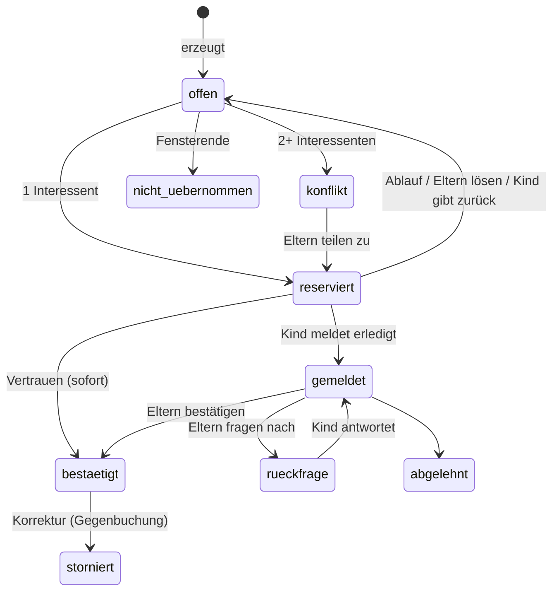
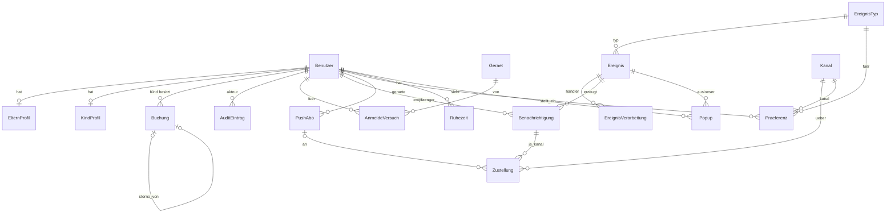
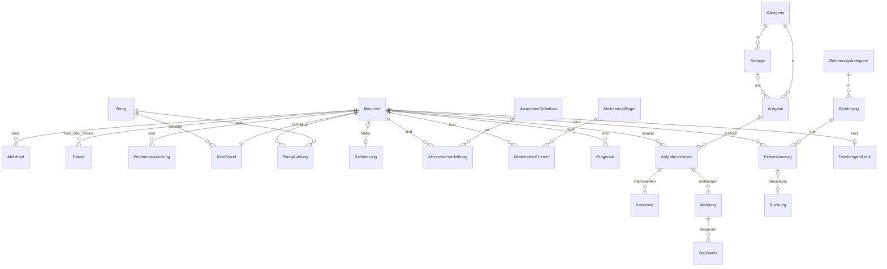
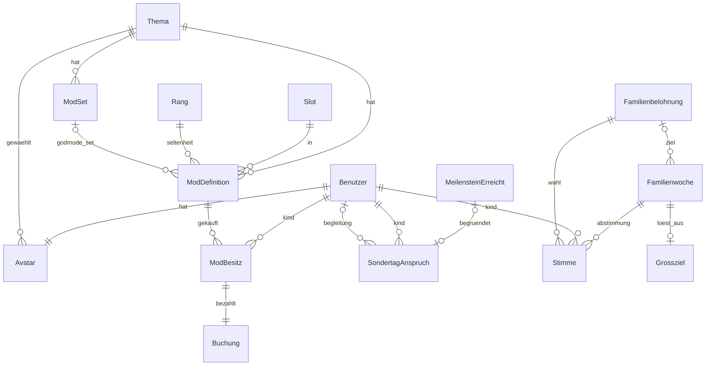

# FamKo: Datenmodell

- **Stand:** 23.10.2026
- **Bezug:** `docs/ARCHITECTURE.md` (Abschnitte und [K]-Punkte), `docs/SPEC.md`
- **Umfang:** 57 Modelle in 11 Apps (Phase 1–3). `oberflaeche` und `einrichtung` haben keine eigenen Modelle.

## 0. Konventionen

- **Primärschlüssel:** `id` BigAutoField, außer anders angegeben.
- **Zeit:** `DateTimeField` immer UTC (aware). Fachliche Tage als `DateField` in Europe/Berlin. ISO-Wochen als Paar `iso_jahr` (smallint) + `iso_woche` (smallint 1–53).
- **Pflicht:** `ja` = NOT NULL ohne Leerwert. `nein` = `null=True` bzw. `blank=True`.
- **FK-Löschverhalten:** `PROTECT` für alles, was Ledger, Audit oder Historie betrifft. Benutzer werden **deaktiviert**, nie gelöscht.
- **Enums:** Django `TextChoices`, als `varchar` gespeichert.
- **Snapshots:** Werte, die sich später ändern dürfen (Punkte, Preis, Zielwert), werden beim Entstehen in die Instanz kopiert (`*_snapshot`). Regeländerungen wirken nur nach vorn.
- **Idempotenz-Schlüssel:** jede maschinell erzeugte Zeile hat einen fachlichen Unique-Constraint (in den Tabellen mit **IDEM** markiert).
- **Insert-only:** `punkte.Buchung`, `kern.AuditEintrag`. Durchgesetzt durch Model-`save()`/`delete()`-Sperre, QuerySet-Sperre und SQLite-Trigger (`BEFORE UPDATE/DELETE -> RAISE(ABORT)`).
- **Kind/Eltern:** FK auf `konten.Benutzer` mit `limit_choices_to` auf die Rolle; Service prüft die Rolle zusätzlich.

---

## 1. `kern`

### 1.1 Einstellung

Typisierter Schlüssel-Wert-Speicher. Definition (Schlüssel, Typ, Validierung, Bezeichnung, Gruppe) liegt in der Registry im Code; **der Wert liegt nur hier** (Seed per Datenmigration).

| Feld | Typ | Pflicht | Constraints / Index |
|---|---|---|---|
| schluessel | varchar(100) | ja | **PK**, z. B. `aufgaben.reservierung_stunden` |
| wert | JSON | ja | gegen Registry-Typ validiert |
| modul | varchar(40) | ja | Index |
| geaendert_von | FK Benutzer | nein | PROTECT |
| geaendert_am | datetime | ja | auto |

### 1.2 AuditEintrag (insert-only)

| Feld | Typ | Pflicht | Constraints / Index |
|---|---|---|---|
| zeit | datetime | ja | Index |
| akteur | FK Benutzer | nein | PROTECT; NULL = System/Job |
| akteur_name | varchar(80) | ja | Snapshot der Namensangabe |
| rolle | enum eltern/kind/system | ja | |
| aktion | varchar(80) | ja | z. B. `aufgabe.bestaetigt`, `pause.gesetzt`, `einstellung.geaendert`; Index |
| objekt_typ | varchar(60) | nein | |
| objekt_id | varchar(40) | nein | Index (objekt_typ, objekt_id) |
| kind | FK Benutzer | nein | Index; betroffenes Kind |
| details | JSON | ja | Default `{}`; **nie** Nachweis-Inhalte |
| geraet | FK konten.Geraet | nein | SET_NULL |

### 1.3 JobSperre

| Feld | Typ | Pflicht | Constraints / Index |
|---|---|---|---|
| name | varchar(60) | ja | **PK** |
| inhaber | varchar(80) | ja | Host + PID |
| gehalten_bis | datetime | ja | Lease; abgelaufen = frei |

### 1.4 JobLauf

| Feld | Typ | Pflicht | Constraints / Index |
|---|---|---|---|
| name | varchar(60) | ja | Index (name, gestartet_am) |
| gestartet_am | datetime | ja | |
| beendet_am | datetime | nein | |
| status | enum laeuft/ok/fehler/uebersprungen | ja | |
| info | JSON | ja | Zähler (erzeugt, abgelaufen, ...), Fehlertext |

---

## 2. `konten`

### 2.1 Benutzer (`AUTH_USER_MODEL`)

| Feld | Typ | Pflicht | Constraints / Index |
|---|---|---|---|
| id | UUID | ja | **PK** |
| rolle | enum eltern/kind | ja | Index |
| anzeigename | varchar(40) | ja | unique (case-insensitive, `Lower`) |
| reihenfolge | smallint | ja | Default 0 |
| akzentfarben | JSON | ja | Liste Hex-Farben; Default `[]` |
| aktiv | bool | ja | Default true |
| erstellt_am | datetime | ja | |
| password | varchar | ja | **unbrauchbar** gesetzt (`set_unusable_password`); Eltern nutzen ElternZugang, Kinder PIN |
| last_login | datetime | nein | Django |

### 2.2 ElternProfil

| Feld | Typ | Pflicht | Constraints / Index |
|---|---|---|---|
| benutzer | 1:1 Benutzer | ja | PK, CASCADE |
| rolle_label | enum mama/papa/andere | ja | für Sondertag-Begleitung "Mama/Papa"; unique wenn ≠ andere |
| email | email | nein | Empfänger für E-Mail-Kanal |

### 2.3 KindProfil

| Feld | Typ | Pflicht | Constraints / Index |
|---|---|---|---|
| benutzer | 1:1 Benutzer | ja | PK, CASCADE |
| pin_hash | varchar(255) | ja | Argon2 |
| pin_gesperrt_bis | datetime | nein | Rate-Limit |
| pin_sperrstufe | smallint | ja | Default 0; Eskalation |
| pin_fehlversuche | smallint | ja | Default 0; Reset bei Erfolg |

### 2.4 ElternZugang (Singleton)

| Feld | Typ | Pflicht | Constraints / Index |
|---|---|---|---|
| id | smallint | ja | PK, CHECK id = 1 |
| passwort_hash | varchar(255) | ja | Argon2 |
| geaendert_am | datetime | ja | |
| geaendert_von | FK Benutzer | nein | PROTECT |

### 2.5 Geraet

| Feld | Typ | Pflicht | Constraints / Index |
|---|---|---|---|
| id | UUID | ja | PK; im signierten Cookie |
| bezeichnung | varchar(60) | ja | "Flur-Tablet" |
| typ | enum kiosk/persoenlich | ja | |
| registriert_von | FK Benutzer | ja | PROTECT |
| registriert_am | datetime | ja | |
| zuletzt_gesehen | datetime | nein | |
| aktiv | bool | ja | Widerruf = false |

### 2.6 AnmeldeVersuch

| Feld | Typ | Pflicht | Constraints / Index |
|---|---|---|---|
| zeit | datetime | ja | Index |
| art | enum eltern/kind | ja | |
| benutzer | FK Benutzer | nein | gewähltes Konto; Index (benutzer, zeit) |
| ip | inet (GenericIPAddress) | nein | Index (ip, zeit) |
| geraet | FK Geraet | nein | SET_NULL |
| erfolgreich | bool | ja | |

- Aufbewahrung 30 Tage (Job `aufraeumen`).

---

## 3. `punkte`

### 3.1 Buchung (insert-only Ledger)

| Feld | Typ | Pflicht | Constraints / Index |
|---|---|---|---|
| kind | FK Benutzer | ja | PROTECT; Index (kind, gebucht_am) |
| gebucht_am | datetime | ja | Systemzeit |
| bezugsdatum | date | ja | fachlicher Tag (Meldedatum, Berlin) für Wochen-/Familienziel-Zuordnung; Index (bezugsdatum) |
| art | enum | ja | `aufgabe`, `serienbonus`, `sonderpunkte`, `einloesung`, `modkauf`, `korrektur`, `storno`, `modul` |
| guthaben_delta | int | ja | |
| xp_delta | int | ja | CHECK: `xp_delta >= 0` außer art in (korrektur, storno) |
| idempotenz_schluessel | varchar(120) | ja | **unique** (IDEM), z. B. `aufgabe:<instanz>:basis`, `aufgabe:<instanz>:serienbonus`, `antrag:<id>`, `modkauf:<besitz>`, `storno:<buchung>` |
| storno_von | FK self | nein | **unique** (eine Buchung nur einmal storniert) |
| quelle_modul | varchar(40) | ja | `aufgaben`, `belohnung`, `avatar`, später `lernen` |
| referenz_typ | varchar(60) | nein | |
| referenz_id | varchar(40) | nein | Index (referenz_typ, referenz_id) |
| begruendung | varchar(200) | nein | Pflicht bei sonderpunkte/korrektur (Service) |
| erstellt_von | FK Benutzer | nein | PROTECT; NULL = System |

- **Salden:** `guthaben = SUM(guthaben_delta)`, `xp = SUM(xp_delta)` je Kind. Kein gespeicherter Saldo (Datenmenge klein: ~3 Kinder x ~30 Buchungen/Woche).
- **Verfügbar zum Beantragen** = Guthaben − Summe offener Einlöseanträge (`belohnung`) − ggf. reservierte Mod-Käufe (sofort gebucht, daher 0).
- **Invarianten:** Guthaben ≥ 0 nach jeder Ausgabe (Service prüft in IMMEDIATE-Transaktion).

---

## 4. `ereignisse`

### 4.1 EreignisTyp

| Feld | Typ | Pflicht | Constraints / Index |
|---|---|---|---|
| slug | varchar(80) | ja | **PK**, z. B. `aufgabe.gemeldet` |
| modul | varchar(40) | ja | |
| bezeichnung | varchar(120) | ja | editierbar |
| zielgruppe | enum eltern/kind/beide/intern | ja | |
| standard_kanaele | JSON | ja | z. B. `["push","email"]`; Seed für Präferenzen |
| deep_link_muster | varchar(200) | nein | z. B. `/eltern/meldung/{instanz}/` |
| push_ttl_sekunden | int | ja | Default 86400 |
| aktiv | bool | ja | |

- Code-Definition in `events.py`, Sync bei `post_migrate` (neue Typen anlegen, bestehende Bezeichnungen nicht überschreiben).

### 4.2 Ereignis (Outbox)

| Feld | Typ | Pflicht | Constraints / Index |
|---|---|---|---|
| typ | FK EreignisTyp | ja | PROTECT; Index (typ, zeit) |
| zeit | datetime | ja | |
| akteur | FK Benutzer | nein | PROTECT |
| kind | FK Benutzer | nein | betroffenes Kind; Index |
| daten | JSON | ja | IDs + Anzeigetexte, keine Nachweis-Inhalte |
| schluessel | varchar(150) | nein | **unique wenn nicht NULL** (IDEM), z. B. `reservierung.erinnerung:<interesse>` |
| verteilt | bool | ja | Default false; Teil-Index `WHERE verteilt = false` für den Worker |

- `max(id)` dient als Live-Version für das Polling.

### 4.3 EreignisVerarbeitung

| Feld | Typ | Pflicht | Constraints / Index |
|---|---|---|---|
| ereignis | FK Ereignis | ja | CASCADE |
| handler | varchar(100) | ja | `modul.funktion` |
| status | enum offen/ok/fehler/aufgegeben | ja | Index (status, naechster_versuch) |
| versuche | smallint | ja | |
| naechster_versuch | datetime | nein | Backoff |
| letzter_fehler | text | nein | |
| erledigt_am | datetime | nein | |

- **unique(ereignis, handler)** (IDEM).

---

## 5. `benachrichtigung`

### 5.1 SmtpKonto (Singleton)

| Feld | Typ | Pflicht | Constraints / Index |
|---|---|---|---|
| id | smallint | ja | PK, CHECK id = 1 |
| host | varchar(200) | ja | |
| port | int | ja | |
| sicherheit | enum starttls/ssl/keine | ja | |
| benutzername | varchar(200) | ja | |
| passwort_verschluesselt | text | ja | Fernet, Schlüssel in `/data/secrets` |
| absender | email | ja | |
| zuletzt_getestet_am | datetime | nein | Testmail im Assistenten |

### 5.2 Kanal

| Feld | Typ | Pflicht | Constraints / Index |
|---|---|---|---|
| slug | varchar(30) | ja | **PK**: `email`, `push`, `popup`; später `homeassistant`, `kiosk` |
| bezeichnung | varchar(60) | ja | |
| aktiv | bool | ja | global abschaltbar |
| konfig | JSON | ja | kanalspezifisch (z. B. HA-URL), Secrets nur verschlüsselt |

### 5.3 Praeferenz

| Feld | Typ | Pflicht | Constraints / Index |
|---|---|---|---|
| benutzer | FK Benutzer | ja | CASCADE |
| ereignistyp | FK EreignisTyp | ja | CASCADE |
| kanal | FK Kanal | ja | CASCADE |
| aktiv | bool | ja | |

- **unique(benutzer, ereignistyp, kanal)**. Fehlende Zeile = Standard aus `EreignisTyp.standard_kanaele` (Zeilen werden beim Anlegen eines Benutzers/Typs per Seed erzeugt).

### 5.4 Ruhezeit

| Feld | Typ | Pflicht | Constraints / Index |
|---|---|---|---|
| benutzer | FK Benutzer | ja | CASCADE; Index |
| von | time | ja | |
| bis | time | ja | `bis < von` = über Mitternacht |
| wochentage | smallint | ja | Bitmaske Mo=1 … So=64 |
| gilt_fuer_email | bool | ja | Default false ([K7]) |
| aktiv | bool | ja | |

### 5.5 Benachrichtigung (Dashboard-Liste)

| Feld | Typ | Pflicht | Constraints / Index |
|---|---|---|---|
| empfaenger | FK Benutzer | ja | CASCADE; Index (empfaenger, gelesen_am) |
| ereignis | FK Ereignis | ja | PROTECT |
| titel | varchar(120) | ja | |
| text | varchar(400) | ja | |
| link | varchar(200) | nein | Deep Link |
| erstellt_am | datetime | ja | |
| gelesen_am | datetime | nein | NULL = ungelesen (Zähler) |

- **unique(empfaenger, ereignis)** (IDEM).

### 5.6 Zustellung

| Feld | Typ | Pflicht | Constraints / Index |
|---|---|---|---|
| benachrichtigung | FK Benachrichtigung | ja | CASCADE |
| kanal | FK Kanal | ja | PROTECT |
| push_abo | FK PushAbo | nein | SET_NULL; nur Kanal push |
| status | enum offen/gesendet/unterdrueckt_ruhezeit/unterdrueckt_praeferenz/fehler/aufgegeben | ja | Index (status, naechster_versuch) |
| versuche | smallint | ja | |
| naechster_versuch | datetime | nein | |
| gesendet_am | datetime | nein | |
| fehler | text | nein | |

- **unique(benachrichtigung, kanal, push_abo)** (IDEM; für E-Mail/Pop-up ist `push_abo` NULL -> zusätzlicher Teil-Unique `(benachrichtigung, kanal) WHERE push_abo IS NULL`).

### 5.7 PushAbo

| Feld | Typ | Pflicht | Constraints / Index |
|---|---|---|---|
| benutzer | FK Benutzer | ja | CASCADE; Index |
| geraet | FK konten.Geraet | nein | SET_NULL |
| endpoint | text | ja | opak, nicht parsen |
| endpoint_hash | char(64) | ja | **unique** (SHA-256 des Endpoints, Dedupe) |
| p256dh | varchar(200) | ja | |
| auth | varchar(100) | ja | |
| bezeichnung | varchar(60) | nein | "iPhone Leon" |
| user_agent | varchar(300) | nein | |
| erstellt_am | datetime | ja | |
| zuletzt_ok | datetime | nein | |
| fehlerzaehler | smallint | ja | |
| aktiv | bool | ja | 404/410 -> false |

- VAPID-Schlüssel liegen als Datei in `/data/secrets`, nicht in der DB.

### 5.8 Popup

| Feld | Typ | Pflicht | Constraints / Index |
|---|---|---|---|
| benutzer | FK Benutzer | ja | CASCADE; Index (benutzer, gesehen_am) |
| art | enum rang/abzeichen/sondertag/familienziel/mod_fertig/info | ja | |
| ereignis | FK Ereignis | ja | PROTECT |
| daten | JSON | ja | Grafik-Referenz, Texte |
| erstellt_am | datetime | ja | |
| gesehen_am | datetime | nein | |

- **unique(benutzer, ereignis, art)** (IDEM).

---

## 6. `spielregeln`

### 6.1 Rang (Konfigurationstabelle)

| Feld | Typ | Pflicht | Constraints / Index |
|---|---|---|---|
| stufe | smallint | ja | **unique**, 1–6 (weitere möglich) |
| schluessel | slug | ja | unique: `common` … `godmode` |
| name | varchar(40) | ja | umbenennbar |
| xp_schwelle | int | ja | CHECK ≥ 0 |
| min_aktive_wochen | smallint | ja | CHECK ≥ 0 |
| mod_preis | int | ja | Standardpreis je Mod dieser Seltenheit |
| bauzeit_stunden | int | ja | Standard-Bauzeit |
| farbe | varchar(7) | ja | Seltenheitsfarbe |
| ist_endstufe | bool | ja | God Mode; genau eine (Teil-Unique) |

- CHECK über Service: Schwellen und Mindestwochen monoton steigend mit der Stufe.

### 6.2 Kalibrierung

| Feld | Typ | Pflicht | Constraints / Index |
|---|---|---|---|
| kind | 1:1 Benutzer | nein | **NULL = global** (unique, eine globale Zeile) |
| faktor_schwelle | decimal(4,2) | ja | Default 1.00, CHECK 0.25–4.00 |
| faktor_preis | decimal(4,2) | ja | Default 1.00 |
| faktor_bauzeit | decimal(4,2) | ja | Default 1.00 |
| notiz | varchar(200) | nein | |
| geaendert_von | FK Benutzer | nein | |
| geaendert_am | datetime | ja | |

- Wirksamer Faktor = global x Kind ([K3]).

### 6.3 Pause

| Feld | Typ | Pflicht | Constraints / Index |
|---|---|---|---|
| kind | FK Benutzer | nein | NULL = ganze Familie; Index (kind, von, bis) |
| von | date | ja | |
| bis | date | nein | NULL = offen; CHECK `bis >= von` |
| grund | varchar(120) | nein | |
| quelle | enum eltern/hausautomation | ja | |
| erstellt_von | FK Benutzer | nein | PROTECT |
| erstellt_am | datetime | ja | |

- Überlappende Pausen desselben Kindes erlaubt (Vereinigung zählt). Jede Änderung -> Audit.

### 6.4 Aktivitaet

| Feld | Typ | Pflicht | Constraints / Index |
|---|---|---|---|
| kind | FK Benutzer | ja | PROTECT; Index (kind, datum) |
| datum | date | ja | Bezugsdatum (Meldedatum, Berlin) |
| modul | varchar(40) | ja | `aufgaben`, später `lernen` |
| referenz | varchar(60) | ja | z. B. Instanz-ID |
| storniert | bool | ja | Default false |
| erstellt_am | datetime | ja | |

- **unique(modul, referenz)** (IDEM).

### 6.5 Wochenauswertung

| Feld | Typ | Pflicht | Constraints / Index |
|---|---|---|---|
| kind | FK Benutzer | ja | PROTECT |
| iso_jahr | smallint | ja | |
| iso_woche | smallint | ja | CHECK 1–53 |
| montag | date | ja | Index |
| aktiv | bool | ja | |
| neutral | bool | ja | Pause-bedingt |
| pausentage | smallint | ja | |
| xp_woche | int | ja | |
| wochenserie_danach | smallint | ja | |
| aktive_wochen_gesamt | int | ja | |
| zuwachs_relativ | decimal(6,3) | nein | Held der Woche |
| held_der_woche | bool | ja | |
| finalisiert_am | datetime | nein | NULL = vorläufig (vor Puffer) |

- **unique(kind, iso_jahr, iso_woche)** (IDEM).

### 6.6 KindStand (Cache, neu berechenbar)

| Feld | Typ | Pflicht | Constraints / Index |
|---|---|---|---|
| kind | 1:1 Benutzer | ja | PK |
| rang | FK Rang | ja | PROTECT; höchster erreichter |
| wochenserie | smallint | ja | Stand letzte finalisierte Woche |
| tagesserie | smallint | ja | |
| rekord_tagesserie | smallint | ja | |
| rekord_wochenserie | smallint | ja | |
| aktive_wochen_gesamt | int | ja | |
| godmode_seit_aktivwochen | int | nein | Zähler für 26-Wochen-Zyklus |
| aktualisiert_am | datetime | ja | |

### 6.7 RangAufstieg

| Feld | Typ | Pflicht | Constraints / Index |
|---|---|---|---|
| kind | FK Benutzer | ja | PROTECT |
| rang | FK Rang | ja | PROTECT |
| erreicht_am | datetime | ja | |
| xp_bei_aufstieg | int | ja | Snapshot |
| aktive_wochen_bei_aufstieg | int | ja | Snapshot |

- **unique(kind, rang)** (IDEM).

### 6.8 AbzeichenDefinition

| Feld | Typ | Pflicht | Constraints / Index |
|---|---|---|---|
| schluessel | slug | ja | **unique**, z. B. `tagesserie-7` |
| name | varchar(60) | ja | |
| beschreibung | varchar(200) | ja | |
| symbol | varchar(100) | ja | Asset-Referenz oder SVG-Key |
| metrik | varchar(60) | ja | Registry-Schlüssel: `tagesserie`, `wochenserie`, `quartal_voll_aktiv`, `rang_erreicht`, später Modul-Metriken |
| schwelle | int | nein | z. B. 7 |
| wiederholbar_je | enum einmalig/quartal/rang | ja | |
| modul | varchar(40) | ja | |
| reihenfolge | smallint | ja | |
| aktiv | bool | ja | |

### 6.9 AbzeichenVerleihung

| Feld | Typ | Pflicht | Constraints / Index |
|---|---|---|---|
| kind | FK Benutzer | ja | PROTECT |
| abzeichen | FK AbzeichenDefinition | ja | PROTECT |
| bereich | varchar(30) | ja | `""`, `2027-Q1`, `rang-3` |
| verliehen_am | datetime | ja | |

- **unique(kind, abzeichen, bereich)** (IDEM).

### 6.10 MeilensteinRegel

| Feld | Typ | Pflicht | Constraints / Index |
|---|---|---|---|
| schluessel | slug | ja | **unique**: `sondertag-ausbaustufe`, `sondertag-godmode-zyklus` |
| name | varchar(80) | ja | |
| metrik | varchar(60) | ja | `ausbaustufe_voll`, `godmode_aktivwochen` |
| bedingung | JSON | ja | z. B. `{"seltenheit_in":[2,3,4,5]}`, `{"alle_n_aktivwochen":26}` |
| belohnungsart | varchar(40) | ja | `sondertag`, `modset`; Module registrieren Handler |
| wiederholbar_je | enum einmalig/bereich | ja | |
| modul | varchar(40) | ja | |
| aktiv | bool | ja | |

### 6.11 MeilensteinErreicht

| Feld | Typ | Pflicht | Constraints / Index |
|---|---|---|---|
| kind | FK Benutzer | ja | PROTECT |
| regel | FK MeilensteinRegel | ja | PROTECT |
| bereich | varchar(30) | ja | `seltenheit-3`, `zyklus-2` |
| erreicht_am | datetime | ja | |
| ereignis | FK ereignisse.Ereignis | nein | SET_NULL |

- **unique(kind, regel, bereich)** (IDEM). Garantiert "je Rang einmal", auch nach Themenwechsel.

### 6.12 Prognose

| Feld | Typ | Pflicht | Constraints / Index |
|---|---|---|---|
| kind | FK Benutzer | ja | CASCADE |
| iso_jahr | smallint | ja | |
| iso_woche | smallint | ja | |
| berechnet_am | datetime | ja | |
| xp_schnitt | decimal(7,1) | ja | |
| aktivquote | decimal(4,3) | ja | |
| eta_naechster_rang | date | nein | |
| eta_naechster_sondertag | date | nein | |
| sondertage_appjahr_prognose | decimal(3,1) | ja | |
| vorschlag_faktor | decimal(4,2) | nein | |

- **unique(kind, iso_jahr, iso_woche)** (IDEM, Upsert).

---

## 7. `aufgaben`

### 7.1 Kategorie

| Feld | Typ | Pflicht | Constraints / Index |
|---|---|---|---|
| name | varchar(40) | ja | unique |
| symbol | varchar(60) | ja | Icon-Key |
| farbe | varchar(7) | nein | |
| systemschluessel | slug | nein | unique wenn gesetzt; `schule` = Brücke zu `lernen` |
| reihenfolge | smallint | ja | |
| aktiv | bool | ja | |

### 7.2 Vorlage (Aufgabenbibliothek)

| Feld | Typ | Pflicht | Constraints / Index |
|---|---|---|---|
| titel | varchar(80) | ja | |
| beschreibung | text | nein | |
| punkte | int | ja | CHECK > 0 |
| freigabeart | enum vertrauen/eltern/nachweis | ja | |
| kategorie | FK Kategorie | nein | PROTECT |
| wiederholung | JSON | nein | gleiche Struktur wie Aufgabe (vorbefüllt) |
| aktiv | bool | ja | |

### 7.3 Aufgabe (Definition + Plan)

| Feld | Typ | Pflicht | Constraints / Index |
|---|---|---|---|
| titel | varchar(80) | ja | |
| punkte | int | ja | CHECK > 0 |
| beschreibung | text | nein | |
| freigabeart | enum vertrauen/eltern/nachweis | ja | Default eltern |
| kategorie | FK Kategorie | nein | PROTECT |
| vorlage | FK Vorlage | nein | SET_NULL |
| zugewiesen_an | FK Benutzer (Kind) | nein | nur dieses Kind sieht sie |
| status | enum aktiv/pausiert/beendet | ja | Index |
| wiederholungsart | enum einmalig/woechentlich/intervall | ja | Default einmalig |
| wochentage | smallint | nein | Bitmaske, Pflicht bei woechentlich |
| intervall_tage | smallint | nein | Pflicht bei intervall, CHECK ≥ 1 |
| start_datum | date | nein | Default heute |
| end_datum | date | nein | CHECK ≥ start |
| fenster_von | time | nein | Zeitfenster-Beginn am Fälligkeitstag |
| fenster_bis | time | nein | Frist/Fensterende; gesetzt = "zeitgebunden" |
| fenster_tage | smallint | nein | Fenster über mehrere Tage (z. B. Mi 18:00 bis Do 07:00 = 1) |
| limit_anzahl | smallint | nein | z. B. 1 |
| limit_zeitraum | enum tag/woche/monat | nein | Paar mit limit_anzahl; je Kind ([K10]) |
| sonderpunkte_deckel_prozent | smallint | nein | NULL = globaler Wert |
| erstellt_von | FK Benutzer | ja | PROTECT |
| erstellt_am / geaendert_am | datetime | ja | |

### 7.4 AufgabenInstanz

| Feld | Typ | Pflicht | Constraints / Index |
|---|---|---|---|
| aufgabe | FK Aufgabe | ja | PROTECT |
| faellig_am | date | nein | NULL bei ungebundener/einmaliger ohne Termin |
| fenster_start | datetime | nein | |
| fenster_ende | datetime | nein | Index (status, fenster_ende) für Verfall |
| titel_snapshot | varchar(80) | ja | |
| punkte_snapshot | int | ja | |
| freigabeart_snapshot | enum | ja | |
| status | enum | ja | `offen`, `konflikt`, `reserviert`, `gemeldet`, `rueckfrage`, `bestaetigt`, `abgelehnt`, `nicht_uebernommen`, `storniert`; Index |
| kind | FK Benutzer | nein | aktueller Inhaber (reserviert ab); Index (kind, status) |
| reserviert_bis | datetime | nein | Index; Ablauf |
| erinnert_am | datetime | nein | Kind-Erinnerung gesendet |
| vorwarnung_am | datetime | nein | Eltern-Vorwarnung "nicht übernommen" |
| bestaetigt_am | datetime | nein | |
| bestaetigt_von | FK Benutzer | nein | PROTECT |
| sortierung | int | ja | Drag-and-Drop-Reihenfolge |
| erzeugt_am | datetime | ja | |

- **IDEM 1:** `unique(aufgabe, faellig_am) WHERE faellig_am IS NOT NULL`.
- **IDEM 2 (kein Stapel):** `unique(aufgabe) WHERE faellig_am IS NULL AND status IN (offen, konflikt, reserviert, gemeldet, rueckfrage)`.
- Statusübergänge nur per bedingtem Update im Service.

### 7.5 Interesse

| Feld | Typ | Pflicht | Constraints / Index |
|---|---|---|---|
| instanz | FK AufgabenInstanz | ja | CASCADE |
| kind | FK Benutzer | ja | PROTECT |
| status | enum aktiv/zugeteilt/verdraengt/zurueckgezogen/abgelaufen | ja | |
| erstellt_am | datetime | ja | |
| entschieden_von | FK Benutzer | nein | Eltern bei Konflikt |

- **unique(instanz, kind) WHERE status IN (aktiv, zugeteilt)** (IDEM).

### 7.6 Meldung

| Feld | Typ | Pflicht | Constraints / Index |
|---|---|---|---|
| instanz | FK AufgabenInstanz | ja | CASCADE; Index |
| kind | FK Benutzer | ja | PROTECT |
| gemeldet_am | datetime | ja | bestimmt Bezugsdatum ([K1]) |
| text | text | nein | **wird bei Abschluss auf NULL gesetzt** |
| status | enum offen/bestaetigt/abgelehnt/rueckfrage | ja | |
| rueckfrage_text | varchar(300) | nein | Eltern-Text, wird bei Abschluss gelöscht |
| entschieden_von | FK Benutzer | nein | |
| entschieden_am | datetime | nein | |
| nachweis_geloescht_am | datetime | nein | Vermerk |

- **unique(instanz) WHERE status IN (offen, rueckfrage)** (eine offene Meldung je Instanz).

### 7.7 Nachweis (temporär)

| Feld | Typ | Pflicht | Constraints / Index |
|---|---|---|---|
| id | UUID | ja | PK = Dateiname |
| meldung | FK Meldung | ja | CASCADE |
| datei | varchar(200) | ja | relativer Pfad in `/data/media/nachweise/` |
| groesse_bytes | int | ja | |
| breite / hoehe | smallint | ja | |
| erstellt_am | datetime | ja | |

- Zeile + Datei werden bei Abschluss gelöscht. CHECK Service: max. 3 je Meldung.

---

## 8. `belohnung`

### 8.1 Belohnungskategorie

| Feld | Typ | Pflicht | Constraints / Index |
|---|---|---|---|
| name | varchar(40) | ja | unique |
| symbol | varchar(60) | ja | |
| systemschluessel | slug | nein | unique; `taschengeld` aktiviert Limit-Logik |
| reihenfolge | smallint | ja | |

### 8.2 Belohnung (Katalog)

| Feld | Typ | Pflicht | Constraints / Index |
|---|---|---|---|
| titel | varchar(80) | ja | |
| kategorie | FK Belohnungskategorie | ja | PROTECT |
| preis_punkte | int | ja | CHECK > 0 |
| geldwert_cent | int | nein | Pflicht bei Kategorie taschengeld |
| symbol | varchar(60) | nein | |
| aktiv | bool | ja | |
| reihenfolge | smallint | ja | |

### 8.3 Einloeseantrag

| Feld | Typ | Pflicht | Constraints / Index |
|---|---|---|---|
| kind | FK Benutzer | ja | PROTECT; Index (kind, status) |
| belohnung | FK Belohnung | ja | PROTECT |
| titel_snapshot | varchar(80) | ja | |
| preis_snapshot | int | ja | |
| geldwert_cent_snapshot | int | nein | |
| status | enum offen/bestaetigt/abgelehnt/zurueckgezogen | ja | |
| erstellt_am | datetime | ja | |
| entschieden_von | FK Benutzer | nein | |
| entschieden_am | datetime | nein | Monat für Taschengeld-Limit |
| ablehnungsgrund | varchar(200) | nein | |
| buchung | 1:1 punkte.Buchung | nein | gesetzt bei Bestätigung (Schlüssel `antrag:<id>`) |

- Service-Regeln (in IMMEDIATE-Transaktion): `preis <= guthaben − offene Anträge`; Taschengeld: `bestätigte (Monat) + offene + neu <= Limit`.

### 8.4 TaschengeldLimit

| Feld | Typ | Pflicht | Constraints / Index |
|---|---|---|---|
| kind | 1:1 Benutzer | ja | PK |
| monatslimit_cent | int | ja | CHECK ≥ 0; Seed aus Einstellung `belohnung.taschengeld_limit_cent` (1000) |

---

## 9. `avatar`

### 9.1 Thema

| Feld | Typ | Pflicht | Constraints / Index |
|---|---|---|---|
| schluessel | slug | ja | unique: `ritter`, …, `eltern` |
| name | varchar(40) | ja | |
| palette | JSON | ja | Farbtoken `p1…pn` |
| figur_varianten | JSON | ja | wählbare Basis-Figuren |
| bau_inszenierung | varchar(40) | ja | `schmiede`, `werkstatt`, … |
| nur_eltern | bool | ja | |
| aktiv | bool | ja | |
| reihenfolge | smallint | ja | |

### 9.2 Slot

| Feld | Typ | Pflicht | Constraints / Index |
|---|---|---|---|
| schluessel | slug | ja | unique: `kopf`, `koerper`, `ruecken`, `hand`, `begleiter`, `hintergrund` |
| name | varchar(40) | ja | |
| ebene | smallint | ja | unique; Render-Reihenfolge |

### 9.3 ModSet

| Feld | Typ | Pflicht | Constraints / Index |
|---|---|---|---|
| thema | FK Thema | ja | PROTECT |
| nummer | smallint | ja | 0 = Basis-God-Mode-Set, 1… = Zyklen |
| name | varchar(60) | ja | |

- **unique(thema, nummer)**.

### 9.4 ModDefinition

| Feld | Typ | Pflicht | Constraints / Index |
|---|---|---|---|
| thema | FK Thema | ja | PROTECT |
| slot | FK Slot | ja | PROTECT |
| seltenheit | FK spielregeln.Rang | ja | PROTECT |
| modset | FK ModSet | nein | nur God-Mode-Zyklen |
| name | varchar(60) | ja | |
| beschreibung | varchar(200) | nein | |
| preis | int | nein | NULL = `Rang.mod_preis` |
| bauzeit_stunden | int | nein | NULL = `Rang.bauzeit_stunden` |
| bauplan | JSON | ja | Teile + Palette + Transformationen |
| svg_override | text | nein | Whitelist-geprüft |
| aktiv | bool | ja | |

- **unique(thema, slot, seltenheit) WHERE modset IS NULL**; **unique(thema, slot, modset) WHERE modset IS NOT NULL**.

### 9.5 Avatar

| Feld | Typ | Pflicht | Constraints / Index |
|---|---|---|---|
| benutzer | 1:1 Benutzer | ja | PK |
| thema | FK Thema | ja | PROTECT |
| figur | JSON | ja | gewählte Variante, Hautton, Haar |
| angelegt | JSON | ja | `{slot: modbesitz_id}`; nur fertige Mods |
| render_hash | char(64) | nein | aktueller Cache-Schlüssel |
| thema_gewaehlt_am | datetime | ja | |

### 9.6 ModBesitz

| Feld | Typ | Pflicht | Constraints / Index |
|---|---|---|---|
| kind | FK Benutzer | ja | PROTECT; Index (kind, status) |
| mod | FK ModDefinition | ja | PROTECT |
| preis_bezahlt | int | ja | Snapshot |
| buchung | 1:1 punkte.Buchung | ja | Schlüssel `modkauf:<id>` |
| gekauft_am | datetime | ja | |
| fertig_geplant_am | datetime | ja | Kauf + Bauzeit x Faktor; Index für Job |
| fertig_am | datetime | nein | |
| zaehlt_ab_iso_jahr | smallint | nein | 1 zählender Mod je Woche |
| zaehlt_ab_iso_woche | smallint | nein | |
| status | enum im_bau/fertig/verloren | ja | |
| verloren_am | datetime | nein | Themenwechsel |

- **unique(kind, mod) WHERE status IN (im_bau, fertig)** (kein Doppelkauf).
- "Max. N zählende Mods je Woche" (`avatar.max_zaehlende_mods_woche`, Startwert 1) prüft der **Service**, nicht ein DB-Constraint: ein Constraint würde den Wert 1 hart codieren (Grundregel 0). Index (kind, zaehlt_ab_iso_jahr, zaehlt_ab_iso_woche).

### 9.7 RenderCache

| Feld | Typ | Pflicht | Constraints / Index |
|---|---|---|---|
| hash | char(64) | ja | **PK** |
| svg | text | ja | |
| erstellt_am | datetime | ja | |
| zuletzt_genutzt | datetime | ja | Aufräumen |

---

## 10. `sondertag`

### 10.1 SondertagAnspruch

| Feld | Typ | Pflicht | Constraints / Index |
|---|---|---|---|
| kind | FK Benutzer | ja | PROTECT; Index (kind, status) |
| meilenstein | 1:1 spielregeln.MeilensteinErreicht | nein | **unique** (IDEM); NULL nur bei manueller Historie |
| quelle | enum meilenstein/manuell | ja | |
| verdient_am | datetime | ja | |
| einloesbar_ab | date | nein | berechnet; neu bei jeder Annahme/Korrektur |
| status | enum verdient/einloesbar/wunsch_offen/angenommen/stattgefunden | ja | |
| wunsch | text | nein | |
| begleitung_wunsch | enum mama/papa/egal | nein | |
| wunsch_am | datetime | nein | |
| angenommen_von | FK Benutzer (Eltern) | nein | |
| begleitung | FK Benutzer (Eltern) | nein | Übergabe ändert nur dieses Feld (Audit) |
| annahme_datum | date | nein | **Bezugsdatum** für 150 Tage und App-Jahr; korrigierbar; Index (kind, annahme_datum) |
| stattgefunden_am | date | nein | optional |
| notiz | varchar(200) | nein | |

- Grenzen (Einstellungen): `sondertag.max_pro_appjahr` (2), `sondertag.mindestabstand_tage` (150). Service prüft bei Annahme: Anzahl `annahme_datum` im App-Jahr < max und Abstand zum vorherigen/nächsten ≥ Mindestabstand.
- Manuelle Historie (vor Go-live) = Anspruch mit `quelle = manuell`, `status = stattgefunden`; zählt für Abstand.
- **[A]** Ein Modell statt Anspruch/Wunsch/Sondertag getrennt: 1:1-Lebenszyklus, weniger Joins.

---

## 11. `familienziel`

### 11.1 Familienbelohnung

| Feld | Typ | Pflicht | Constraints / Index |
|---|---|---|---|
| titel | varchar(60) | ja | |
| symbol | varchar(60) | nein | |
| ist_grossziel | bool | ja | |
| aktiv | bool | ja | |
| reihenfolge | smallint | ja | |

### 11.2 Familienwoche

| Feld | Typ | Pflicht | Constraints / Index |
|---|---|---|---|
| iso_jahr | smallint | ja | |
| iso_woche | smallint | ja | |
| montag | date | ja | |
| ziel_punkte | int | ja | Snapshot aus Einstellung bei Wochenbeginn |
| belohnung | FK Familienbelohnung | nein | Ergebnis der Abstimmung |
| abstimmung_status | enum offen/geschlossen/gleichstand/eltern_entschieden | ja | betrifft Abstimmung **für** diese Woche |
| status | enum laufend/erreicht/verfehlt/neutral | ja | |
| erreicht_am | datetime | nein | bedingtes Update laufend -> erreicht |
| eingeloest_am | datetime | nein | Eltern haken Belohnung ab |
| finalisiert_am | datetime | nein | |

- **unique(iso_jahr, iso_woche)** (IDEM).

### 11.3 Stimme

| Feld | Typ | Pflicht | Constraints / Index |
|---|---|---|---|
| woche | FK Familienwoche | ja | CASCADE; Zielwoche |
| kind | FK Benutzer | ja | PROTECT |
| belohnung | FK Familienbelohnung | ja | PROTECT |
| abgegeben_am | datetime | ja | |

- **unique(woche, kind)** (änderbar bis Fensterende).

### 11.4 Grossziel

| Feld | Typ | Pflicht | Constraints / Index |
|---|---|---|---|
| ausloesende_woche | 1:1 Familienwoche | ja | **unique** (IDEM); letzte der 4 Wochen |
| belohnung | FK Familienbelohnung | nein | |
| freigeschaltet_am | datetime | ja | |
| eingeloest_am | datetime | nein | |

---

## 12. Modell-Übersicht

| App | Modelle | Anzahl |
|---|---|---|
| kern | Einstellung, AuditEintrag, JobSperre, JobLauf | 4 |
| konten | Benutzer, ElternProfil, KindProfil, ElternZugang, Geraet, AnmeldeVersuch | 6 |
| punkte | Buchung | 1 |
| ereignisse | EreignisTyp, Ereignis, EreignisVerarbeitung | 3 |
| benachrichtigung | SmtpKonto, Kanal, Praeferenz, Ruhezeit, Benachrichtigung, Zustellung, PushAbo, Popup | 8 |
| spielregeln | Rang, Kalibrierung, Pause, Aktivitaet, Wochenauswertung, KindStand, RangAufstieg, AbzeichenDefinition, AbzeichenVerleihung, MeilensteinRegel, MeilensteinErreicht, Prognose | 12 |
| aufgaben | Kategorie, Vorlage, Aufgabe, AufgabenInstanz, Interesse, Meldung, Nachweis | 7 |
| belohnung | Belohnungskategorie, Belohnung, Einloeseantrag, TaschengeldLimit | 4 |
| avatar | Thema, Slot, ModSet, ModDefinition, Avatar, ModBesitz, RenderCache | 7 |
| sondertag | SondertagAnspruch | 1 |
| familienziel | Familienbelohnung, Familienwoche, Stimme, Grossziel | 4 |
| **Summe** | | **57** |

---

## 13. ER-Diagramme

### 13.1 Kern, Punkte, Ereignisse, Benachrichtigungen

### 13.2 Spielregeln, Aufgaben, Belohnung

### 13.3 Avatar, Sondertag, Familienziel

---

## 14. Idempotenz-Schlüssel (Übersicht)

| Erzeugung | Schlüssel |
|---|---|
| Instanz terminierter Aufgabe | `unique(aufgabe, faellig_am)` |
| Instanz ungebundener Aufgabe | Teil-Unique: max. 1 offene je Aufgabe |
| Interesse | `unique(instanz, kind)` solange aktiv/zugeteilt |
| offene Meldung | Teil-Unique je Instanz |
| Ledger-Buchung | `unique(idempotenz_schluessel)`; Storno `unique(storno_von)` |
| Aktivität | `unique(modul, referenz)` |
| Wochenauswertung | `unique(kind, iso_jahr, iso_woche)` |
| Familienwoche | `unique(iso_jahr, iso_woche)` |
| Stimme | `unique(woche, kind)` |
| Großziel | `unique(ausloesende_woche)` |
| Rangaufstieg | `unique(kind, rang)` |
| Abzeichen | `unique(kind, abzeichen, bereich)` |
| Meilenstein | `unique(kind, regel, bereich)` |
| Sondertag-Anspruch | `unique(meilenstein)` |
| Prognose | `unique(kind, iso_jahr, iso_woche)` |
| Ereignis aus Job | `unique(schluessel)` |
| Handler-Ausführung | `unique(ereignis, handler)` |
| Benachrichtigung | `unique(empfaenger, ereignis)` |
| Zustellung | `unique(benachrichtigung, kanal, push_abo)` |
| Pop-up | `unique(benutzer, ereignis, art)` |
| Mod-Kauf | `unique(kind, mod)` solange im Bau/fertig |
| Push-Abo | `unique(endpoint_hash)` |
| Erinnerungen/Vorwarnungen | `erinnert_am`/`vorwarnung_am IS NULL` + Ereignis-Schlüssel |

---

## 15. Einstellungen und Konfigurationstabellen

### 15.1 Konfigurationstabellen (strukturierte Regeln, im Eltern-Dashboard gepflegt)

| Tabelle | Inhalt | Seed |
|---|---|---|
| `spielregeln.Rang` | Stufen, Namen, XP-Schwellen, Mindestwochen, Mod-Preise, Bauzeiten, Farben | SPEC 18.1 + O4 |
| `spielregeln.Kalibrierung` | Faktoren global/Kind | 1.00 |
| `spielregeln.AbzeichenDefinition` | Abzeichen-Regeln | SPEC 18.3 |
| `spielregeln.MeilensteinRegel` | Sondertag-Meilensteine | SPEC 18.7 |
| `aufgaben.Kategorie` | Kategorien + Symbole | SPEC 5.2 |
| `aufgaben.Vorlage` | Aufgabenbibliothek | SPEC 18.5 |
| `belohnung.Belohnungskategorie`, `.Belohnung` | Katalog | SPEC 18.4 |
| `belohnung.TaschengeldLimit` | je Kind | 1000 Cent |
| `familienziel.Familienbelohnung` | Familienbelohnungen + Großziele | SPEC 18.6 + "Ausflug" |
| `avatar.Thema`, `.Slot`, `.ModSet`, `.ModDefinition` | Themen, Slots, Mods | Generator-Fixtures |
| `ereignisse.EreignisTyp` | Bezeichnung, Zielgruppe, Standardkanäle | Code-Sync |
| `benachrichtigung.Kanal`, `.Praeferenz`, `.Ruhezeit` | Kanäle, Präferenzen je Elternteil | E24 |
| `benachrichtigung.SmtpKonto` | SMTP | Assistent |
| `konten.ElternZugang` | Eltern-Passwort | Assistent |

### 15.2 Einstellungen (`kern.Einstellung`, Schlüssel = Startwert)

**allgemein**
- `allgemein.anzeigename` = "FamKo"
- `allgemein.zeitzone` = "Europe/Berlin"
- `allgemein.go_live_datum` = (Assistent)
- `allgemein.sprache` = "de"
- `allgemein.einrichtung_abgeschlossen` = false

**konten**
- `konten.kind_pin_fehlversuche` = 5
- `konten.kind_pin_sperre_minuten` = 5
- `konten.kind_pin_sperre_max_minuten` = 60
- `konten.eltern_fehlversuche` = 10
- `konten.eltern_sperre_minuten` = 15
- `konten.sitzung_eltern_vertraut_tage` = 90
- `konten.sitzung_eltern_stunden` = 12
- `konten.sitzung_kind_persoenlich_tage` = 365
- `konten.kiosk_leerlauf_sekunden` = 300
- `konten.kiosk_warnung_sekunden` = 30
- `konten.kind_netze_cidr` = [] (leer = aus)

**aufgaben**
- `aufgaben.reservierung_stunden` = 48
- `aufgaben.erinnerung_kind_stunden_vorher` = 6
- `aufgaben.vorwarnung_eltern_stunden_vorher` = 3
- `aufgaben.instanz_horizont_tage` = 14
- `aufgaben.sonderpunkte_deckel_aktiv` = true
- `aufgaben.sonderpunkte_deckel_prozent` = 50
- `aufgaben.nachweis_max_upload_mb` = 15
- `aufgaben.nachweis_max_kante_px` = 1600
- `aufgaben.nachweis_max_anzahl` = 3
- `aufgaben.nachweis_sicherheitsnetz_tage` = 14

**spielregeln**
- `spielregeln.serienbonus_start` = 2
- `spielregeln.serienbonus_schritt_prozent` = 5
- `spielregeln.serienbonus_deckel_prozent` = 25
- `spielregeln.serienbonus_auf_sonderpunkte` = false
- `spielregeln.bezugsdatum` = "meldung" (oder "bestaetigung", [K1])
- `spielregeln.wochen_puffer_stunden` = 24
- `spielregeln.pause_neutral_ab_tagen` = 1
- `spielregeln.held_basis_wochen` = 4
- `spielregeln.held_mindestbasis_punkte` = 50
- `spielregeln.prognose_basis_wochen` = 6
- `spielregeln.prognose_annahme_punkte_woche` = 175
- `spielregeln.ziel_sondertage_jahr` = 2

**avatar**
- `avatar.max_zaehlende_mods_woche` = 1
- `avatar.godmode_zyklus_aktivwochen` = 26

**sondertag**
- `sondertag.max_pro_appjahr` = 2
- `sondertag.mindestabstand_tage` = 150
- `sondertag.wunsch_vor_einloesbar_erlaubt` = true

**belohnung**
- `belohnung.taschengeld_limit_cent` = 1000 (Standard für neue Kinder)

**familienziel**
- `familienziel.wochenziel_punkte` = 450
- `familienziel.grossziel_nach_wochen` = 4
- `familienziel.abstimmung_tag` = 7 (Sonntag)
- `familienziel.abstimmung_von` = "00:00"
- `familienziel.abstimmung_bis` = "23:59"
- `familienziel.xp_arten` = ["aufgabe","serienbonus","sonderpunkte","korrektur","storno"]

**oberflaeche**
- `oberflaeche.ranking_modus` = "showcase" (showcase/held/rohpunkte)
- `oberflaeche.poll_tablet_sekunden` = 10
- `oberflaeche.poll_geraet_sekunden` = 30
- `oberflaeche.tablet_reload_stunden` = 6
- `oberflaeche.kind_design` = "dunkel"

**benachrichtigung**
- `benachrichtigung.push_ttl_standard_sekunden` = 86400
- `benachrichtigung.zustellung_max_versuche` = 5
- `benachrichtigung.aufbewahrung_tage` = 90

**betrieb**
- `betrieb.backup_taeglich_behalten` = 14
- `betrieb.backup_woechentlich_behalten` = 8
- `betrieb.backup_monatlich_behalten` = 12

- **Nicht in der DB (bewusst):** Secrets (`SECRET_KEY`, VAPID, Fernet) in `/data/secrets`; Domain/Proxy-Header in `.env`. Begründung: werden vor DB-Zugriff gebraucht bzw. sind Infrastruktur.
