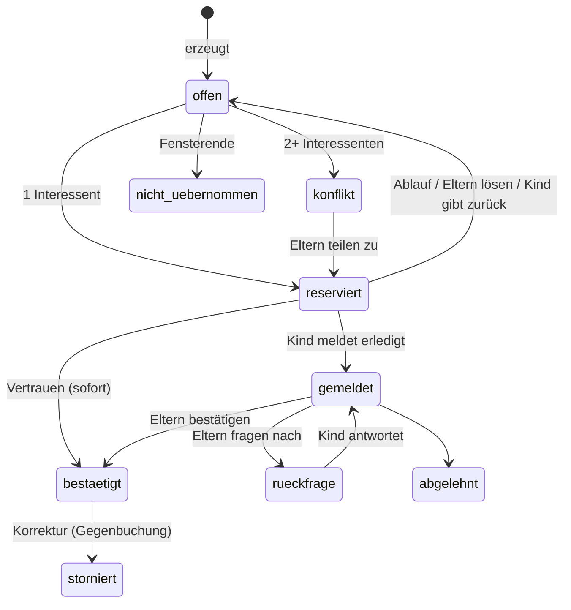
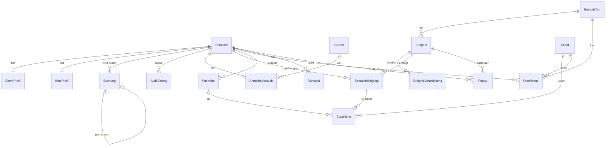
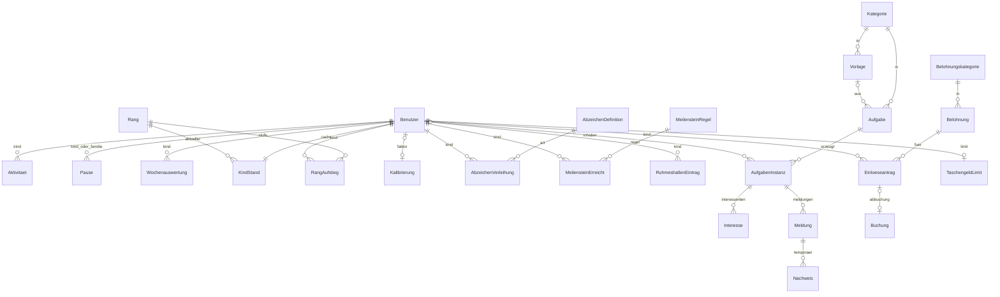
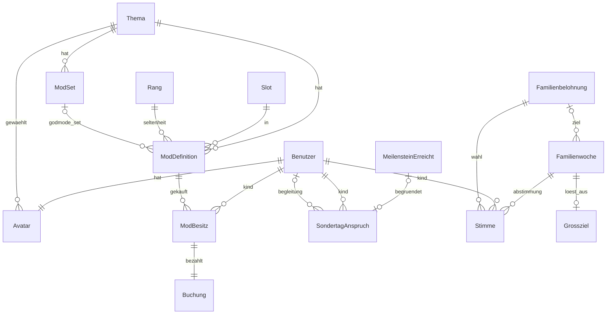

# Nestwerk: Datenmodell

- **Stand:** 24.10.2026 (Review AP31: Abschnitte 5.8, 6, 9–12, 14, 15.2 an den Code angeglichen)
- **Bezug:** `docs/ARCHITECTURE.md` (Abschnitte und [K]-Punkte), `docs/SPEC.md`
- **Umfang:** siehe Abschnitt 12 (Stand Code nach Phase 2). `oberflaeche` und `einrichtung` haben keine eigenen Modelle.

## 0. Konventionen

- **Primärschlüssel:** `id` BigAutoField, außer anders angegeben.
- **Zeit:** `DateTimeField` immer UTC (aware). Fachliche Tage als `DateField` in Europe/Berlin. ISO-Wochen als Paar `iso_jahr` (smallint) + `iso_woche` (smallint 1–53).
- **Pflicht:** `ja` = NOT NULL ohne Leerwert. `nein` = `null=True` bzw. `blank=True`.
- **FK-Löschverhalten:** `PROTECT` für alles, was Ledger, Audit oder Historie betrifft. Benutzer werden **deaktiviert**, nie gelöscht.
- **Enums:** Django `TextChoices`, als `varchar` gespeichert.
- **Snapshots:** Werte, die sich später ändern dürfen (Punkte, Preis, Zielwert), werden beim Entstehen in die Instanz kopiert (`*_snapshot`). Regeländerungen wirken nur nach vorn.
- **Idempotenz-Schlüssel:** jede maschinell erzeugte Zeile hat einen fachlichen Unique-Constraint (in den Tabellen mit **IDEM** markiert).
- **Insert-only:** `punkte.Buchung`, `kern.AuditEintrag`. Durchgesetzt durch Model-`save()`/`delete()`-Sperre, QuerySet-Sperre und SQLite-Trigger (`BEFORE UPDATE/DELETE -> RAISE(ABORT)`).
- **Kind/Eltern:** FK auf `konten.Benutzer` mit `limit_choices_to` auf die Rolle; Service prüft die Rolle zusätzlich.

---

## 1. `kern`

### 1.1 Einstellung

Typisierter Schlüssel-Wert-Speicher. Definition (Schlüssel, Typ, Validierung, Bezeichnung, Gruppe) liegt in der Registry im Code; **der Wert liegt nur hier** (Seed per Datenmigration).

| Feld | Typ | Pflicht | Constraints / Index |
|---|---|---|---|
| schluessel | varchar(100) | ja | **PK**, z. B. `aufgaben.reservierung_stunden` |
| wert | JSON | ja | gegen Registry-Typ validiert |
| modul | varchar(40) | ja | Index |
| geaendert_von | FK Benutzer | nein | PROTECT |
| geaendert_am | datetime | ja | auto |

### 1.2 AuditEintrag (insert-only)

| Feld | Typ | Pflicht | Constraints / Index |
|---|---|---|---|
| zeit | datetime | ja | Index |
| akteur | FK Benutzer | nein | PROTECT; NULL = System/Job |
| akteur_name | varchar(80) | ja | Snapshot der Namensangabe |
| rolle | enum eltern/kind/system | ja | |
| aktion | varchar(80) | ja | z. B. `aufgabe.bestaetigt`, `pause.gesetzt`, `einstellung.geaendert`; Index |
| objekt_typ | varchar(60) | nein | |
| objekt_id | varchar(40) | nein | Index (objekt_typ, objekt_id) |
| kind | FK Benutzer | nein | Index; betroffenes Kind |
| details | JSON | ja | Default `{}`; **nie** Nachweis-Inhalte |
| geraet | FK konten.Geraet | nein | SET_NULL |

### 1.3 JobSperre

| Feld | Typ | Pflicht | Constraints / Index |
|---|---|---|---|
| name | varchar(60) | ja | **PK** |
| inhaber | varchar(80) | ja | Host + PID |
| gehalten_bis | datetime | ja | Lease; abgelaufen = frei |

### 1.4 JobLauf

| Feld | Typ | Pflicht | Constraints / Index |
|---|---|---|---|
| name | varchar(60) | ja | Index (name, gestartet_am) |
| gestartet_am | datetime | ja | |
| beendet_am | datetime | nein | |
| status | enum laeuft/ok/fehler/uebersprungen | ja | |
| info | JSON | ja | Zähler (erzeugt, abgelaufen, ...), Fehlertext |

---

## 2. `konten`

### 2.1 Benutzer (`AUTH_USER_MODEL`)

| Feld | Typ | Pflicht | Constraints / Index |
|---|---|---|---|
| id | UUID | ja | **PK** |
| rolle | enum eltern/kind | ja | Index |
| anzeigename | varchar(40) | ja | unique (case-insensitive, `Lower`) |
| reihenfolge | smallint | ja | Default 0 |
| akzentfarben | JSON | ja | Liste Hex-Farben; Default `[]` |
| aktiv | bool | ja | Default true |
| erstellt_am | datetime | ja | |
| password | varchar | ja | **unbrauchbar** gesetzt (`set_unusable_password`); Eltern nutzen ElternZugang, Kinder PIN |
| last_login | datetime | nein | Django |

### 2.2 ElternProfil

| Feld | Typ | Pflicht | Constraints / Index |
|---|---|---|---|
| benutzer | 1:1 Benutzer | ja | PK, CASCADE |
| rolle_label | enum mama/papa/andere | ja | für Sondertag-Begleitung "Mama/Papa"; unique wenn ≠ andere |
| email | email | nein | Empfänger für E-Mail-Kanal |

### 2.3 KindProfil

| Feld | Typ | Pflicht | Constraints / Index |
|---|---|---|---|
| benutzer | 1:1 Benutzer | ja | PK, CASCADE |
| pin_hash | varchar(255) | ja | Argon2 |
| pin_gesperrt_bis | datetime | nein | Rate-Limit |
| pin_sperrstufe | smallint | ja | Default 0; Eskalation |
| pin_fehlversuche | smallint | ja | Default 0; Reset bei Erfolg |

### 2.4 ElternZugang (Singleton)

| Feld | Typ | Pflicht | Constraints / Index |
|---|---|---|---|
| id | smallint | ja | PK, CHECK id = 1 |
| passwort_hash | varchar(255) | ja | Argon2 |
| geaendert_am | datetime | ja | |
| geaendert_von | FK Benutzer | nein | PROTECT |

### 2.5 Geraet

| Feld | Typ | Pflicht | Constraints / Index |
|---|---|---|---|
| id | UUID | ja | PK; im signierten Cookie |
| bezeichnung | varchar(60) | ja | "Flur-Tablet" |
| typ | enum kiosk/persoenlich | ja | |
| registriert_von | FK Benutzer | ja | PROTECT |
| registriert_am | datetime | ja | |
| zuletzt_gesehen | datetime | nein | |
| aktiv | bool | ja | Widerruf = false |

### 2.6 AnmeldeVersuch

| Feld | Typ | Pflicht | Constraints / Index |
|---|---|---|---|
| zeit | datetime | ja | Index |
| art | enum eltern/kind | ja | |
| benutzer | FK Benutzer | nein | gewähltes Konto; Index (benutzer, zeit) |
| ip | inet (GenericIPAddress) | nein | Index (ip, zeit) |
| geraet | FK Geraet | nein | SET_NULL |
| erfolgreich | bool | ja | |

- Aufbewahrung 30 Tage (Job `aufraeumen`).

---

## 3. `punkte`

### 3.1 Buchung (insert-only Ledger)

| Feld | Typ | Pflicht | Constraints / Index |
|---|---|---|---|
| kind | FK Benutzer | ja | PROTECT; Index (kind, gebucht_am) |
| gebucht_am | datetime | ja | Systemzeit |
| bezugsdatum | date | ja | fachlicher Tag (Meldedatum, Berlin) für Wochen-/Familienziel-Zuordnung; Index (bezugsdatum) |
| art | enum | ja | `aufgabe`, `serienbonus`, `sonderpunkte`, `einloesung`, `modkauf`, `korrektur`, `storno`, `modul` |
| guthaben_delta | int | ja | |
| xp_delta | int | ja | CHECK: `xp_delta >= 0` außer art in (korrektur, storno) |
| idempotenz_schluessel | varchar(120) | ja | **unique** (IDEM), z. B. `aufgabe:<instanz>:basis`, `aufgabe:<instanz>:serienbonus`, `antrag:<id>`, `modkauf:<besitz>`, `storno:<buchung>` |
| storno_von | FK self | nein | **unique** (eine Buchung nur einmal storniert) |
| quelle_modul | varchar(40) | ja | `aufgaben`, `belohnung`, `avatar`, später `lernen` |
| referenz_typ | varchar(60) | nein | |
| referenz_id | varchar(40) | nein | Index (referenz_typ, referenz_id) |
| begruendung | varchar(200) | nein | Pflicht bei sonderpunkte/korrektur (Service) |
| erstellt_von | FK Benutzer | nein | PROTECT; NULL = System |

- **Salden:** `guthaben = SUM(guthaben_delta)`, `xp = SUM(xp_delta)` je Kind. Kein gespeicherter Saldo (Datenmenge klein: ~3 Kinder x ~30 Buchungen/Woche).
- **Verfügbar zum Beantragen** = Guthaben − Summe offener Einlöseanträge (`belohnung`) − ggf. reservierte Mod-Käufe (sofort gebucht, daher 0).
- **Invarianten:** Guthaben ≥ 0 nach jeder Ausgabe (Service prüft in IMMEDIATE-Transaktion).

---

## 4. `ereignisse`

### 4.1 EreignisTyp

| Feld | Typ | Pflicht | Constraints / Index |
|---|---|---|---|
| slug | varchar(80) | ja | **PK**, z. B. `aufgabe.gemeldet` |
| modul | varchar(40) | ja | |
| bezeichnung | varchar(120) | ja | editierbar |
| zielgruppe | enum eltern/kind/beide/intern | ja | |
| standard_kanaele | JSON | ja | z. B. `["push","email"]`; Seed für Präferenzen |
| deep_link_muster | varchar(200) | nein | z. B. `/eltern/meldung/{instanz}/` |
| push_ttl_sekunden | int | ja | Default 86400 |
| aktiv | bool | ja | |

- Code-Definition in `events.py`, Sync bei `post_migrate` (neue Typen anlegen, bestehende Bezeichnungen nicht überschreiben).

### 4.2 Ereignis (Outbox)

| Feld | Typ | Pflicht | Constraints / Index |
|---|---|---|---|
| typ | FK EreignisTyp | ja | PROTECT; Index (typ, zeit) |
| zeit | datetime | ja | |
| akteur | FK Benutzer | nein | PROTECT |
| kind | FK Benutzer | nein | betroffenes Kind; Index |
| daten | JSON | ja | IDs + Anzeigetexte, keine Nachweis-Inhalte |
| schluessel | varchar(150) | nein | **unique wenn nicht NULL** (IDEM), z. B. `reservierung.erinnerung:<interesse>` |
| verteilt | bool | ja | Default false; Teil-Index `WHERE verteilt = false` für den Worker |

- `max(id)` dient als Live-Version für das Polling.

### 4.3 EreignisVerarbeitung

| Feld | Typ | Pflicht | Constraints / Index |
|---|---|---|---|
| ereignis | FK Ereignis | ja | CASCADE |
| handler | varchar(100) | ja | `modul.funktion` |
| status | enum offen/ok/fehler/aufgegeben | ja | Index (status, naechster_versuch) |
| versuche | smallint | ja | |
| naechster_versuch | datetime | nein | Backoff |
| letzter_fehler | text | nein | |
| erledigt_am | datetime | nein | |

- **unique(ereignis, handler)** (IDEM).

---

## 5. `benachrichtigung`

### 5.1 SmtpKonto (Singleton)

| Feld | Typ | Pflicht | Constraints / Index |
|---|---|---|---|
| id | smallint | ja | PK, CHECK id = 1 |
| host | varchar(200) | ja | |
| port | int | ja | |
| sicherheit | enum starttls/ssl/keine | ja | |
| benutzername | varchar(200) | ja | |
| passwort_verschluesselt | text | ja | Fernet, Schlüssel in `/data/secrets` |
| absender | email | ja | |
| zuletzt_getestet_am | datetime | nein | Testmail im Assistenten |

### 5.2 Kanal

| Feld | Typ | Pflicht | Constraints / Index |
|---|---|---|---|
| slug | varchar(30) | ja | **PK**: `email`, `push`, `popup`; später `homeassistant`, `kiosk` |
| bezeichnung | varchar(60) | ja | |
| aktiv | bool | ja | global abschaltbar |
| konfig | JSON | ja | kanalspezifisch (z. B. HA-URL), Secrets nur verschlüsselt |

### 5.3 Praeferenz

| Feld | Typ | Pflicht | Constraints / Index |
|---|---|---|---|
| benutzer | FK Benutzer | ja | CASCADE |
| ereignistyp | FK EreignisTyp | ja | CASCADE |
| kanal | FK Kanal | ja | CASCADE |
| aktiv | bool | ja | |

- **unique(benutzer, ereignistyp, kanal)**. Fehlende Zeile = Standard aus `EreignisTyp.standard_kanaele` (Zeilen werden beim Anlegen eines Benutzers/Typs per Seed erzeugt).

### 5.4 Ruhezeit

| Feld | Typ | Pflicht | Constraints / Index |
|---|---|---|---|
| benutzer | FK Benutzer | ja | CASCADE; Index |
| von | time | ja | |
| bis | time | ja | `bis < von` = über Mitternacht |
| wochentage | smallint | ja | Bitmaske Mo=1 … So=64 |
| gilt_fuer_email | bool | ja | Default false ([K7]) |
| aktiv | bool | ja | |

### 5.5 Benachrichtigung (Dashboard-Liste)

| Feld | Typ | Pflicht | Constraints / Index |
|---|---|---|---|
| empfaenger | FK Benutzer | ja | CASCADE; Index (empfaenger, gelesen_am) |
| ereignis | FK Ereignis | ja | PROTECT |
| titel | varchar(120) | ja | |
| text | varchar(400) | ja | |
| link | varchar(200) | nein | Deep Link |
| erstellt_am | datetime | ja | |
| gelesen_am | datetime | nein | NULL = ungelesen (Zähler) |

- **unique(empfaenger, ereignis)** (IDEM).

### 5.6 Zustellung

| Feld | Typ | Pflicht | Constraints / Index |
|---|---|---|---|
| benachrichtigung | FK Benachrichtigung | ja | CASCADE |
| kanal | FK Kanal | ja | PROTECT |
| push_abo | FK PushAbo | nein | SET_NULL; nur Kanal push |
| status | enum offen/gesendet/unterdrueckt_ruhezeit/unterdrueckt_praeferenz/fehler/aufgegeben | ja | Index (status, naechster_versuch) |
| versuche | smallint | ja | |
| naechster_versuch | datetime | nein | |
| gesendet_am | datetime | nein | |
| fehler | text | nein | |

- **unique(benachrichtigung, kanal, push_abo)** (IDEM; für E-Mail/Pop-up ist `push_abo` NULL -> zusätzlicher Teil-Unique `(benachrichtigung, kanal) WHERE push_abo IS NULL`).

### 5.7 PushAbo

| Feld | Typ | Pflicht | Constraints / Index |
|---|---|---|---|
| benutzer | FK Benutzer | ja | CASCADE; Index |
| geraet | FK konten.Geraet | nein | SET_NULL |
| endpoint | text | ja | opak, nicht parsen |
| endpoint_hash | char(64) | ja | **unique** (SHA-256 des Endpoints, Dedupe) |
| p256dh | varchar(200) | ja | |
| auth | varchar(100) | ja | |
| bezeichnung | varchar(60) | nein | "iPhone Leon" |
| user_agent | varchar(300) | nein | |
| erstellt_am | datetime | ja | |
| zuletzt_ok | datetime | nein | |
| fehlerzaehler | smallint | ja | |
| aktiv | bool | ja | 404/410 -> false |

- VAPID-Schlüssel liegen als Datei in `/data/secrets`, nicht in der DB.

### 5.8 Popup

| Feld | Typ | Pflicht | Constraints / Index |
|---|---|---|---|
| empfaenger | FK Benutzer | ja | CASCADE; Index (empfaenger, gesehen_am) |
| benachrichtigung | 1:1 Benachrichtigung | ja | CASCADE (IDEM: ein Pop-up je Benachrichtigung) |
| art | varchar(80) | ja | Ereignistyp, steuert die Darstellung |
| titel | varchar(120) | ja | |
| text | varchar(400) | nein | |
| erstellt_am | datetime | ja | |
| gesehen_am | datetime | nein | |

---

## 6. `spielregeln`

> **Stand Review AP31 (24.10.2026):** Tabellen dieses Abschnitts sind aus den Django-Modellen erzeugt (Code ist maßgeblich, B-22). Fachliche Erläuterungen stehen in ARCHITECTURE 7.

- Kein Modell `Prognose` (früher 6.12): die Prognose (AP32) wird live berechnet (`sondertag.prognose`, `spielregeln.prognose`) und nicht gespeichert; Kalibrierung über `Kalibrierung.faktor_schwelle`/`faktor_wochen`.
- `KindStand.godmode_seit_aktivwochen` entfällt: der God-Mode-Zyklus wird live aus Aktivitäten nach dem Rang-Fakt berechnet (`avatar.godmode`).

### 6.1 Rang

Rangstufe = Seltenheit (SPEC 6.2/18.1, Entscheidung 14). Name umbenennbar; Schwellen und Mindestwochen steigen mit der Stufe (Service prüft). Die niedrigste Stufe ist der Startrang.

| Feld | Typ | Pflicht | Hinweis |
|---|---|---|---|
| stufe | smallint ≥ 0 | ja | unique |
| schluessel | slug(20) | ja | unique |
| name | varchar(40) | ja |  |
| xp_schwelle | int ≥ 0 | ja |  |
| min_aktive_wochen | smallint ≥ 0 | ja |  |
| mod_preis | int ≥ 0 | ja |  |
| bauzeit_stunden | int ≥ 0 | ja |  |
| farbe | varchar(7) | ja |  |
| ist_endstufe | bool | ja |  |

- **unique(ist_endstufe) WHERE ist_endstufe = True** (`spielregeln_rang_eine_endstufe`)

### 6.2 Kalibrierung

Kalibrierungsfaktoren (K3, DATA_MODEL 6.2): ``kind = NULL`` = global (genau eine Zeile). Wirksamer Faktor = global x Kind. AP22 nutzt ``faktor_schwelle`` (XP-Schwellen), Preis und Bauzeit folgen mit AP26.

| Feld | Typ | Pflicht | Hinweis |
|---|---|---|---|
| kind | 1:1 Benutzer | nein | unique; CASCADE |
| faktor_schwelle | decimal(4,2) | ja |  |
| faktor_preis | decimal(4,2) | ja |  |
| faktor_bauzeit | decimal(4,2) | ja |  |
| faktor_wochen | decimal(4,2) | ja | AP32: Mindest-Aktivwochen (P-07) |
| notiz | varchar(200) | nein |  |
| geaendert_von | FK Benutzer | nein | SET_NULL |
| geaendert_am | datetime | ja |  |

- **unique(Ausdruck)** (`spielregeln_kalibrierung_eine_globale`)

- CHECK `spielregeln_kalibrierung_bereich`

### 6.3 RangAufstieg

Fakt "Kind hat Rang erreicht" (unique je Kind+Rang). Bleibt, auch wenn Schwellen später steigen oder XP durch Korrektur sinken (K2). Mehrfachsprung = je Stufe ein Eintrag.

| Feld | Typ | Pflicht | Hinweis |
|---|---|---|---|
| kind | FK Benutzer | ja | PROTECT |
| rang | FK Rang | ja | PROTECT |
| erreicht_am | datetime | ja |  |
| xp_bei_aufstieg | int | ja |  |
| aktive_wochen_bei_aufstieg | int ≥ 0 | ja |  |
| schwelle_bei_aufstieg | int ≥ 0 | ja | wirksame XP-Schwelle |

- **unique(kind, rang)** (`spielregeln_rangaufstieg_idem`)

### 6.4 Pause

Pause eines Kindes oder der ganzen Familie (``kind = NULL``). ``von``/``bis`` sind lokale Daten, inklusiv; ``bis = NULL`` = offen. Überlappungen sind erlaubt (Vereinigung zählt).

| Feld | Typ | Pflicht | Hinweis |
|---|---|---|---|
| kind | FK Benutzer | nein | PROTECT |
| von | date | ja |  |
| bis | date | nein |  |
| grund | varchar(120) | nein |  |
| quelle | varchar(20) | ja | eltern/hausautomation |
| erstellt_von | FK Benutzer | nein | PROTECT |
| erstellt_am | datetime | ja |  |

- CHECK `spielregeln_pause_bis_nach_von`
- Index (kind, von, bis)

### 6.5 Aktivitaet

Fakt "Kind war an ``datum`` aktiv" (bestätigte Aufgabe, später z. B. Lernen).

| Feld | Typ | Pflicht | Hinweis |
|---|---|---|---|
| kind | FK Benutzer | ja | PROTECT |
| datum | date | ja |  |
| modul | varchar(40) | ja |  |
| referenz | varchar(60) | ja |  |
| storniert | bool | ja |  |
| erstellt_am | datetime | ja |  |

- **unique(modul, referenz)** (`spielregeln_akt_idem`)
- Index (kind, datum)

### 6.6 Wochenauswertung

Auswertung einer ISO-Woche je Kind (Zwischenspeicher). ``finalisiert_am = NULL`` = vorläufig (Woche vorbei, Puffer läuft noch).

| Feld | Typ | Pflicht | Hinweis |
|---|---|---|---|
| kind | FK Benutzer | ja | PROTECT |
| iso_jahr | smallint ≥ 0 | ja |  |
| iso_woche | smallint ≥ 0 | ja |  |
| montag | date | ja | Index |
| aktiv | bool | ja |  |
| neutral | bool | ja | nicht aktiv, aber pausiert (Serie bleibt) |
| pausentage | smallint ≥ 0 | ja |  |
| xp_woche | int | ja |  |
| wochenserie_danach | smallint ≥ 0 | ja |  |
| aktive_wochen_gesamt | int ≥ 0 | ja |  |
| zuwachs_relativ | decimal(6,3) | nein |  |
| held_der_woche | bool | ja |  |
| finalisiert_am | datetime | nein |  |

- **unique(kind, iso_jahr, iso_woche)** (`spielregeln_woche_idem`)

- CHECK `spielregeln_woche_1_53`

### 6.7 KindStand

Zwischenspeicher je Kind (DATA_MODEL 6.6). ``rang`` = höchster erreichter Rang (aus den ``RangAufstieg``-Fakten, sonst Startrang).

| Feld | Typ | Pflicht | Hinweis |
|---|---|---|---|
| kind | 1:1 Benutzer | ja | PK; CASCADE |
| rang | FK Rang | nein | PROTECT |
| wochenserie | smallint ≥ 0 | ja |  |
| rekord_wochenserie | smallint ≥ 0 | ja |  |
| aktive_wochen_gesamt | int ≥ 0 | ja |  |
| tagesserie | smallint ≥ 0 | ja |  |
| rekord_tagesserie | smallint ≥ 0 | ja |  |
| letzte_woche | varchar(10) | nein |  |
| stand_datum | date | nein |  |
| aktualisiert_am | datetime | ja |  |

### 6.8 AbzeichenDefinition

Abzeichen-Regel als Daten (DATA_MODEL 6.8): verliehen, wenn ``metrik`` (Schlüssel aus ``kern.registry``) ``vergleich`` ``schwelle`` erfüllt. Eltern legen an, ändern, deaktivieren; Module können eigene Zeilen ergänzen. ``symbol`` = Grafik-Schlüssel (AP28 liefert ``static/abzeichen/<symbol>.svg``; bis dahin Platzhalter-Icon je ``gruppe``).

| Feld | Typ | Pflicht | Hinweis |
|---|---|---|---|
| schluessel | slug(60) | ja | unique |
| name | varchar(60) | ja |  |
| beschreibung | varchar(200) | nein |  |
| symbol | slug(100) | ja | Index |
| gruppe | slug(30) | ja | Index |
| metrik | varchar(60) | ja |  |
| vergleich | varchar(2) | ja | >=/>/== |
| schwelle | int ≥ 0 | ja |  |
| wiederholbar | varchar(10) | ja | einmalig/bereich |
| modul | varchar(40) | ja |  |
| reihenfolge | smallint ≥ 0 | ja |  |
| aktiv | bool | ja |  |

### 6.9 AbzeichenVerleihung

Fakt "Kind hat Abzeichen verdient" (DATA_MODEL 6.9). Unveränderlich: bleibt, auch wenn Eltern die Schwelle später erhöhen oder das Abzeichen deaktivieren. ``unique(kind, abzeichen, bereich)`` verhindert Doppelverleihung (auch bei parallelen Prüfungen).

| Feld | Typ | Pflicht | Hinweis |
|---|---|---|---|
| kind | FK Benutzer | ja | PROTECT |
| abzeichen | FK AbzeichenDefinition | ja | PROTECT |
| bereich | varchar(30) | nein |  |
| bereich_bezeichnung | varchar(60) | nein |  |
| wert | int | ja | Metrik-Wert bei Verleihung (Snapshot) |
| schwelle | int ≥ 0 | ja | Schwelle bei Verleihung (Snapshot) |
| verliehen_am | datetime | ja |  |

- **unique(kind, abzeichen, bereich)** (`spielregeln_abzeichen_idem`)

### 6.10 MeilensteinRegel

Benannte Bedingung (DATA_MODEL 6.10, generisch): alle ``bedingungen`` müssen gelten (UND), je Eintrag ``{"metrik": "rang", "vergleich": ">=", "wert": 2}``. ``belohnungsart`` wertet das Modul aus, das ``meilenstein.erreicht`` abonniert (z. B. ``sondertag``, AP27).

| Feld | Typ | Pflicht | Hinweis |
|---|---|---|---|
| schluessel | slug(60) | ja | unique |
| name | varchar(80) | ja |  |
| beschreibung | varchar(200) | nein |  |
| bedingungen | JSON | ja |  |
| belohnungsart | varchar(40) | nein |  |
| wiederholbar | varchar(10) | ja | einmalig/bereich |
| modul | varchar(40) | ja |  |
| reihenfolge | smallint ≥ 0 | ja |  |
| aktiv | bool | ja |  |

### 6.11 MeilensteinErreicht

Fakt "Kind hat Meilenstein erreicht" (DATA_MODEL 6.11), nie zurückgenommen. ``werte`` = Metrik-Werte bei Erfüllung (Snapshot).

| Feld | Typ | Pflicht | Hinweis |
|---|---|---|---|
| kind | FK Benutzer | ja | PROTECT |
| regel | FK MeilensteinRegel | ja | PROTECT |
| bereich | varchar(30) | nein |  |
| werte | JSON | ja |  |
| erreicht_am | datetime | ja |  |
| ereignis | FK Ereignis | nein | SET_NULL |

- **unique(kind, regel, bereich)** (`spielregeln_meilenstein_idem`)

---

## 7. `aufgaben`

### 7.1 Kategorie

| Feld | Typ | Pflicht | Constraints / Index |
|---|---|---|---|
| name | varchar(40) | ja | unique |
| symbol | varchar(60) | ja | Icon-Key |
| farbe | varchar(7) | nein | |
| systemschluessel | slug | nein | unique wenn gesetzt; `schule` = Brücke zu `lernen` |
| reihenfolge | smallint | ja | |
| aktiv | bool | ja | |

### 7.2 Vorlage (Aufgabenbibliothek)

| Feld | Typ | Pflicht | Constraints / Index |
|---|---|---|---|
| titel | varchar(80) | ja | |
| beschreibung | text | nein | |
| punkte | int | ja | CHECK > 0 |
| freigabeart | enum vertrauen/eltern/nachweis | ja | |
| kategorie | FK Kategorie | nein | PROTECT |
| wiederholung | JSON | nein | gleiche Struktur wie Aufgabe (vorbefüllt) |
| aktiv | bool | ja | |

### 7.3 Aufgabe (Definition + Plan)

| Feld | Typ | Pflicht | Constraints / Index |
|---|---|---|---|
| titel | varchar(80) | ja | |
| punkte | int | ja | CHECK > 0 |
| beschreibung | text | nein | |
| freigabeart | enum vertrauen/eltern/nachweis | ja | Default eltern |
| kategorie | FK Kategorie | nein | PROTECT |
| vorlage | FK Vorlage | nein | SET_NULL |
| zugewiesen_an | FK Benutzer (Kind) | nein | nur dieses Kind sieht sie |
| status | enum aktiv/pausiert/beendet | ja | Index |
| wiederholungsart | enum einmalig/woechentlich/intervall | ja | Default einmalig |
| wochentage | smallint | nein | Bitmaske, Pflicht bei woechentlich |
| intervall_tage | smallint | nein | Pflicht bei intervall, CHECK ≥ 1 |
| start_datum | date | nein | Default heute |
| end_datum | date | nein | CHECK ≥ start |
| fenster_von | time | nein | Zeitfenster-Beginn am Fälligkeitstag |
| fenster_bis | time | nein | Frist/Fensterende; gesetzt = "zeitgebunden" |
| fenster_tage | smallint | nein | Fenster über mehrere Tage (z. B. Mi 18:00 bis Do 07:00 = 1) |
| limit_anzahl | smallint | nein | z. B. 1 |
| limit_zeitraum | enum tag/woche/monat | nein | Paar mit limit_anzahl; je Kind ([K10]) |
| sonderpunkte_deckel_prozent | smallint | nein | NULL = globaler Wert |
| erstellt_von | FK Benutzer | ja | PROTECT |
| erstellt_am / geaendert_am | datetime | ja | |

### 7.4 AufgabenInstanz

| Feld | Typ | Pflicht | Constraints / Index |
|---|---|---|---|
| aufgabe | FK Aufgabe | ja | PROTECT |
| faellig_am | date | nein | NULL bei ungebundener/einmaliger ohne Termin |
| fenster_start | datetime | nein | |
| fenster_ende | datetime | nein | Index (status, fenster_ende) für Verfall |
| titel_snapshot | varchar(80) | ja | |
| punkte_snapshot | int | ja | |
| freigabeart_snapshot | enum | ja | |
| status | enum | ja | `offen`, `konflikt`, `reserviert`, `gemeldet`, `rueckfrage`, `bestaetigt`, `abgelehnt`, `nicht_uebernommen`, `storniert`; Index |
| kind | FK Benutzer | nein | aktueller Inhaber (reserviert ab); Index (kind, status) |
| reserviert_bis | datetime | nein | Index; Ablauf |
| erinnert_am | datetime | nein | Kind-Erinnerung gesendet |
| vorwarnung_am | datetime | nein | Eltern-Vorwarnung "nicht übernommen" |
| bestaetigt_am | datetime | nein | |
| bestaetigt_von | FK Benutzer | nein | PROTECT |
| sortierung | int | ja | Drag-and-Drop-Reihenfolge |
| erzeugt_am | datetime | ja | |

- **IDEM 1:** `unique(aufgabe, faellig_am) WHERE faellig_am IS NOT NULL`.
- **IDEM 2 (kein Stapel):** `unique(aufgabe) WHERE faellig_am IS NULL AND status IN (offen, konflikt, reserviert, gemeldet, rueckfrage)`.
- Statusübergänge nur per bedingtem Update im Service.

### 7.5 Interesse

| Feld | Typ | Pflicht | Constraints / Index |
|---|---|---|---|
| instanz | FK AufgabenInstanz | ja | CASCADE |
| kind | FK Benutzer | ja | PROTECT |
| status | enum aktiv/zugeteilt/verdraengt/zurueckgezogen/abgelaufen | ja | |
| erstellt_am | datetime | ja | |
| entschieden_von | FK Benutzer | nein | Eltern bei Konflikt |

- **unique(instanz, kind) WHERE status IN (aktiv, zugeteilt)** (IDEM).

### 7.6 Meldung

| Feld | Typ | Pflicht | Constraints / Index |
|---|---|---|---|
| instanz | FK AufgabenInstanz | ja | CASCADE; Index |
| kind | FK Benutzer | ja | PROTECT |
| gemeldet_am | datetime | ja | bestimmt Bezugsdatum ([K1]) |
| text | text | nein | **wird bei Abschluss auf NULL gesetzt** |
| status | enum offen/bestaetigt/abgelehnt/rueckfrage | ja | |
| rueckfrage_text | varchar(300) | nein | Eltern-Text, wird bei Abschluss gelöscht |
| entschieden_von | FK Benutzer | nein | |
| entschieden_am | datetime | nein | |
| nachweis_geloescht_am | datetime | nein | Vermerk |

- **unique(instanz) WHERE status IN (offen, rueckfrage)** (eine offene Meldung je Instanz).

### 7.7 Nachweis (temporär)

| Feld | Typ | Pflicht | Constraints / Index |
|---|---|---|---|
| id | UUID | ja | PK = Dateiname |
| meldung | FK Meldung | ja | CASCADE |
| datei | varchar(200) | ja | relativer Pfad in `/data/media/nachweise/` |
| groesse_bytes | int | ja | |
| breite / hoehe | smallint | ja | |
| erstellt_am | datetime | ja | |

- Zeile + Datei werden bei Abschluss gelöscht. CHECK Service: max. 3 je Meldung.

---

## 8. `belohnung`

### 8.1 Belohnungskategorie

| Feld | Typ | Pflicht | Constraints / Index |
|---|---|---|---|
| name | varchar(40) | ja | unique |
| symbol | varchar(60) | ja | |
| systemschluessel | slug | nein | unique; `taschengeld` aktiviert Limit-Logik |
| reihenfolge | smallint | ja | |

### 8.2 Belohnung (Katalog)

| Feld | Typ | Pflicht | Constraints / Index |
|---|---|---|---|
| titel | varchar(80) | ja | |
| kategorie | FK Belohnungskategorie | ja | PROTECT |
| preis_punkte | int | ja | CHECK > 0 |
| geldwert_cent | int | nein | Pflicht bei Kategorie taschengeld |
| symbol | varchar(60) | nein | |
| aktiv | bool | ja | |
| reihenfolge | smallint | ja | |

### 8.3 Einloeseantrag

| Feld | Typ | Pflicht | Constraints / Index |
|---|---|---|---|
| kind | FK Benutzer | ja | PROTECT; Index (kind, status) |
| belohnung | FK Belohnung | ja | PROTECT |
| titel_snapshot | varchar(80) | ja | |
| preis_snapshot | int | ja | |
| geldwert_cent_snapshot | int | nein | |
| status | enum offen/bestaetigt/abgelehnt/zurueckgezogen | ja | |
| erstellt_am | datetime | ja | |
| entschieden_von | FK Benutzer | nein | |
| entschieden_am | datetime | nein | Monat für Taschengeld-Limit |
| ablehnungsgrund | varchar(200) | nein | |
| buchung | 1:1 punkte.Buchung | nein | gesetzt bei Bestätigung (Schlüssel `antrag:<id>`) |

- Service-Regeln (in IMMEDIATE-Transaktion): `preis <= guthaben − offene Anträge`; Taschengeld: `bestätigte (Monat) + offene + neu <= Limit`.

### 8.4 TaschengeldLimit

| Feld | Typ | Pflicht | Constraints / Index |
|---|---|---|---|
| kind | 1:1 Benutzer | ja | PK |
| monatslimit_cent | int | ja | CHECK ≥ 0; Seed aus Einstellung `belohnung.taschengeld_limit_cent` (1000) |

---

## 9. `avatar`

> **Stand Review AP31 (24.10.2026):** Tabellen dieses Abschnitts sind aus den Django-Modellen erzeugt (Code ist maßgeblich, B-22). Fachliche Erläuterungen stehen in ARCHITECTURE 7.

- `ModDefinition.seltenheit` ist eine Zahl (= `Rang.stufe`), kein FK; `Avatar.angelegt` = `{slot: mod_schluessel}`.
- Zeitbremse (`avatar.max_zaehlende_mods_woche`) ist eine Warteschlange im Service (`zaehlt_ab_iso_*`), kein Constraint.

### 9.1 Thema

| Feld | Typ | Pflicht | Hinweis |
|---|---|---|---|
| schluessel | slug(40) | ja | unique |
| name | varchar(40) | ja |  |
| beschreibung | varchar(200) | nein |  |
| palette | JSON | ja |  |
| figur_varianten | JSON | ja | Wählbare Frisuren |
| bau_inszenierung | varchar(40) | ja |  |
| daten | JSON | ja | Kleidung, Grundausstattung, Formen |
| nur_eltern | bool | ja |  |
| aktiv | bool | ja |  |
| reihenfolge | SmallIntegerField | ja |  |

### 9.2 Slot

| Feld | Typ | Pflicht | Hinweis |
|---|---|---|---|
| schluessel | slug(20) | ja | unique |
| name | varchar(40) | ja |  |
| ebene | SmallIntegerField | ja | unique |

### 9.3 ModSet

God-Mode-Set je 26-Wochen-Zyklus (DATA_MODEL 9.3, O3): ``nummer`` 1, 2, … = Zyklus. Die 6 Mods (1 je Slot) entstehen aus den Seltenheit-6-Bauplänen des Themas (AP27).

| Feld | Typ | Pflicht | Hinweis |
|---|---|---|---|
| thema | FK Thema | ja | PROTECT |
| nummer | smallint ≥ 0 | ja |  |
| name | varchar(60) | ja |  |

- **unique(thema, nummer)** (`avatar_modset_thema_nummer`)

- CHECK `avatar_modset_nummer_ab_1`

### 9.4 ModDefinition

| Feld | Typ | Pflicht | Hinweis |
|---|---|---|---|
| schluessel | slug(60) | ja | unique |
| thema | FK Thema | ja | PROTECT |
| slot | FK Slot | ja | PROTECT |
| seltenheit | SmallIntegerField | ja |  |
| modset | FK ModSet | nein | PROTECT; Nur God-Mode-Zyklus-Sets (AP27) |
| name | varchar(60) | ja |  |
| beschreibung | varchar(200) | nein |  |
| preis | int | nein | Leer = Standardpreis des Rangs |
| bauzeit_stunden | int | nein | Leer = Standard des Rangs |
| bauplan | JSON | ja | {"teile": [...]} |
| svg_override | text | nein | Whitelist-geprüft |
| aktiv | bool | ja |  |

- **unique(thema, slot, seltenheit) WHERE modset IS NULL** (`avatar_mod_thema_slot_seltenheit`)

- **unique(thema, slot, modset) WHERE modset IS NOT NULL** (`avatar_mod_thema_slot_modset`)

- CHECK `avatar_mod_seltenheit_1_6`

### 9.5 Avatar

| Feld | Typ | Pflicht | Hinweis |
|---|---|---|---|
| benutzer | 1:1 Benutzer | ja | PK; CASCADE |
| thema | FK Thema | ja | PROTECT |
| figur | JSON | ja | haut, haar, frisur |
| angelegt | JSON | ja | {slot: mod-schluessel}; nur fertige, eigene Mods (AP26) |
| render_hash | varchar(64) | nein |  |
| thema_gewaehlt_am | datetime | ja |  |

### 9.6 ModBesitz

Gekaufter Mod eines Kindes (DATA_MODEL 9.6): ``im_bau`` bis ``fertig_geplant_am``, dann ``fertig`` (Job ``mods_fertigstellen``); Themenwechsel -> ``verloren`` (keine Erstattung).

| Feld | Typ | Pflicht | Hinweis |
|---|---|---|---|
| kind | FK Benutzer | ja | PROTECT |
| mod | FK ModDefinition | ja | PROTECT |
| preis_bezahlt | int ≥ 0 | ja |  |
| bauzeit_stunden | int ≥ 0 | ja | Snapshot beim Kauf |
| buchung | 1:1 Buchung | ja | unique; PROTECT; Mod-Kauf |
| gekauft_am | datetime | ja |  |
| fertig_geplant_am | datetime | ja | Index |
| fertig_am | datetime | nein |  |
| zaehlt_ab_iso_jahr | SmallIntegerField | nein |  |
| zaehlt_ab_iso_woche | SmallIntegerField | nein |  |
| status | varchar(12) | ja | im_bau/fertig/verloren/eingefroren (Ruhmeshalle) |
| verloren_am | datetime | nein |  |

- **unique(kind, mod) WHERE status IN ['im_bau', 'fertig']** (`avatar_besitz_kein_doppelkauf`)

- CHECK `avatar_besitz_fertig_mit_zeit`
- Index (kind, status)
- Index (kind, zaehlt_ab_iso_jahr, zaehlt_ab_iso_woche)

### 9.7 RenderCache

| Feld | Typ | Pflicht | Hinweis |
|---|---|---|---|
| hash | varchar(64) | ja | PK |
| svg | text | ja |  |
| erstellt_am | datetime | ja |  |
| zuletzt_genutzt | datetime | ja | Index |

### 9.8 RuhmeshallenEintrag (P3-A)

Held in der Ruhmeshalle: Snapshot des fertig ausgebauten Avatars. Unveränderlich außer Widmung, wird nie gelöscht (ARCHITECTURE 7).

| Feld | Typ | Pflicht | Hinweis |
|---|---|---|---|
| kind | FK Benutzer | ja | PROTECT |
| thema | FK Thema | ja | PROTECT |
| thema_daten | json | ja | Snapshot |
| mods | json | ja | Snapshot `{slot: mod}` |
| figur | json | ja | Snapshot |
| rang_stufe | int ≥ 0 | ja | Rang zum Zeitpunkt |
| rang_name | varchar(40) | ja |  |
| rang_selten | varchar(20) | ja |  |
| themenstart | datetime | ja | Idempotenz-Schlüssel |
| erstellt_am | datetime | ja |  |
| bauzeit_wochen | int ≥ 0 | ja |  |
| anzahl_mods | int ≥ 0 | ja |  |
| aufgaben_anzahl | int ≥ 0 | ja |  |
| widmung | varchar(140) | nein | nur Eltern, Audit |
| widmung_von | FK Benutzer | nein | PROTECT |
| widmung_am | datetime | nein |  |

- **unique(kind, themenstart)** (`avatar_halle_einmalig`)

---

## 10. `sondertag`

> **Stand Review AP31 (24.10.2026):** Tabellen dieses Abschnitts sind aus den Django-Modellen erzeugt (Code ist maßgeblich, B-22). Fachliche Erläuterungen stehen in ARCHITECTURE 7.

- Status gespeichert: verdient/wunsch_offen/angenommen/stattgefunden; "einlösbar" wird berechnet (erster offener Anspruch und `einloesbar_ab <= heute`).
- `einloesbar_gemeldet_am` (Review AP31): Meldung "jetzt einlösbar" genau einmal.

### 10.1 SondertagAnspruch

| Feld | Typ | Pflicht | Hinweis |
|---|---|---|---|
| kind | FK Benutzer | ja | PROTECT |
| meilenstein | 1:1 MeilensteinErreicht | nein | unique; PROTECT; NULL nur bei manueller Historie |
| quelle | varchar(12) | ja | meilenstein/manuell |
| titel | varchar(80) | nein | z. B. Meilenstein |
| verdient_am | datetime | ja |  |
| einloesbar_ab | date | nein | berechnet (Grenzen) |
| status | varchar(14) | ja | verdient/wunsch_offen/angenommen/stattgefunden |
| wunsch | text | nein |  |
| begleitung_wunsch | varchar(5) | nein | mama/papa/egal |
| wunsch_am | datetime | nein |  |
| angenommen_von | FK Benutzer | nein | PROTECT |
| begleitung | FK Benutzer | nein | PROTECT; Übergabe ändert nur dieses Feld (Audit) |
| annahme_datum | date | nein | Bezugsdatum für Abstand und App-Jahr (korrigierbar) |
| stattgefunden_am | date | nein |  |
| einloesbar_gemeldet_am | datetime | nein | Meldung 'jetzt einlösbar' verschickt (genau einmal, auch bei Freischaltung) |
| notiz | varchar(200) | nein |  |

- CHECK `sondertag_meilenstein_oder_manuell`

- CHECK `sondertag_angenommen_mit_datum`
- Index (kind, status)
- Index (kind, annahme_datum)

---

## 11. `familienziel`

> **Stand Review AP31 (24.10.2026):** Tabellen dieses Abschnitts sind aus den Django-Modellen erzeugt (Code ist maßgeblich, B-22). Fachliche Erläuterungen stehen in ARCHITECTURE 7.

### 11.1 Familienbelohnung

| Feld | Typ | Pflicht | Hinweis |
|---|---|---|---|
| titel | varchar(60) | ja |  |
| symbol | varchar(60) | nein |  |
| ist_grossziel | bool | ja |  |
| aktiv | bool | ja |  |
| reihenfolge | smallint ≥ 0 | ja |  |

### 11.2 Familienwoche

| Feld | Typ | Pflicht | Hinweis |
|---|---|---|---|
| iso_jahr | smallint ≥ 0 | ja |  |
| iso_woche | smallint ≥ 0 | ja |  |
| montag | date | ja |  |
| ziel_punkte | int ≥ 0 | ja | Snapshot aus der Einstellung |
| belohnung | FK Familienbelohnung | nein | PROTECT |
| abstimmung_status | varchar(20) | ja | offen/geschlossen/gleichstand/eltern_entschieden |
| status | varchar(10) | ja | laufend/erreicht/verfehlt/neutral |
| erreicht_am | datetime | nein |  |
| eingeloest_am | datetime | nein |  |
| finalisiert_am | datetime | nein |  |

- **unique(iso_jahr, iso_woche)** (`familienziel_woche_idem`)

- CHECK `familienziel_erreicht_hat_zeit`

### 11.3 Stimme

| Feld | Typ | Pflicht | Hinweis |
|---|---|---|---|
| woche | FK Familienwoche | ja | CASCADE |
| kind | FK Benutzer | ja | PROTECT |
| belohnung | FK Familienbelohnung | ja | PROTECT |
| abgegeben_am | datetime | ja |  |

- **unique(woche, kind)** (`familienziel_stimme_je_kind`)

### 11.4 Grossziel

| Feld | Typ | Pflicht | Hinweis |
|---|---|---|---|
| ausloesende_woche | 1:1 Familienwoche | ja | unique; PROTECT |
| belohnung | FK Familienbelohnung | nein | PROTECT |
| name | varchar(60) | nein |  |
| freigeschaltet_am | datetime | ja |  |
| eingeloest_am | datetime | nein |  |

---
## 12. Modell-Übersicht

| App | Modelle | Anzahl |
|---|---|---|
| kern | Einstellung, AuditEintrag, JobSperre, JobLauf | 4 |
| konten | Benutzer, ElternProfil, KindProfil, ElternZugang, Geraet, AnmeldeVersuch | 6 |
| punkte | Buchung | 1 |
| ereignisse | EreignisTyp, Ereignis, EreignisVerarbeitung, WorkerHerzschlag | 4 |
| benachrichtigung | SmtpKonto, Kanal, Praeferenz, Ruhezeit, BenachrichtigungsProfil, Benachrichtigung, PushAbo, Zustellung, Popup | 9 |
| spielregeln | Rang, Kalibrierung, RangAufstieg, Pause, Aktivitaet, Wochenauswertung, KindStand, AbzeichenDefinition, AbzeichenVerleihung, MeilensteinRegel, MeilensteinErreicht | 11 |
| aufgaben | Kategorie, Vorlage, Aufgabe, AufgabenInstanz, Interesse, Meldung | 6 |
| belohnung | Belohnungskategorie, Belohnung, Einloeseantrag, TaschengeldLimit | 4 |
| avatar | Thema, Slot, ModSet, ModDefinition, Avatar, ModBesitz, RenderCache, RuhmeshallenEintrag | 8 |
| sondertag | SondertagAnspruch | 1 |
| familienziel | Familienbelohnung, Familienwoche, Stimme, Grossziel | 4 |
| **Summe** | | **58** |

---

## 13. ER-Diagramme

### 13.1 Kern, Punkte, Ereignisse, Benachrichtigungen

### 13.2 Spielregeln, Aufgaben, Belohnung

### 13.3 Avatar, Sondertag, Familienziel

---

## 14. Idempotenz-Schlüssel (Übersicht)

| Erzeugung | Schlüssel |
|---|---|
| Instanz terminierter Aufgabe | `unique(aufgabe, faellig_am)` |
| Instanz ungebundener Aufgabe | Teil-Unique: max. 1 offene je Aufgabe |
| Interesse | `unique(instanz, kind)` solange aktiv/zugeteilt |
| offene Meldung | Teil-Unique je Instanz |
| Ledger-Buchung | `unique(idempotenz_schluessel)`; Storno `unique(storno_von)` |
| Aktivität | `unique(modul, referenz)` |
| Wochenauswertung | `unique(kind, iso_jahr, iso_woche)` |
| Familienwoche | `unique(iso_jahr, iso_woche)` |
| Stimme | `unique(woche, kind)` |
| Großziel | `unique(ausloesende_woche)` |
| Rangaufstieg | `unique(kind, rang)` |
| Abzeichen | `unique(kind, abzeichen, bereich)` |
| Meilenstein | `unique(kind, regel, bereich)` |
| Sondertag-Anspruch | `unique(meilenstein)` |
| Ruhmeshalle (P3-A) | `unique(kind, themenstart)` (Doppelklick liefert bestehenden Eintrag) |
| God-Mode-Set | `unique(thema, nummer)` |
| Held der Woche | Woche bewertet, sobald `zuwachs_relativ` gesetzt (Fakt) + Ereignis-Schlüssel |
| Sondertag "jetzt einlösbar" | bedingtes Update `einloesbar_gemeldet_am IS NULL` + Ereignis-Schlüssel |
| Wochenabschluss-Ereignisse | `finalisiert_am IS NULL -> gesetzt` + Ereignis-Schlüssel |
| Ereignis aus Job | `unique(schluessel)` |
| Handler-Ausführung | `unique(ereignis, handler)` |
| Benachrichtigung | `unique(empfaenger, ereignis)` |
| Zustellung | `unique(benachrichtigung, kanal, push_abo)` |
| Pop-up | `unique(benachrichtigung)` (1:1) |
| Mod-Kauf | `unique(kind, mod)` solange im Bau/fertig |
| Push-Abo | `unique(endpoint_hash)` |
| Erinnerungen/Vorwarnungen | `erinnert_am`/`vorwarnung_am IS NULL` + Ereignis-Schlüssel |

---

## 15. Einstellungen und Konfigurationstabellen

### 15.1 Konfigurationstabellen (strukturierte Regeln, im Eltern-Dashboard gepflegt)

| Tabelle | Inhalt | Seed |
|---|---|---|
| `spielregeln.Rang` | Stufen, Namen, XP-Schwellen, Mindestwochen, Mod-Preise, Bauzeiten, Farben | SPEC 18.1 + O4 |
| `spielregeln.Kalibrierung` | Faktoren global/Kind | 1.00 |
| `spielregeln.AbzeichenDefinition` | Abzeichen-Regeln | SPEC 18.3 |
| `spielregeln.MeilensteinRegel` | Sondertag-Meilensteine | SPEC 18.7 |
| `aufgaben.Kategorie` | Kategorien + Symbole | SPEC 5.2 |
| `aufgaben.Vorlage` | Aufgabenbibliothek | SPEC 18.5 |
| `belohnung.Belohnungskategorie`, `.Belohnung` | Katalog | SPEC 18.4 |
| `belohnung.TaschengeldLimit` | je Kind | 1000 Cent |
| `familienziel.Familienbelohnung` | Familienbelohnungen + Großziele | SPEC 18.6 + "Ausflug" |
| `avatar.Thema`, `.Slot`, `.ModSet`, `.ModDefinition` | Themen, Slots, Mods | Generator-Fixtures |
| `ereignisse.EreignisTyp` | Bezeichnung, Zielgruppe, Standardkanäle | Code-Sync |
| `benachrichtigung.Kanal`, `.Praeferenz`, `.Ruhezeit` | Kanäle, Präferenzen je Elternteil | E24 |
| `benachrichtigung.SmtpKonto` | SMTP | Assistent |
| `konten.ElternZugang` | Eltern-Passwort | Assistent |

### 15.2 Einstellungen (`kern.Einstellung`, Schlüssel = Startwert)

Aus der Registry und den Datenmigrationen erzeugt (Review AP31, B-22). "(Assistent)" = setzt der Einrichtungs-Assistent. Backup-Aufbewahrung bleibt bewusst Umgebungsvariable (B-20).

**allgemein**
- `allgemein.anzeigename` = (Assistent) – Name der Installation
- `allgemein.einrichtung_abgeschlossen` = true (intern, nicht im Editor) – Einrichtung abgeschlossen
- `allgemein.go_live_datum` = "2026-10-03" – Go-live-Datum
- `allgemein.joblauf_aufbewahrung_tage` = 90 – Aufbewahrung der Job-Läufe
- `allgemein.sprache` = (Assistent) – Sprache
- `allgemein.zeitzone` = "Europe/Berlin" – Zeitzone

**aufgaben**
- `aufgaben.erinnerung_kind_stunden_vorher` = 6 – Erinnerung an das Kind vor Reservierungsablauf
- `aufgaben.instanz_horizont_tage` = 14 – Vorlauf für Aufgaben mit Zeitfenster
- `aufgaben.kind_vorschau_tage` = 1 – Kinder sehen Termine im Voraus
- `aufgaben.mitbewerben_erlaubt` = true – Mehrere Kinder dürfen dieselbe Aufgabe wählen
- `aufgaben.nachweis_max_anzahl` = 3 – Fotos je Meldung höchstens
- `aufgaben.nachweis_max_kante_px` = 1600 – Nachweis-Foto wird verkleinert auf
- `aufgaben.nachweis_max_upload_mb` = 15 – Nachweis-Foto höchstens
- `aufgaben.reservierung_stunden` = 48 – Reservierung ohne Frist läuft ab nach
- `aufgaben.sonderpunkte_deckel_aktiv` = true – Obergrenze für Sonderpunkte
- `aufgaben.sonderpunkte_deckel_prozent` = 50 – Sonderpunkte höchstens
- `aufgaben.vorwarnung_stunden_vorher` = 3 – Vorwarnung an Eltern vor 'nicht übernommen'

**avatar**
- `avatar.godmode_zyklus_aktivwochen` = 26 – God-Mode-Zyklus
- `avatar.max_zaehlende_mods_woche` = 1 – Zählende Mods pro Woche

**belohnung**
- `belohnung.taschengeld_limit_cent` = 1000 – Taschengeld-Limit pro Monat und Kind

**benachrichtigung**
- `benachrichtigung.aufbewahrung_tage` = 90 – Aufbewahrung gelesener Benachrichtigungen
- `benachrichtigung.aufbewahrung_ungelesen_tage` = 180 – Aufbewahrung ungelesener Benachrichtigungen
- `benachrichtigung.push_erlaubte_hosts` = ["push.apple.com", "fcm.googleapis.com", "push.services.mozilla.com", "notify.windows.com"] – Erlaubte Push-Dienste (Host-Endungen)
- `benachrichtigung.push_ttl_standard_sekunden` = 86400 – Standard-Lebensdauer einer Push-Nachricht
- `benachrichtigung.zustellung_aufbewahrung_tage` = 90 – Aufbewahrung der Zustell-Protokolle
- `benachrichtigung.zustellung_max_versuche` = 5 – Max. Versuche je Zustellung

**einrichtung**
- `einrichtung.basis_url` = "" – Öffentliche Adresse (Basis-URL)
- `einrichtung.schritt` = 1 (intern, nicht im Editor) – Einrichtung: erreichter Schritt
- `einrichtung.smtp_uebersprungen` = false (intern, nicht im Editor) – Einrichtung: E-Mail-Versand übersprungen

**ereignisse**
- `ereignisse.aufbewahrung_tage` = 180 – Aufbewahrung verarbeiteter Ereignisse
- `ereignisse.backoff_basis_sekunden` = 30 – Wartezeit vor dem 1. Wiederholversuch
- `ereignisse.backoff_max_sekunden` = 3600 – Max. Wartezeit zwischen Versuchen
- `ereignisse.max_versuche` = 8 – Max. Versuche je Ereignis-Handler

**familienziel**
- `familienziel.abstimmung_beginn` = "00:00" – Abstimmung: Beginn
- `familienziel.abstimmung_ende` = "23:59" – Abstimmung: Ende
- `familienziel.abstimmung_tag` = 7 – Abstimmung: Wochentag
- `familienziel.grossziel_name` = "Ausflug" – Name des großen Ziels
- `familienziel.grossziel_serie` = 4 – Großziel nach Wochenzielen in Folge
- `familienziel.wochenziel_punkte` = 450 – Wochenziel der Familie

**konten**
- `konten.eltern_fehlversuche` = 10 – Fehlversuche bis zur Sperre (Eltern-Login, je IP)
- `konten.eltern_sperre_minuten` = 15 – Sperre und Zählfenster (Eltern-Login)
- `konten.kind_netze_cidr` = ["127.0.0.0/8", "10.0.0.0/8", "172.16.0.0/12", "192.168.0.0/16", "::1/128", "fc00::/7"] – Netze für den Kinder-Login
- `konten.kind_pin_fehlversuche` = 5 – PIN-Fehlversuche bis zur Sperre (Kind)
- `konten.kind_pin_sperre_max_minuten` = 60 – Höchstdauer der PIN-Sperre (Kind)
- `konten.kind_pin_sperre_minuten` = 5 – Erste PIN-Sperre (Kind)
- `konten.kiosk_leerlauf_sekunden` = 300 – Abmeldung des Kiosk-Tablets nach Leerlauf
- `konten.kiosk_warnung_sekunden` = 30 – Warnhinweis vor der Abmeldung (Kiosk)
- `konten.sitzung_eltern_stunden` = 12 – Eltern-Sitzung ohne vertrautes Gerät
- `konten.sitzung_eltern_vertraut_tage` = 90 – Eltern-Sitzung auf vertrautem Gerät
- `konten.sitzung_kind_persoenlich_tage` = 365 – Kinder-Sitzung auf persönlichem Gerät
- `konten.vertraute_proxys` = ["127.0.0.0/8", "10.0.0.0/8", "172.16.0.0/12", "192.168.0.0/16", "::1/128", "fc00::/7"] – Vertrauenswürdige Proxys (X-Forwarded-For)

**oberflaeche**
- `oberflaeche.ranking_modus` = "schaufenster" – Familien-Ranking: Ansicht
- `oberflaeche.tablet_aktualisierung_sekunden` = 10 – Tablet: Aktualisierung
- `oberflaeche.tablet_neuladen_stunden` = 6 – Tablet: vollständiges Neuladen

**sondertag**
- `sondertag.max_pro_appjahr` = 2 – Sondertage pro App-Jahr
- `sondertag.mindestabstand_tage` = 150 – Mindestabstand zwischen Sondertagen
- `sondertag.wunsch_max_zeichen` = 300 – Länge des Sondertag-Wunschs
- `sondertag.wunsch_vor_einloesbar_erlaubt` = true – Wunsch schon vor dem Einlösedatum

**spielregeln**
- `spielregeln.held_basis_wochen` = 4 – Held der Woche: Vergleich mit den letzten Wochen
- `spielregeln.held_min_wochen` = 2 – Held der Woche: Mindestwochen Historie
- `spielregeln.held_mindestbasis_punkte` = 50 – Held der Woche: Mindestwert als Vergleich
- `spielregeln.neutral_ab_pausentagen` = 1 – Woche ohne Aufgabe ist neutral ab
- `spielregeln.puffer_stunden` = 24 – Wochenabschluss wartet nach Wochenende
- `spielregeln.serienbonus_deckel_prozent` = 25 – Serienbonus höchstens
- `spielregeln.serienbonus_schritt_prozent` = 5 – Serienbonus je Serienwoche
- `spielregeln.serienbonus_start` = 2 – Serienbonus ab Serie

- **Nicht in der DB (bewusst):** Secrets (`SECRET_KEY`, VAPID, Fernet) in `/data/secrets`; Domain/Proxy-Header in `.env`. Begründung: werden vor DB-Zugriff gebraucht bzw. sind Infrastruktur.
